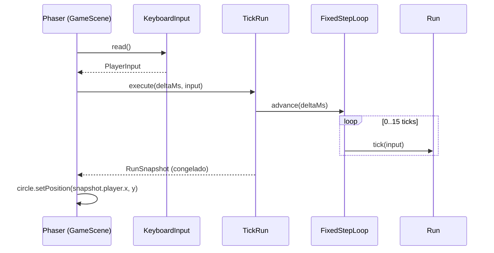

# Design · 0001-walking-skeleton

## Resumen
Un núcleo puro (`domain` + `application`) mueve al jugador en ticks fijos de 1/60 s y devuelve un `RunSnapshot`
inmutable. Phaser 4 (infraestructura) solo lee el teclado, le pasa al bucle el tiempo transcurrido y pinta el
snapshot. Los guardarraíles de arquitectura se aplican a cualquier autor reutilizando los hooks de `.claude/hooks/`
en el `pre-commit` y en CI, además de ESLint con reglas de capas.

## Piezas por capa
| Capa | Pieza | Nueva/Mod. | Notas |
|---|---|---|---|
| domain | `shared/Vector2` (VO) | Nueva | Inmutable: `add`, `scale`, `length`, `normalizedIfLong`. Base de `Position` y `PlayerInput` |
| domain | `arena/Arena` (VO) | Nueva | Ancho y alto; `clampCircle(center, radius)`. Invariante: ancho, alto > 0 |
| domain | `player/Player` (entidad) | Nueva | Posición, radio y velocidad; `move(input, dt, arena)` devuelve un `Player` nuevo |
| domain | `player/PlayerInput` (VO) | Nueva | Componentes limitadas a [-1, 1] y normalizadas si el módulo > 1 |
| domain | `run/Run` (aggregate root) | Nueva | Tick actual + jugador + arena; `tick(input)` avanza un paso; `snapshot()` devuelve copia congelada |
| domain | `run/RunSnapshot` (DTO) | Nueva | `{ tick, player: { x, y, radius } }`, `readonly` y `Object.freeze` |
| domain | `shared/Result` | Nueva | `Ok | Err` para fallos esperables (AGENTS.md §4) |
| application | `FixedStepLoop` | Nueva | Acumulador puro: `advance(elapsedMs, input) → ticks ejecutados`. Tope 250 ms (15 ticks) |
| application | `StartRun` (caso de uso) | Nueva | Crea un `Run` a partir de `RunConfig` ya validado |
| application | `TickRun` (caso de uso) | Nueva | Orquesta `FixedStepLoop` + `Run`; devuelve el `RunSnapshot` del frame |
| infrastructure | `content/loadRunConfig` | Nueva | Lee `content/player.json` y `content/arena.json` y los valida con zod → `Result<RunConfig>` |
| infrastructure | `phaser/KeyboardInput` | Nueva | WASD + flechas → `PlayerInput` |
| infrastructure | `phaser/GameScene` | Nueva | `update(_, deltaMs)`: input → `TickRun` → pinta el círculo. Sin lógica de juego |
| composition | `main.ts` | Nueva | Carga contenido, crea casos de uso y `Phaser.Game`; si el contenido es inválido muestra el error en pantalla |
| tooling | `scripts/guard-staged.mjs` | Nueva | Ejecuta los dos hooks sobre el contenido preparado (`git show :<ruta>`) o, con `--all`, sobre `git ls-files` |
| tooling | `eslint.config.js` | Nueva | typescript-eslint `strictTypeChecked` + `eslint-plugin-boundaries` + `no-restricted-globals/properties` |
| tooling | `.husky/pre-commit` | Nueva | `npx lint-staged && node scripts/guard-staged.mjs` |
| tooling | `.github/workflows/ci.yml` | Mod. | Añade `npm run guard:all` en `quality` (dentro de `npm run verify`) |

Sin puertos nuevos: el movimiento no necesita `Clock` ni `RandomGenerator` (el tiempo llega como argumento y no hay
azar). Se crearán cuando un change los necesite, con dos implementaciones (real y fake), para no sobrediseñar.

## Flujo de un frame

## Guardarraíles reutilizados (architecture-guardrails)
`guard-staged.mjs` no duplica reglas: por cada fichero lanza `node .claude/hooks/guard-*.mjs` con el mismo JSON que
envía Claude Code (`{ "tool_input": { "file_path", "content" } }`) y recoge el código 2. Así hay **una sola fuente
de reglas** para las tres capas (Claude Code, pre-commit, CI). Ejecución en paralelo con `Promise.all` para cumplir
< 2 s con 50 ficheros. `--no-verify` queda prohibido en AGENTS.md y lo cubre el CI.

## Dependencias nuevas
| Paquete | Versión exacta | Motivo | Alternativa descartada |
|---|---|---|---|
| phaser | 4.2.1 | Motor (ADR-0001) | Kaplay, Canvas 2D (spike) |
| zod | 4.6.7 | Validar contenido y entradas externas (AGENTS.md §3.6) | Validación manual |
| typescript | 6.0.3 | Tipado estricto | 7.0.2: typescript-eslint 8.73 solo admite TS < 6.1 |
| vite | 8.3.8 | Dev server y build | — |
| vitest | 5.1.1 | Tests de dominio y aplicación | Jest (más configuración con ESM y TS) |
| @playwright/test | 1.65.1 | Smoke E2E en chromium | Cypress (más pesado) |
| eslint | 10.15.0 | Guardarraíl capa 2 | — |
| @eslint/js | 10.0.1 | Reglas base | — |
| typescript-eslint | 8.73.0 | Reglas con información de tipos | — |
| eslint-plugin-boundaries | 7.4.4 | Reglas de capas declarativas | `no-restricted-imports` por carpeta (frágil con rutas relativas) |
| prettier | 3.10.1 | Formato | — |
| husky | 9.1.7 | Hook `pre-commit` | Hooks de git a mano (no se versionan) |
| lint-staged | 17.6.1 | ESLint/Prettier solo sobre lo preparado | — |
| @types/node | 26.6.6 | Tipos para scripts y config | — |

Todas con versión exacta (sin `^`), y `package-lock.json` versionado.

## Rendimiento y seguridad
- Presupuesto: `Run.tick` < 0,05 ms (trivial en este change; se mide con `vitest bench` en el change de colisiones,
  ADR-0003). Bundle de producción: medir y anotar en el verify-report (Phaser domina el tamaño).
- Sin datos persistidos ni red. Única entrada externa: `content/*.json` (versionado, validado con zod).
- Vite `base: '/tfm-survivors/'` para GitHub Pages.
- E2E: `main.ts` expone `window.__sprint` (solo lectura del último snapshot) **solo** si la URL lleva `?e2e`, para
  que Playwright verifique el movimiento sin leer píxeles.

## Pasos manuales del autor (fuera del código)
1. GitHub → *Settings → Pages → Source: GitHub Actions* (necesario para `deploy-pages`).
2. Protección de `main`: exigir PR y el check `quality` (ver docs/exploration §4 sobre `paths-ignore`).

## ADRs
- ADR-0001 (Phaser 4.2.1), ADR-0002 (núcleo puro). Sin ADR nueva: la reutilización de hooks se documenta aquí y en
  AGENTS.md §3.
