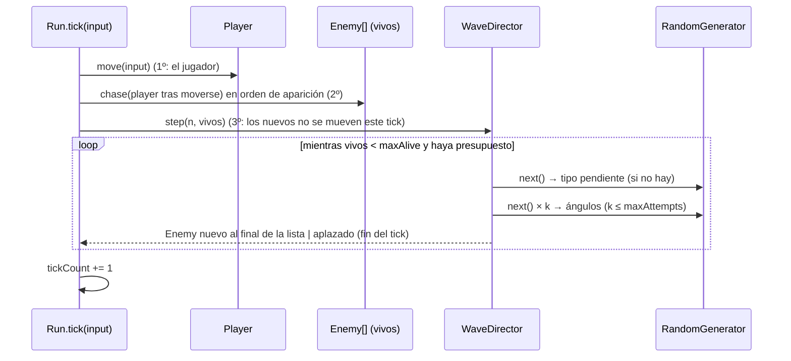

# Design · 0002-enemy-spawning

## Resumen
El núcleo puro gana enemigos. Cada tick, `Run` mueve al jugador, mueve a los enemigos vivos en línea recta hacia él
y después deja que el director de oleadas gaste presupuesto en enemigos nuevos. Los enemigos nacen en un anillo
fuera de la vista, recortado a la arena. Toda la aleatoriedad entra por el puerto nuevo `RandomGenerator`. La
composición lo crea con la semilla de `?seed=`, validada con zod. El contenido crece con `enemies.json`, `waves.json`
y la vista en `arena.json`. La validación cruzada vive en el dominio y zod la reutiliza. `GameScene` pinta hasta 200
círculos con un pool preasignado. El camino caliente no asigna objetos por enemigo y tick (ADR-0003).

## Preguntas abiertas de la propuesta (resueltas)
1. **Benchmark aparte: `npm run bench`**, con Vitest bench y sin bloquear `verify` ni el CI. Estoy de acuerdo con
   el orquestador: la media en ms depende de la máquina, y un runner compartido de GitHub puede variar ×2–×3
   entre ejecuciones. Un umbral duro en CI daría falsos rojos, y uno holgado no protegería nada. Dos salvaguardas:
   - El resultado (media y p99 por tick) se anota en el `verify-report` y en ADR-0003, que pasa a *aceptada* con esos datos.
   - Las simulaciones de 10 min de los tests unitarios (36.000 ticks con hasta 200 vivos) corren dentro de `verify`
     con el `testTimeout` de 20 s. Sirven de alarma gruesa: una regresión de órdenes de magnitud las haría fallar.
2. **La vista va en `content/arena.json`**, como objeto `view`. Estoy de acuerdo, por tres motivos:
   - Arena y vista son geometría del mundo en las mismas unidades.
   - Se validan juntas.
   - Un fichero más con su loader no se justifica por 2 números.

   Además, **la composición dimensiona el canvas de Phaser con `arena.view`**, y ya no con `arena.width/height`.
   Así el tamaño de la vista y el de lo que se pinta salen de una sola fuente, lo que mitiga el riesgo "vista frente
   a pantalla" de la propuesta. La spec no exige `view ≤ arena` y no se añade esa regla. Mientras no haya cámara,
   el contenido por defecto mantiene `view` igual a la arena.

## Piezas por capa
| Capa | Pieza | Nueva/Mod. | Notas |
|---|---|---|---|
| domain | `shared/RandomGenerator` (puerto) | Nueva | `next(): number` en [0, 1). Única fuente de azar del núcleo |
| domain | `shared/Vector2` (VO) | Mod. | + `distanceTo(other)`. Sin `normalize`/`sub`: la persecución va con escalares |
| domain | `arena/Arena` (VO) | Mod. | + `clampX(x, r)` y `clampY(y, r)`. `clampCircle` se reescribe con ellos, sin cambiar su comportamiento |
| domain | `arena/View` (VO) | Nueva | `width`, `height` > 0 y finitos; `halfDiagonal` = `Math.hypot(w, h) / 2` |
| domain | `enemy/EnemyType` (VO) | Nueva | `id`, `speed`, `radius`, `cost` > 0. Inmutable y compartido por todos los enemigos de ese tipo |
| domain | `enemy/EnemyCatalog` (VO) | Nueva | `create(types, arena)`: id únicos y radio que cabe (`Arena.fits`). `get(id)` |
| domain | `enemy/Enemy` (entidad) | Nueva | `id` (secuencial), `type`, posición **mutable interna** (`x`, `y`). `chase(tx, ty, dt, arena)` |
| domain | `wave/WaveTable` (VO) | Nueva | Tramos `{fromSecond, budgetPerSecond, types: EnemyType[]}`. Orden estricto y tramo 0 en 0 s. `indexAt(tick)` |
| domain | `wave/SpawnRules` (VO) | Nueva | `maxAlive`, `minDistance`, `maxAttempts` y `ringRadius = view.halfDiagonal + margin` (calculado) |
| domain | `wave/placeSpawn` (servicio) | Nueva | Función pura: anillo, recorte y distancia mínima con reintentos. Devuelve `Vector2 \| null` |
| domain | `wave/WaveDirector` (servicio con estado) | Nueva | Presupuesto acumulado y tipo pendiente. Lo posee `Run` |
| domain | `run/RunConfig` | Nueva (movida) | La interfaz `RunConfig` sale de `Run.ts` y crece. + `buildRunRules(config)` (invariantes y referencias cruzadas) |
| domain | `run/Run` (aggregate root) | Mod. | `start(config, random, setup?)`. Lista interna `Enemy[]` + director. Orden fijo del tick |
| domain | `run/RunSnapshot` (DTO) | Mod. | + `enemies: readonly EnemySnapshot[]` (`id`, `type`, `x`, `y`, `radius`), congelado |
| application | `StartRun` | Mod. | `execute(config, random)` |
| application | `TickRun`, `FixedStepLoop` | Sin cambios | |
| infrastructure | `random/Mulberry32RandomGenerator` (adaptador) | Nueva | mulberry32 movido desde `tests/support`. Expone `seed` (para 0007) |
| infrastructure | `content/schemas` | Nueva | Esquemas zod de los 4 ficheros. Separado del loader para respetar el límite de líneas |
| infrastructure | `content/loadRunConfig` | Mod. | `parseRunConfig({player, arena, enemies, waves})`. `superRefine` reutiliza `buildRunRules` |
| infrastructure | `url/resolveSeed` | Nueva | `resolveSeed(search, fallback) → {seed, warning?}` con zod. No escribe en consola |
| infrastructure | `phaser/EnemyLayer` | Nueva | Pool de círculos preasignado. Solo `import type` de Phaser, así que se testea en Node con dobles |
| infrastructure | `phaser/enemyPalette` | Nueva | Color de placeholder por `id` de tipo, con un color por defecto. Es presentación y no va en contenido |
| infrastructure | `phaser/GameScene` | Mod. | Recibe `maxEnemies`. Crea el `EnemyLayer` en `create()` y lo sincroniza en `update()` |
| composition | `main.ts` | Mod. | `resolveSeed` + `crypto.getRandomValues` + `console.warn`. `Mulberry32RandomGenerator`. Canvas = `view`. Probe con `seed` |
| content | `enemies.json`, `waves.json` | Nuevas | Ver esquemas |
| content | `arena.json` | Mod. | + `view` |
| tooling | `package.json`, `vite.config.ts` | Mod. | Script `bench` y `test.benchmark.include` |

### Puerto `RandomGenerator`: dónde vive y por qué
- **El puerto va en `src/domain/shared/RandomGenerator.ts`**. Lo consume el agregado `Run`, porque el azar forma
  parte de la regla de spawn, y el dominio no puede importar de `application`. ADR-0002 ya lo prevé.
- Tiene dos implementaciones previsibles, así que el puerto no es sobreingeniería:
  1. `Mulberry32RandomGenerator`, en infraestructura y usado en producción y en los tests de integración.
  2. `StubRandom`, en `tests/support/random.ts`. Su valor se fija desde el test, por ejemplo con
     `stub.value = 0.625`. Lo necesita el escenario "El presupuesto no se pierde al aplazar".
- **Por qué mulberry32 va en infraestructura aunque es código puro**: es una implementación concreta y técnica
  (AGENTS.md §4, prefijo técnico) y solo la composición la instancia (§3.4). Los tests pueden importarla porque
  `tests/` no tiene reglas de capa.
- **Cómo se mueve el mulberry32 de `tests/support`**:
  1. Primero (TDD) se escribe un test de regresión con los 5 primeros valores que hoy da `seededRandom(2026)`.
  2. Después se crea el adaptador y el test pasa contra él.
  3. Por último se borra `seededRandom` de `builders.ts`, y `loop.test.ts` pasa a
     `new Mulberry32RandomGenerator(2026)`.
- Hay un test de contrato compartido (`describeRandomGeneratorContract`) que se ejecuta contra las dos
  implementaciones: valores en [0, 1), finitos y reproducibles para la misma configuración.
- No se crea el puerto `Clock`: el tiempo de partida es `tick / 60`, y nada en el núcleo necesita la hora real.

## Contenido y validación

### Ficheros (valores iniciales de la spec, orientativos)
```jsonc
// content/arena.json
{ "width": 960, "height": 540, "view": { "width": 960, "height": 540 } }
// content/enemies.json
{ "types": [
  { "id": "bug",            "speed": 90, "radius": 10, "cost": 1 },
  { "id": "memory-leak",    "speed": 45, "radius": 22, "cost": 3 },
  { "id": "merge-conflict", "speed": 70, "radius": 16, "cost": 2 } ] }
// content/waves.json
{ "maxAlive": 200,
  "spawn": { "margin": 32, "minDistance": 200, "maxAttempts": 8 },
  "segments": [
    { "fromSecond": 0,   "budgetPerSecond": 1,   "types": ["bug"] },
    { "fromSecond": 60,  "budgetPerSecond": 2,   "types": ["bug", "merge-conflict"] },
    { "fromSecond": 180, "budgetPerSecond": 3.5, "types": ["bug", "merge-conflict", "memory-leak"] },
    { "fromSecond": 300, "budgetPerSecond": 5,   "types": ["bug", "merge-conflict", "memory-leak"] },
    { "fromSecond": 480, "budgetPerSecond": 7,   "types": ["bug", "merge-conflict", "memory-leak"] } ] }
```
Los `budgetPerSecond` no decrecen, como pide la spec. Los spawns por minuto esperados son
`budgetPerSecond / coste medio` (1; 1,33; 1,75; 2,5; 3,5 por segundo), así que tampoco bajan. Sin muertes, el
tope de 200 se alcanza hacia los 2,5 min. Es aceptable hasta 0003.

### Esquemas zod (`infrastructure/content/schemas.ts`)
- Todos son `z.strictObject`, así que se rechazan los campos desconocidos.
- **Rangos por campo** (los mensajes son constantes exportadas por el dominio, como en 0001):
  - `speed`, `radius` y `cost`: `positive()`.
  - `view.width` y `view.height`: `positive()`.
  - `maxAlive` y `maxAttempts`: `int().min(1)`.
  - `margin`, `minDistance` y `budgetPerSecond`: `nonnegative()`.
  - `fromSecond`: `nonnegative()`.
  - `types` (en cada tramo) y `segments`: `min(1)`.
  - `id`: `string().regex(/^[a-z][a-z0-9-]*$/)`.
  - `arena.width` y `arena.height` siguen siendo `int().positive()`.
- **Validación cruzada**: un `superRefine` sobre el conjunto llama a `buildRunRules(config)` del dominio. Si
  devuelve `Err`, añade un issue con `path = error.field.split('.')` y el mensaje del dominio. Esta es la única
  implementación de las reglas cruzadas:
  - `2·radius ≤ min(ancho, alto)`, con `Arena.fits`.
  - `id` únicos.
  - El primer `fromSecond` vale 0.
  - Los `fromSecond` son estrictamente crecientes.
  - Cada tipo citado existe en el catálogo.
- **Mensajes**: el campo es la ruta (`enemies.types.1.id`, `waves.segments.0.types.1`, `waves.segments.2.fromSecond`,
  `waves.maxAlive`…). Así se cumple el "error que menciona `<campo>`". En el tipo inexistente, el mensaje incluye el
  id (`Tipo de enemigo desconocido: segfault`).
- `minDistance` ≥ `ringRadius` **no** se rechaza. Es válido según la spec, y el escenario "Ninguna posición válida"
  lo usa a propósito.

### `RunConfig` y `loadRunConfig`
```ts
// src/domain/run/RunConfig.ts (sale de Run.ts; Run.ts lo re-exporta para no romper imports)
export interface RunConfig {
  readonly arena: { readonly width: number; readonly height: number;
                    readonly view: { readonly width: number; readonly height: number } };
  readonly player: { readonly speed: number; readonly radius: number };
  readonly enemies: { readonly types: readonly EnemyTypeConfig[] };   // {id, speed, radius, cost}
  readonly waves: {
    readonly maxAlive: number;
    readonly spawn: { readonly margin: number; readonly minDistance: number; readonly maxAttempts: number };
    readonly segments: readonly { readonly fromSecond: number; readonly budgetPerSecond: number;
                                  readonly types: readonly string[] }[];
  };
}
export function buildRunRules(config: RunConfig): Result<RunRules, DomainError>;
// RunRules = { arena, view, catalog, table, spawn }
```
- `parseRunConfig(raw: { player; arena; enemies; waves })` tiene la misma forma que los ficheros. `loadRunConfig()`
  importa los 4 JSON.
- `Run.start` llama a `buildRunRules` como defensa (contenido que no pase por zod, como los tests o futuros
  editores) y obtiene los VOs ya construidos. Las reglas no se duplican: zod comprueba la forma y los rangos, y el
  dominio las reglas semánticas, que zod reutiliza. Los rangos también se comprueban en los factories del dominio,
  con las mismas constantes, como en 0001.

## Simulación

### Entidad `Enemy` y persecución
`chase(tx, ty, dt, arena)` trabaja con escalares y sin asignar objetos:
1. Calcula `dx`, `dy` y `d = Math.hypot(dx, dy)`, con `step = speed · dt`.
2. Si `d ≤ step`, el enemigo termina en `(tx, ty)`. Esto cubre `d = 0` sin dividir por cero y evita sobrepasar al
   jugador.
3. Si no, avanza: `x += dx / d · step` e `y += dy / d · step`.
4. Después recorta: `x = arena.clampX(x, r)` e `y = arena.clampY(y, r)`. Es la misma regla que `clampCircle`, así
   que cubre el escenario "Enemigo más grande que el jugador junto a un borde" (938, 270).

Solo `Run` crea y mueve los `Enemy`. Nunca salen del agregado: el snapshot copia los escalares.

### Director de oleadas (`WaveDirector`)
- **Estado**: `budget60` (presupuesto × 60), `pending: EnemyType | null` y `segmentIndex`.
- **Unidades enteras**: cada tick se suma `budgetPerSecond` a `budget60` y se compara con `cost × 60`. Equivale a
  `budgetPerSecond × 1/60` frente a `cost`, pero es **exacto con valores enteros**: sumar 1/60 sesenta veces no da
  exactamente 1 en coma flotante. Esto hace robustos los escenarios con conteo exacto (615 ticks → 10, 12 ticks
  a 1.000/s → 200).
- **Tramo activo**: en el tick n (n = `tickCount + 1`, el valor que mostrará `snapshot.tick`) es el último con
  `fromSecond ≤ n / 60`. Un cursor monótono lo hace O(1). Al cambiar de tramo, `pending = null`: se conserva el
  presupuesto y se vuelve a elegir el tipo, como pide la spec.
- **Tope**: si `vivos ≥ maxAlive`, ese tick no se acumula presupuesto ni se intenta nada, y no se consume azar. La
  spec deja para 0003 qué pasa al bajar del tope. Esta opción evita una ráfaga acumulada y es barata de cambiar.
- **Gasto en el tick**: el bucle sigue mientras `vivos < maxAlive`:
  1. Si `pending` es nulo, se elige `types[floor(next() · n)]`. Siempre consume 1 valor, aunque `n = 1`, para que
     el flujo de azar sea estable.
  2. Si `budget60 < cost · 60`, el bucle termina.
  3. Se llama a `placeSpawn`. Si devuelve `null`, el spawn se aplaza: no se gasta presupuesto, el tipo pendiente se
     mantiene y **el tick termina**. Así hay como mucho `maxAttempts` intentos fallidos por tick.
  4. Si hay posición, se crea el `Enemy`, se resta el coste y `pending = null`.
- **El aplazamiento no detiene la acumulación**. Así lo exige el escenario de los 2 spawns en el tick 121. El coste
  es que, tras un aplazamiento largo, puede salir una ráfaga de varios spawns en un tick, siempre limitada por
  `maxAlive`. Se anota como riesgo para 0003.

### Colocación (`placeSpawn`)
`placeSpawn(player: Vector2, radius, rules, arena, random): Vector2 | null` repite hasta `maxAttempts` veces:
1. `θ = next() · 2π`.
2. `c = (px + cos θ · R, py + sin θ · R)`, con `R = ringRadius`, que con los valores por defecto vale ≈ 582,727.
3. `p = arena.clampCircle(c, radius)`.
4. Si `p.distanceTo(player) ≥ minDistance`, devuelve `p`.

Si ningún intento vale, devuelve `null`. Cada intento consume exactamente 1 valor. Con la arena igual a la vista,
R es mayor que la distancia del centro a cualquier esquina (550,7), así que todo punto se recorta a un borde.

### Orden del tick y del consumo de azar (contrato de determinismo)

El orden fijo es jugador → persecución → director. Cumple "persigue la posición del jugador en el mismo tick" y
"sin movimiento en el tick de aparición". Cualquier cambio de este orden o del consumo de azar cambia las partidas
de una semilla, y es un cambio de contrato.

**Límite conocido**: `Math.cos`, `Math.sin` y `Math.hypot` no están especificados bit a bit entre motores de JS.
La misma semilla reproduce la partida en el mismo navegador (y en Node/V8 para los tests), pero podría divergir
entre Chrome y Firefox. Hay que tenerlo en cuenta en 0007 (reto diario).

### Estado inicial opcional (`RunSetup`)
Los escenarios de `enemy-behavior` y algunos de spawn colocan al jugador o a enemigos en posiciones concretas,
por ejemplo un enemigo en (100, 270) o el jugador en (16, 16). Para eso, `Run.start` acepta un tercer argumento
opcional `setup?: { player?: {x, y}; enemies?: readonly {type: string; x: number; y: number}[] }`:
- Valida los tipos contra el catálogo y recorta las posiciones a la arena.
- La composición no lo usa.
- Es preferible a exponer mutadores o a mover al jugador con inputs, porque eso consumiría ticks y presupuesto.

### `RunSnapshot`
```ts
export interface EnemySnapshot {
  readonly id: number; readonly type: string; readonly x: number; readonly y: number; readonly radius: number;
}
export interface RunSnapshot { readonly tick: number; readonly player: {…}; readonly enemies: readonly EnemySnapshot[] }
```
- Cada llamada crea un array nuevo, con `Object.freeze` sobre el array y sobre cada elemento, en orden de
  aparición.
- El `id` es un contador de la partida que empieza en 0 y nunca se reutiliza.
- Se llama una vez por frame, no por tick, desde `TickRun.execute`. El coste es de 201 objetos por frame, y el
  benchmark lo mide aparte.

## Render: `EnemyLayer` (pool)
- `GameScene.create()` crea el `EnemyLayer` con un factory `() => this.add.circle(0, 0, 1, 0).setVisible(false)`
  y **preasigna `maxEnemies` círculos** (200, que llegan desde `config.waves.maxAlive` vía composición). El
  jugador se crea después, para que se pinte encima.
- `sync(enemies)` funciona así:
  - Para cada `i < n`, llama a `setPosition`. Si el tipo del hueco `i` cambió, llama además a `setRadius` y a
    `setFillStyle(enemyPalette(type))`, y hace visible el hueco.
  - Para cada `i ≥ n` que estuviera visible, lo oculta.
  - **No crea ni destruye objetos del motor por frame.** El hueco se asigna por índice: con la lista en orden de
    aparición es correcto también cuando 0003 elimine enemigos, porque el hueco se vuelve a pintar si cambia de tipo.
- `EnemyLayer` depende de una interfaz estructural mínima (`CircleSprite`: `setPosition`, `setRadius`,
  `setFillStyle` y `setVisible`) que `Phaser.GameObjects.Arc` cumple. Se prueba en Node con dobles. No es un puerto
  de dominio: es una costura de testabilidad dentro de la infraestructura.
- **Alternativa descartada**: un `Graphics` que se borra y redibuja 200 `fillCircle` cada frame. Tiene menos
  objetos, pero regenera la geometría cada frame y mezcla el pintado de todos los tipos en un solo objeto.

## Rendimiento y GC (ADR-0003)
- **Decisión**: se aplica ADR-0003 ya en este change, en su forma mínima. `Enemy` tiene estado escalar mutable,
  interno al agregado y nunca expuesto. La persecución no asigna nada.
- **Coste estimado**: en régimen, un tick asigna solo los ~3 `Vector2` del jugador. Un spawn asigna como mucho
  `maxAttempts` `Vector2` más 1 `Enemy`.
- **Alternativas descartadas**:
  - (a) `Enemy` inmutable con `Vector2`: unos 5 objetos por enemigo y tick, unos 60.000 por segundo. Pasaría
    probablemente los 2 ms, pero añade presión al GC justo antes de que 0004 y 0005 sumen proyectiles y gemas.
  - (b) *Struct of arrays* con `Float64Array`: tiene la mejor localidad, pero es prematuro para 200 entidades,
    complica las bajas de 0003 y se lee peor.
- `Player` sigue siendo inmutable, porque es una sola entidad. La asimetría queda documentada en el propio
  `Enemy`.

| Medida | Presupuesto | Dónde se mide |
|---|---|---|
| `Run.tick` con 200 vivos (input (1, 0), 600 ticks) | ≤ 2 ms de media (spec). Estimación: < 0,1 ms | `tests/bench/run.bench.ts` (`npm run bench`) |
| `Run.snapshot()` con 200 vivos | ≤ 0,3 ms (informativo) | mismo bench |
| `EnemyLayer.sync` con 200 | sin asignaciones; < 0,5 ms | inspección y test con dobles (sin `new` tras `create`) |

El bench prepara la partida con el contenido por defecto y la semilla 7, y avanza hasta exactamente 200 vivos
antes de medir. Configuración: `"bench": "vitest bench --run"` y `test.benchmark.include:
['tests/bench/**/*.bench.ts']`. `npm test` no lo ejecuta, pero `lint` y `typecheck` sí lo comprueban.

He comprobado en `node_modules` que Vitest 5.1.1 tiene el comando `vitest bench`, la opción `test.benchmark`
(con `include`) y `bench` como *fixture* del contexto de test:
`test('…', async ({ bench }) => (await bench('tick', fn).run()).latency.mean)`.
Ya no hay un `bench()` global, como en Vitest 1 a 3.

Plan B, si la fixture fallara en *apply*: un `vitest.bench.config.ts` propio que incluya
`tests/bench/**/*.perf.ts` y mida con `performance.now`, que está permitido en `tests/`.

## Seguridad y datos
- **Entrada externa nueva: `?seed`**. `resolveSeed` la valida con
  `z.string().regex(/^\d+$/).transform(Number).pipe(z.number().int().min(0).max(4294967295))`.
  - Con `?seed=` vacío, `-1`, `1.5`, `abc` o `4294967296` devuelve una `warning` que menciona `seed`. El valor
    crudo va truncado a 32 caracteres y solo se usa en `console.warn`, nunca en HTML.
  - Si falta, se usa el *fallback* sin aviso.
- **La semilla aleatoria** sale de `crypto.getRandomValues(new Uint32Array(1))[0]` en la composición (permitido
  fuera del núcleo). El núcleo recibe un `RandomGenerator` ya sembrado y no conoce el origen de la semilla.
- **Sin datos persistidos ni red**. El contenido sigue siendo versionado y validado con zod.
- **E2E**: el probe `window.__sprint` (solo con `?e2e`) añade `seed` de solo lectura.

## Dependencias nuevas
Ninguna. zod, Vitest (incluido `vitest bench`) y Phaser ya están instalados. mulberry32 son 8 líneas propias; se
descarta `seedrandom` porque añade una dependencia para algo trivial y su API usa estado global opcional.

## Estrategia de tests (pirámide)
| Nivel | Qué | Escenarios de la spec |
|---|---|---|
| Unit dominio (base) | `Vector2.distanceTo`; `Arena.clampX/Y` ≡ `clampCircle`; `View.halfDiagonal`; `EnemyCatalog`/`WaveTable`/`buildRunRules` (mensajes y campos) | Contenido validado (parte del dominio) |
| Unit dominio | `Enemy.chase` aislado | Persecución horizontal, diagonal, llegada sin sobrepasar, dos velocidades, borde (938) |
| Unit dominio | `placeSpawn` con `StubRandom` y con mulberry32 | Arena mayor que la vista, igual a la vista, esquina, ninguna posición válida (cuenta de `next()` ≤ 8 por tick) |
| Unit dominio | `WaveDirector` | Ritmo con coste 1, coste que retrasa, varios en un tick, tramo sin presupuesto, cambio de tramo, tope y tope mínimo, presupuesto que no se pierde |
| Integración núcleo (`Run` + mulberry32) | Determinismo (600 ticks, cada tick), semillas distintas, snapshot congelado (array y elementos), ids estables, orden, mismo tick, primer tick de vida, solapamiento | simulation-loop (MODIFIED), enemy-behavior |
| Integración núcleo, larga | Un solo fichero `tests/domain/long-run.test.ts` reutiliza una simulación de 36.000 ticks (semilla 7) para: spawns legales, enemigos dentro de la arena en cada tick, mezcla de tipos y partida larga reproducible | 4 escenarios de 10 min |
| Contrato | `describeRandomGeneratorContract` contra `Mulberry32RandomGenerator` y `StubRandom`; vector de regresión del antiguo `seededRandom` | Semilla (parte del núcleo) |
| Unit infraestructura | `parseRunConfig` (cada regla y su campo), `loadRunConfig()` válido, 3 tipos por defecto, tabla por defecto no decreciente; `resolveSeed` (42, 0, 4294967295, inválidas, ausente); `EnemyLayer` con dobles (sin crear tras preasignar, oculta los sobrantes, recolorea al cambiar de tipo) | enemy-spawning (contenido), simulation-loop (semilla) |
| E2E (cima, 2 tests) | `?e2e&seed=42`: `probe.seed === 42`, aparece ≥ 1 enemigo en < 3 s, todos dentro de la arena, sin errores ni avisos. `?e2e&seed=abc`: exactamente 1 `warning` con `seed` y la semilla en rango | Semilla válida o inválida (navegador) |
| Bench (aparte) | `npm run bench` | Rendimiento con el tope |

Cambios en tests existentes:
- `aRunConfig` crece con `enemies` y `waves` por defecto (los de la spec), y aparecen los builders
  `aWavesConfig(overrides)` y `rawContent()`.
- `run.test.ts` espera `enemies: []` en el tick 0.
- `content.test.ts` usa los 4 ficheros.
- `loop.test.ts` pasa el generador a `StartRun`.

## Reglas de capas y pureza
- Ningún fichero nuevo de `domain` importa nada fuera de `domain`. `application` solo importa `domain`.
- El único azar del núcleo es `random.next()`. Las llamadas a `Math.cos`, `Math.sin`, `Math.hypot` y `Math.floor`
  son puras y las permiten tanto ESLint como el hook.
- `crypto`, `window.location` y `console.warn` solo aparecen en `composition/main.ts`.
- `Mulberry32RandomGenerator` y `resolveSeed` viven en infraestructura y solo la composición los instancia o
  llama.
- `EnemyLayer` usa `import type` de Phaser.
- No hace falta tocar las reglas de los guardarraíles (spec `architecture-guardrails` sin cambios).

## Riesgos
- **Ráfaga tras un aplazamiento largo**: es posible porque el presupuesto sigue acumulándose, aunque la limita
  `maxAlive`. Se revisará en 0003, junto con la política de presupuesto al bajar del tope.
- **Deriva entre navegadores** por las funciones trigonométricas (ver "Límite conocido").
- **Vista distinta de la arena sin cámara**: el canvas usa `view`, así que una vista menor que la arena dejaría
  zonas sin pintar. Lo resolverá el change de cámara.
- **Duración de la suite**: las simulaciones de 10 min van a un único fichero para no repetirlas. Si superan unos
  5 s en total, se valorará reducir los snapshots por tick a los de spawn.

## ADRs
- No hay ADR nueva: ninguna decisión es cara de revertir, porque `Enemy` es interno y el PRNG va detrás de un
  puerto.
- ADR-0003 pasa de *propuesta* a *aceptada* al cerrar *verify*, con las cifras del bench (tarea de docs). Su
  decisión queda concretada así: entidades del camino caliente con estado escalar mutable interno; *struct of
  arrays* solo si el bench lo exige.
