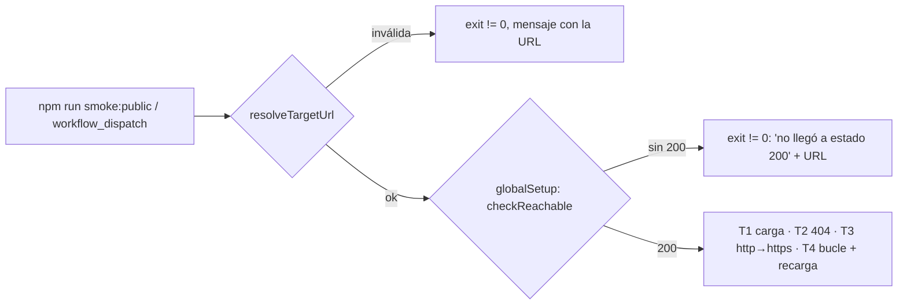

# Design · 0011-public-deploy

## Resumen
El despliegue ya existe en `ci.yml` y no se toca. El change añade:
- Un **smoke a demanda** contra la URL publicada. Usa una config de Playwright aparte
  (`playwright.remote.config.ts`, `testDir: tests/remote`, sin `webServer`), con una comprobación previa de que la
  URL responde (`globalSetup`) y un tope de tiempo global.
- El comando `npm run smoke:public` y el workflow `.github/workflows/smoke-public.yml`, que solo se dispara con
  `workflow_dispatch`.
- Tests estáticos de Vitest. Comprueban que el smoke no entra en `test:e2e`, en `verify` ni en ningún disparador
  automático, y describen el despliegue que ya existe en `ci.yml` sin modificar el fichero.

ADR-0004 recoge como riesgo aceptado las cabeceras que Pages no permite.

> Revisado tras contrastar con `specs/public-deploy/spec.md` (7 requisitos, 26 escenarios). Cambios respecto a la
> primera versión: `speed=15`, import idempotente del fichero exportado (no del fixture `F`), presupuesto ≤ 180 s
> con `globalTimeout`, comprobación previa de la URL, tests de 404 y de HTTP→HTTPS, y comprobaciones del `index.html`
> servido. Las discrepancias con la spec están en "Discrepancias con la spec".

## Piezas por capa
El change no toca `src/`. `domain`, `application`, `infrastructure` y `composition` quedan **sin cambios**. Todo es
configuración de pruebas y CI.

| Ámbito | Pieza | Nueva/Mod. | Notas |
|---|---|---|---|
| tests (soporte) | `tests/remote/target.ts` | Nueva | Funciones puras: `resolveTargetUrl`, `checkReachable` (fetch inyectado), `isPublicTarget`, `localAssetRefs` |
| tests (config) | `playwright.remote.config.ts` | Nueva | `testDir: 'tests/remote'`, sin `webServer`, `globalSetup`, `globalTimeout` |
| tests (preflight) | `tests/remote/preflight.ts` | Nueva | `globalSetup`: `checkReachable` con `fetch` real; si no hay 200, aborta con la URL en el mensaje |
| tests (E2E remoto) | `tests/remote/public.spec.ts` | Nueva | 4 tests: carga limpia, 404, HTTP→HTTPS y bucle completo con recarga |
| tests (unit) | `tests/remote/target.test.ts` | Nueva | Vitest (`*.test.ts`), sin red: URL inválida, barra final, preflight con fetch falso, refs locales |
| tests (guardarraíl) | `tests/guardrails/smoke-isolation.test.ts` | Nueva | Lectura estática de `package.json`, configs y workflows |
| tests (guardarraíl) | `tests/guardrails/deploy.test.ts` | Nueva | Describe el despliegue de `ci.yml` leyéndolo como texto (no lo modifica) |
| tests (guardarraíl) | `tests/guardrails/csp.test.ts` | Mod. | Añade `report-to` a la lista de directivas prohibidas en la meta |
| scripts | `package.json` → `"smoke:public"` | Mod. | `playwright test --config playwright.remote.config.ts` |
| CI | `.github/workflows/smoke-public.yml` | Nueva | Solo `workflow_dispatch`; `permissions: contents: read`; `timeout-minutes: 8` |
| typecheck | `tsconfig.json` → `include` | Mod. | Añade `playwright.remote.config.ts` |
| docs | ADR-0004, README, AGENTS.md, GDD, diario de IA | Mod./Nueva | — |
| sin cambios | `ci.yml`, `ci.test.ts`, `playwright.config.ts`, `tests/e2e/**`, `src/**`, `content/**` | — | — |

`tests/remote/target.test.ts` entra en `npm test` por el `include` `tests/**/*.test.ts`. Es lógica pura con un
`fetch` falso inyectado, sin red, así que `verify` sigue sin acceder a la red.

### Por qué una config separada
- **Exclusión por construcción**: `playwright test` sin `--config` carga `playwright.config.ts`, y su
  `testDir: 'tests/e2e'` no ve `tests/remote/`. No hace falta `grep`, `testIgnore` ni variables de entorno. Con una
  config única y un proyecto `remote`, habría que filtrar en `test:e2e`, y el smoke arrancaría el `webServer` (build
  más preview).
- **Sin `webServer`**: el smoke nunca construye la app ni levanta un servidor. Para la URL alternativa en
  `localhost`, el usuario levanta antes `npm run build && npm run preview` (lo explica el README).

### URL objetivo (`tests/remote/target.ts`)
- `resolveTargetUrl(raw: string | undefined): Result<URL, string>`:
  - sin valor (o vacío) → URL pública;
  - `new URL(raw)` dentro de `try`; con protocolo distinto de `http:` o `https:` → `err` con un mensaje que
    contiene la URL indicada;
  - si falta, añade la `/` final al `pathname` (escenario "Barra final opcional").
- La config lee `process.env.SMOKE_URL` y lanza `Error(mensaje)` si `resolveTargetUrl` falla. Playwright termina
  con código distinto de 0 antes de abrir ninguna página (escenario "URL objetivo inválida").
- `isPublicTarget(url)` indica si el origen es `https://adrian-asm.github.io`. Los tests de 404 y de HTTP→HTTPS solo
  corren contra la URL pública (`test.skip` en otro caso): `vite preview` devuelve `index.html` con 200 en rutas
  inexistentes y no sirve HTTPS.

### Preflight y distinción "no responde" frente a "regresión"
- `checkReachable(url, fetchFn, { attempts: 3, timeoutMs: 10_000, gapMs: 5_000 })` hace un GET con
  `AbortSignal.timeout`. Devuelve `ok` al primer 200 y, si no, `err("La carga inicial de <url> no llegó a estado 200
  (<estado | error de red>)")`. El peor caso es de unos 40 s.
- `globalSetup` (`preflight.ts`) la llama con el `fetch` global de Node 22 y lanza el error si falla. No corre
  ningún test y el informe solo muestra ese mensaje. Así se distingue de un fallo de CSP o del bucle de juego
  (escenario "URL objetivo que no responde").

## Flujo del smoke (`tests/remote/public.spec.ts`)
Reutiliza de `tests/e2e/probe.ts`: `watchCsp`, `cspState`, `collect`, `gameUrl`, `playChoosingFirst`, `focusGame`,
`probe` y `menuPanel`. Reutiliza `decodeProgress` del codec de producción. Los helpers de exportar e importar
(≈10 líneas) se copian, para no tocar `tests/e2e/`. La velocidad es `REMOTE_SPEED = 15`, el máximo de
`resolveSpeed`, que fija la spec.

Hay un fixture común por test: `watchCsp`, `collect(page, ['error', 'warning'])` y la recogida de errores de carga:
- respuestas `>= 400` del mismo origen que la URL objetivo;
- `requestfailed` del mismo origen;
- mensajes de consola de CSP (texto con `Content Security Policy`);
- origen de cada petición `document`, que debe ser siempre el de la URL objetivo (escenario "URL objetivo
  alternativa").

**T1 · Carga limpia** (escenarios "Sin recursos rotos", "Carga limpia" y la parte servida de "Rutas del index.html" y
"Directivas que la meta ignora"):
1. `goto('./')`: la respuesta tiene estado 200 y el menú de inicio es visible.
2. Si la URL objetivo es la pública, `page.url()` empieza por `https://`.
3. `cspState` → `{ violations: [], metas: 1 }`, 0 mensajes de consola de CSP y 0 `pageerror`.
4. `localAssetRefs(await response.text())` (regex sobre `src` y `href` del HTML servido, que es el `dist/index.html`
   publicado): todas empiezan por `${pathname de la URL objetivo}` y ninguna por `/src/`, `http:`, `https:` ni
   `//`. La meta CSP servida no contiene `frame-ancestors`, `report-uri`, `report-to` ni `sandbox`.
5. 0 respuestas fallidas del mismo origen.

**T2 · Ruta inexistente** (solo con la URL pública): `goto('./no-existe')` → estado 404 y `#game canvas` con
`count() === 0`.

**T3 · HTTP→HTTPS** (solo con la URL pública): `request.get('http://adrian-asm.github.io/tfm-survivors/')`
siguiendo redirecciones (por defecto en Playwright) → `status() === 200` y `url()` empieza por la URL pública.

**T4 · Jugar, guardar, exportar, importar y recargar** (escenarios "Jugar, guardar, exportar e importar en
producción" y "Persistencia tras recargar en producción"):
1. Contexto nuevo, sin siembra. `goto(gameUrl({ seed: 42, speed: 15 }))` y `expectSpeed(15)`. La sonda existe en
   producción porque `main.ts` la activa en tiempo de ejecución con `?e2e` (líneas 89 y 124), no con
   `import.meta.env`, como fijó el change 0008.
2. `playChoosingFirst` hasta `status === 'over'` con `outcome === 'lost'`. La semilla 42 es `STILL_DEFEAT_SEED`
   y pierde quieta hacia el tick 4.682: unos 312 frames a 15 ticks por frame.
3. Se ve el overlay de resultados (región `Progreso`). `localStorage['sprint-survivors/progress']` pasa
   `decodeProgress` y tiene 1 entrada con `seed: 42` y `outcome: 'lost'`.
4. **Exportar**: hay 1 evento `download` (contador de eventos), `failure()` es nulo, el nombre sugerido es
   `sprint-survivors-progress.json` y el contenido decodificado es `toStrictEqual` al guardado. `acceptDownloads`
   viene `true` por defecto (verificado en los tipos de Playwright).
5. **Importar el mismo fichero**: con `filechooser` y `setFiles(texto exportado)`, el estado contiene `importado`
   y lo guardado sigue con 1 entrada (import idempotente).
6. `cspState` → sin violaciones y sin errores no capturados.
7. **Recarga**: `reload()` con un colector nuevo de avisos. El progreso de la sonda coincide con
   `decodeProgress(guardado antes)`, no hay ningún aviso que contenga `progress` y la CSP sigue sin violaciones.

### Presupuesto de tiempo (≤ 180 s, spec "Smoke a demanda")
| Ajuste | Valor | Motivo |
|---|---|---|
| preflight | ≤ ~40 s (3 × 10 s + 2 × 5 s) | Solo se alcanza si la URL no responde. Si responde, < 2 s |
| `globalTimeout` | 130 000 ms | Tope duro de la ejecución: 130 s más 40 s de preflight dan menos de 180 s aunque Playwright no cuente el `globalSetup` |
| `timeout` (test) | 60 000 ms | T4 tarda unos 30–40 s (carga, unos 312 frames, export, import y recarga) |
| `retries` | 1 | Absorbe un fallo puntual de red. Un test que pasa al reintentar sale como **flaky**: red, no regresión. Con 2 reintentos el peor caso superaría el tope |
| `workers` | 1 | Pocas peticiones a Pages; ejecución nominal de unos 60 s |
| `use.navigationTimeout` | 20 000 ms | Primera carga de unos 1,4 MB sin caché |
| `expect.timeout` | 10 000 ms | WebGL por software en el runner |
| margen de `playChoosingFirst` | 40 000 ms | Tope de reloj; la aserción es el `outcome` |
| `trace` / `reporter` / `outputDir` | `retain-on-failure` / `list` + `html` en `playwright-report/smoke` / `test-results/smoke` | Rutas ya ignoradas por git y ESLint |

La duración real (`time npm run smoke:public`) se registra en `verify-report.md`.

## Workflow `smoke-public.yml`
- `on: workflow_dispatch` con un input `url` (string, opcional, por defecto la URL pública). Sin `push`,
  `pull_request`, `pull_request_target`, `schedule` ni `workflow_run`.
- `permissions: contents: read` a nivel de workflow, sin `pages`, `id-token` ni secretos.
- `concurrency: { group: smoke-public, cancel-in-progress: true }`.
- Un job `smoke` con `ubuntu-latest` y `timeout-minutes: 8` (la spec pide ≤ 10). Pasos: `checkout@v4`,
  `setup-node@v4` (`lts/*`, caché de npm), `npm ci`, `npx playwright install --with-deps chromium`,
  `npm run smoke:public` y `upload-artifact@v4` de `playwright-report/smoke` solo si falla (`retention-days: 3`).
- **Inyección**: el input llega por `env: SMOKE_URL: ${{ inputs.url }}` y nunca se interpola en `run:`. La config
  lo valida con `resolveTargetUrl`.

## Tests estáticos (Vitest, dentro de `verify`)
Leen los ficheros como texto, con regex y sin dependencia YAML, igual que `ci.test.ts`. La lógica de análisis va
en funciones que reciben el texto (`triggersOf(yaml)`, `jobBlock(yaml, name)`). Así cada aserción tiene también un
caso en rojo sobre un texto mutado, aunque el fichero real ya cumpla.

`smoke-isolation.test.ts` (requisito "Smoke remoto fuera de la verificación habitual" y "Workflow manual"):
1. `test:e2e` no contiene `--config` ni `remote`. Ningún script de la cadena de `verify` (expandida
   recursivamente por `npm run X`) invoca `playwright` ni `smoke:public`.
2. `smoke:public` usa `--config playwright.remote.config.ts`. La config remota tiene `testDir: 'tests/remote'` y
   ninguna línea de código con `webServer`, y la de `test:e2e` tiene `testDir: 'tests/e2e'`.
3. Ningún fichero de `tests/e2e/` importa de `tests/remote/`.
4. En `.github/workflows/*.yml`, solo `smoke-public.yml` contiene `smoke:public`. Sus disparadores son
   exactamente `[workflow_dispatch]`, con el input `url` y la URL pública por defecto. Tiene `contents: read`, sin
   `pages`, `id-token` ni `write`, y `timeout-minutes` ≤ 10. `ci.yml` no contiene `smoke`.

`deploy.test.ts` (requisito "Publicación automática", que es caracterización de lo existente): en `ci.yml`, el job
`deploy` tiene `needs: [quality, e2e]` y un `if` con `github.event_name == 'push'` y
`github.ref == 'refs/heads/main'`. `upload-pages-artifact` lleva la misma condición y `path: dist`. El
`paths-ignore` del push contiene las 5 rutas de documentación. Los escenarios de PR en verde, push solo de
documentación y e2e en rojo se cumplen por esas condiciones (comportamiento de GitHub Actions); no se simulan.

## Discrepancias con la spec (para el orquestador)
1. **`outcome` `defeat`** (escenario "Jugar, guardar, exportar e importar en producción"): el historial guarda
   `'won' | 'lost'` (spec `progress-persistence` y `HistoryEntryView`). No existe `defeat`. El design comprueba
   `'lost'`; **hay que corregir la spec**.
2. **"El número de tests de `test:e2e` es el mismo que antes"**: no se automatiza. Se comprueba en verify con
   `npx playwright test --list` comparado con `main`, que hoy son 48 tests. Un test permanente con ese número
   rompería cualquier change futuro que añada E2E. Lo que se automatiza es el aislamiento por `testDir`.
3. **"ci.yml / ci.test.ts sin diferencias con main… lo comprueba un test en verify"**: un test permanente que fije
   el contenido (hash) bloquearía cualquier cambio futuro de la CI, y `git diff main` no funciona en el checkout
   superficial de Actions. Propuesta: lo automático es que `ci.yml` no menciona el smoke y que `ci.test.ts` siga en
   verde. El "sin diferencias" lo comprueba el verifier con `git diff --quiet main -- .github/workflows/ci.yml
   tests/guardrails/ci.test.ts`. **Sugiero suavizar la frase de la spec** ("lo comprueba un test automático").
4. **Escenarios sobre `dist/index.html`** ("Rutas del index.html construido" y "Directivas que la meta ignora"):
   `verify` no construye. Se cubren con el `index.html` **servido** en el smoke (es el `dist` publicado) y, para
   las directivas, con `csp.test.ts` sobre el `index.html` fuente (la build no cambia la meta, `config/csp.ts`) y
   `report-to` añadido. Si la spec exige leer `dist/` literalmente, el verifier lo hace a mano tras
   `npm run build`.
5. **"Evidencia del despliegue vigente"**: no lo cubre ningún test. El verifier anota en `verify-report.md` el
   identificador de la última ejecución de `ci` en `main` con `deploy` en verde (hoy, 44796176861).

## Riesgos
- **Favicon**: si Chromium pide `/favicon.ico` en la raíz de `adrian-asm.github.io` y recibe 404, T1 falla por
  "0 respuestas ≥ 400 del mismo origen". `index.html` no declara ningún icono. No se filtra. Si ocurre, se añade
  `public/favicon.svg` con `<link rel="icon" href="/favicon.svg">`, que Vite reescribe con la base. `data:` no
  sirve, porque `img-src` cae en `default-src 'self'`. Es la tarea condicional 3.4.
- **`playChoosingFirst` a velocidad 15 en el runner**: hay más ticks por frame y el frame es más pesado, pero
  el coste es lineal y ya se comprobó hasta 15 en el change 0008.

## Dependencias nuevas
Ninguna. Se usan `@playwright/test` 1.65.1, Vitest y el `fetch` de Node 22, que ya están disponibles. Se descarta
`yaml` para los tests estáticos: las regex bastan sobre workflows controlados por el proyecto, con el mismo
criterio que `ci.test.ts`.

## Rendimiento y seguridad
- **Presupuesto**: no hay impacto en ms/tick ni en el bundle, porque `src/` no cambia. El smoke dura unos 60 s
  nominales con un tope de 170 s. Cada lanzamiento manual en CI cuesta unos 3–4 min (lo que más tarda es instalar
  Chromium); push y PR no consumen nada. `verify` suma unos ms por los tests estáticos y unitarios, sin red.
- **Datos persistidos**: el smoke solo escribe `sprint-survivors/progress` en el contexto efímero de Playwright, que
  se descarta al terminar cada test. No usa `storageState` ni siembra nada, y no toca el navegador del usuario.
- **Entradas externas**: el fichero importado es el que exporta el propio juego y pasa por la misma validación zod
  que en local (ADR-0004). `SMOKE_URL` se valida en la config y llega al workflow por `env`.
- **Sonda en producción**: con `?e2e`, la página expone `window.__sprint` (lectura del estado) y `speed`. Es
  público por diseño desde el change 0008: no hay secretos ni cuentas.
- **Cabeceras de Pages**: `frame-ancestors`, `report-uri`/`report-to` y `sandbox` no se pueden aplicar. El riesgo
  aceptado está en ADR-0004.

## Fuentes consultadas
- No interviene ninguna API de Phaser, así que no se ha consultado el MCP `phaser-docs`.
- Playwright: tipos de `node_modules/playwright/types/test.d.ts` (1.65.1) para `navigationTimeout`,
  `acceptDownloads` y `ignoreHTTPSErrors`. No se usa `ignoreHTTPSErrors`.
- Sonda en producción: `src/composition/main.ts` y `src/infrastructure/url/resolveSpeed.ts` (`speed` 1..15).

## ADRs
- `docs/adr/0004-seguridad-local-first.md`: apartado "Riesgo aceptado: cabeceras en GitHub Pages" (change 0011),
  que nombra `frame-ancestors`, `report-uri`, `report-to` y `sandbox` y menciona el clickjacking. No hace falta un
  ADR nuevo.
