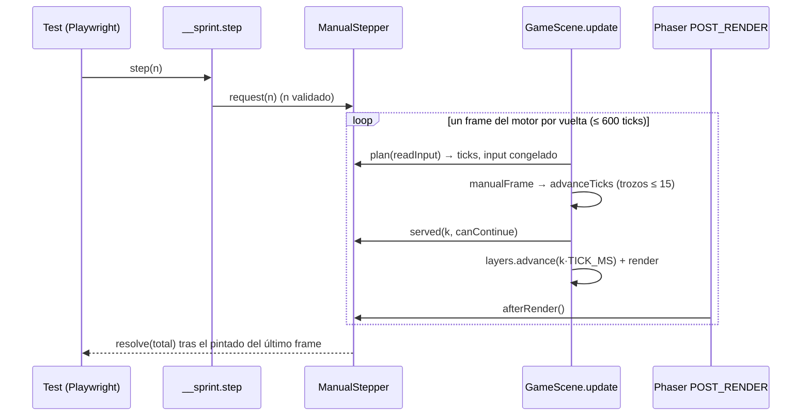

# Design · 0014-e2e-manual-step

- **Entrada**: `proposal.md` (aprobada 2026-11-23), `exploration.md`, spec delta `specs/simulation-loop/spec.md`.
  También la ampliación de alcance aprobada por el usuario el 2026-11-23: frenar la CPU con CDP en `CI_LIKE`, que
  **sustituye** a `--workers=8`.
- **ADR**: no hace falta. Todo vive en el adaptador y en las herramientas de test, y se revierte quitando una rama
  de `GameScene` y dos proyectos de Playwright. ADR-0002 (núcleo puro) se cumple sin cambios.
- **Dependencias nuevas**: ninguna. Se usan zod 4.6.7, `@playwright/test` 1.65.1 (opción `tag` y `grep` por
  proyecto, CDP con `newCDPSession`) y Phaser 4.2.1, todo ya instalado.

## 0. Consulta de la API de Phaser

- Vía: MCP `phaser-docs` (disponible en esta sesión), contrastada con `node_modules/phaser`.
- `Phaser.Core.Events.POST_RENDER`: https://phaser.io/oss/docs/api-documentation/namespace/core-events.md#post_render-1
  ("todas las escenas se han pintado en el canvas cuando se emite"). En 4.2.1, `src/core/Game.js` L470-502:
  `PRE_STEP → STEP → scene.update → POST_STEP → render → POST_RENDER`, una vez por frame.
- Teclado (`node_modules/phaser/src/input/keyboard`): `KeyboardManager.onKeyDown/onKeyUp` encolan el evento DOM y
  emiten `MANAGER_PROCESS`. `KeyboardPlugin` escucha ese evento (`KeyboardPlugin.js` L220) y procesa la cola **en el
  mismo momento del evento DOM**, no al empezar el frame. Consecuencias:
  - `Key.isDown` (`KeyboardInput`) pasa a true en cuanto llega el `keydown` y vuelve a false con el `keyup`.
    Pulsar y soltar sin un frame entre medias no deja ningún rastro en el movimiento, como dice la spec en
    "Pulsación sin step entre medias".
  - `ChoiceKeys`, `PauseKey` y `RestartKey` guardan el evento `down` en una bandera que dura hasta el siguiente
    `update`, así que una pulsación de 1/2/3, Esc o R **sí** se mantiene entre `step`s.

## 1. Piezas y capa de cada una

| Pieza | Capa | Nueva/modificada | Por qué ahí |
|---|---|---|---|
| `resolveManual(search)` | infrastructure/url | nueva | Entrada externa (URL) validada con zod, al lado de `resolveSeed` y `resolveSpeed` |
| `resolveAdvance(search)` | infrastructure/url | nueva | Fija la precedencia manual > speed en un único sitio que se puede probar en Node |
| `parseStepCount(n)` y `requestStep(...)` | infrastructure/e2e | nuevas | Entrada externa (argumento de `window.__sprint.step`) validada con zod; avisos de consola |
| `ManualStepper` | infrastructure/e2e | nueva | Cola de peticiones `step` y presupuesto de ticks por frame. Sin import del motor (patrón de `PauseGate`) |
| `advanceTicks(run, ticks, input)` | infrastructure/phaser (`advanceFrame.ts`) | nueva función | Trocea n ticks en llamadas a `TickRun.execute` de ≤ 15 ticks. Pura, se prueba en Node |
| `PauseGate.manualFrame(...)` | infrastructure/phaser | método nuevo | 0 ticks en pausa, igual que `frame` en tiempo real |
| `GameScene` | infrastructure/phaser | modificada | Rama manual en `update`; el camino de tiempo real queda tal cual |
| `main.ts` | composition | modificada | Resuelve el modo, crea el `ManualStepper` (solo con manual), engancha `POST_RENDER` y amplía la sonda |
| `tests/e2e/fixtures.ts` | tests | nueva | `test` extendido con el frenado de CPU por CDP (opción `cpuThrottle`) |
| `tests/e2e/probe.ts` | tests | modificada | Helpers `step`, `stepUntil`, `playToEnd`, `holdKey`, `waitForRun` y `gameUrl({ manual })` |
| `playwright.config.ts` | tests | modificada | Proyectos `logic` y `realtime`, frenado de CPU y `retries` |

**Capas intactas**: no se toca ningún fichero de `src/domain` ni de `src/application`. Se reutilizan
`TickRun.execute`, `TickRun.discardPending`, `TickRun.status`, `TickRun.snapshot`, `MAX_FRAME_MS`
(`src/application/FixedStepLoop.ts`) y `TICK_SECONDS` (`src/domain/run/Run.ts`). La infraestructura puede importar
ambas capas. El núcleo no sabe nada de `manual` ni de `step`.

**Sin puertos nuevos**: `ManualStepper` tiene una sola implementación. `GameScene` lo recibe como un tipo
estructural estrecho (`ManualFrames`) declarado en sus deps, el mismo patrón que `PauseView` y `SceneProgress`.
No es un puerto del dominio.

## 2. Resolución de `manual` (D1)

`src/infrastructure/url/resolveManual.ts`:

```ts
export interface ResolvedManual { readonly manual: boolean; readonly warning?: string }
export function resolveManual(search: string): ResolvedManual
```

- Sin `e2e`: `{ manual: false }`, sin aviso. El valor de `manual` no se mira.
- Con `e2e` y sin `manual`: `{ manual: false }`.
- Con `e2e` y `manual`: `z.enum(['', '1', 'true'])` sobre `params.get('manual')`. Si el valor es válido, el
  resultado es `{ manual: true }`. Si no, es `{ manual: false, warning }`; el aviso menciona `manual` (y no `seed` ni
  `speed`) y repite el valor crudo recortado a 32 caracteres con `JSON.stringify`, igual que `resolveSpeed`.

`src/infrastructure/url/resolveAdvance.ts` (precedencia, spec MODIFIED "Velocidad de simulación en modo E2E"):

```ts
export interface ResolvedAdvance {
  readonly manual: boolean;
  readonly speed: number;          // 1 si manual
  readonly warnings: readonly string[];
}
export function resolveAdvance(search: string): ResolvedAdvance
```

- Si el modo manual está activo, `resolveSpeed` **no se llama**. `speed` queda en 1 y no hay aviso de `speed`, sea
  válido o no ("Manual gana a speed", "Manual con speed inválida").
- Si no lo está, `speed` sale de `resolveSpeed` sin cambios (comportamiento de 0008), y los avisos de manual y de
  speed se acumulan, uno de cada como mucho ("Manual inválido no anula speed", "Avisos independientes de seed,
  speed y manual").
- `resolveSpeed` no cambia.

`main.ts` llama a `resolveAdvance(window.location.search)` **una vez** en lugar de `resolveSpeed` y escribe cada
aviso con `console.warn`. El resultado vale para toda la carga: R y `Volver al menú` + `Jugar` reutilizan la misma
instancia de `GameScene` con las mismas deps y no releen la URL ("Velocidad en todas las partidas de la carga").

**Cómo llega a la escena**: `GameSceneDeps` gana `manual?: ManualFrames`. Con el modo manual, la composición crea
un `ManualStepper` y lo pasa; sin él pasa `undefined` y `simSpeed: speed` como hoy. Sin `?e2e` la escena recibe
exactamente lo mismo que en el change 0012, así que el jugador no nota nada ("Manual ignorado fuera de E2E",
guardado incluido).

## 3. Mecánica de `step(n)` (D2)

### 3.1 Validación y avisos: `src/infrastructure/e2e/stepRequest.ts`

```ts
export const StepCountSchema = z.number().int().min(1).max(Number.MAX_SAFE_INTEGER);
export function requestStep(
  n: unknown, stepper: ManualStepper | undefined, warn: (msg: string) => void,
): Promise<number>
```

Orden de comprobación:
1. Sin `stepper` (no hay modo manual): `warn` con un mensaje que menciona `manual` y no la palabra `step` (p. ej.
   "Sin modo manual (?e2e&manual) la partida no se avanza a mano.") y `Promise.resolve(0)`. El avance en tiempo real
   no se toca ("Step sin modo manual").
2. `StepCountSchema.safeParse(n)` falla (0, negativo, no entero, `NaN`, `Infinity`, texto, `undefined`): `warn` con
   un mensaje que menciona `step` y no `manual`, y `Promise.resolve(0)`, **sin esperar frame**. El mensaje describe el
   valor con `typeof` y, si es número o texto, con `String(n).slice(0, 32)`. Nunca se usa `JSON.stringify` de un
   `unknown`, porque podría lanzar con un `BigInt` o un objeto cíclico.
3. Si `n` es válido: `stepper.request(n)`.

### 3.2 `ManualStepper` (cola FIFO y presupuesto por frame)

```ts
/** Lo que GameScene necesita del modo manual (tipo estructural, declarado en GameScene.ts). */
export interface ManualFrames {
  /** Ticks de este frame (0 si no hay petición) e input congelado de la petición. */
  plan(readInput: () => PlayerInput): { readonly ticks: number; readonly input: PlayerInput };
  /** Ticks ejecutados de verdad y si la petición puede seguir en el siguiente frame. */
  served(executed: number, canContinue: boolean): void;
}
export class ManualStepper implements ManualFrames {
  request(ticks: number): Promise<number>; // ya validado
  plan(...); served(...);
  /** Composición: en `Phaser.Core.Events.POST_RENDER`, con el frame ya pintado. */
  afterRender(): void;
}
/** Ticks máximos por frame del motor en modo manual (configuración de pruebas, no contenido). */
export const MAX_STEP_TICKS_PER_FRAME = 600;
```

Estado: una cola de peticiones `{ remaining, done, input?, servedThisFrame, finished, resolve }`. Solo la cabeza
está activa.

- `request(n)` encola la petición y devuelve su promesa. Las llamadas simultáneas se atienden una tras otra, en
  orden, cada una con sus propios ticks ("Llamadas simultáneas").
- `plan(readInput)`, una vez por `update` de `GameScene`. Sin cabeza devuelve `{ ticks: 0 }`. Con cabeza:
  - en su primer frame congela `input = readInput()` ("input leído una vez, al empezar, para todos sus ticks");
  - marca `servedThisFrame`;
  - devuelve `min(remaining, MAX_STEP_TICKS_PER_FRAME)`.
- `served(executed, canContinue)`: `done += executed` y `remaining -= executed`. La petición queda `finished` si
  `remaining === 0`, si `!canContinue` (pausa, oferta o fin) o si `executed` < lo planificado.
- `afterRender()`, al final de cada frame del juego, haya o no partida. Si la cabeza está `finished` **o no se ha
  atendido en este frame** (no hay `GameScene` activa: menú, arranque), resuelve con `done`, la saca de la cola y la
  siguiente empieza en el frame siguiente. Si no, limpia `servedThisFrame` y la petición sigue en el siguiente frame.
  Con esto:
  - "Step en el menú" devuelve 0 en el primer frame. No hace falta que la sonda conozca la pantalla.
  - "Llamada simultánea que encuentra la oferta": la segunda petición empieza con la partida eligiendo mejora y
    devuelve 0.
  - La promesa se resuelve **después del pintado** del frame que contiene el snapshot final, como pide la spec
    ("terminar solo cuando el frame que refleja el snapshot final está pintado").

**Por qué 600 ticks por frame y no los n en un frame**: la spec admite n hasta `Number.MAX_SAFE_INTEGER` y
`step(36000)` en un solo frame bloquearía la página varios segundos, con un solo pintado y sin atender el teclado.
Con 600 ticks (10 s simulados) el peor frame cuesta 600 × 2 ms = 1,2 s con el tope del benchmark, y en la práctica
menos de 0,2 s. Repartir los ticks en frames depende **del número de ticks, no de la duración del frame**: el
resultado es el mismo con cualquier `deltaMs` ("Independiente de la duración de los frames"). Si Esc pausa entre
dos frames de un `step` largo, la petición termina con los ticks hechos (`canContinue` = false). La spec no dice
nada de este caso; queda documentado aquí.

### 3.3 `advanceTicks`: troceo en llamadas de ≤ 15 ticks

En `src/infrastructure/phaser/advanceFrame.ts`, junto a `advanceFrame`:

```ts
export const TICK_MS = TICK_SECONDS * 1000;
/** Ticks por llamada a `execute` sin que el tope de 250 ms recorte: 15. */
export const TICKS_PER_EXECUTE = Math.round(MAX_FRAME_MS / TICK_MS);
export function advanceTicks(
  run: Pick<TickRun, 'execute' | 'status' | 'discardPending' | 'snapshot'>,
  ticks: number,
  input: PlayerInput,
): { readonly snapshot: RunSnapshot; readonly ticks: number }
```

- Con `ticks === 0` o una partida que no está en curso: `{ snapshot: run.snapshot(), ticks: 0 }`.
- Si no: guarda `start = run.snapshot().tick`. Después, mientras queden ticks y `run.status === 'running'`, hace
  `k = min(TICKS_PER_EXECUTE, quedan)`, `run.discardPending()` y `snapshot = run.execute(k * TICK_MS, input)`.
  Devuelve `ticks = snapshot.tick - start`.
- `Math.round` y no `Math.floor`: `250 / 16,666…` da 14,999… en coma flotante. Un test fija que vale 15.
  `15 × TICK_MS` = 250,00000000000003, el tope lo deja en 250 y el `EPSILON_MS` de `FixedStepLoop` ejecuta 15
  ticks; otro test lo fija.
- `discardPending()` antes de cada trozo garantiza que el acumulador empieza a 0 y que no se arrastran residuos de
  coma flotante. El número de ticks es exacto. No cambia ninguna regla: es el método que ya usa la pausa.
- Cuando se abre una oferta o termina la partida, `FixedStepLoop` corta el trozo y `status` deja de ser `running`,
  así que el bucle para y los ticks restantes se descartan. Nunca se elige una mejora dentro de un `step`.

`PauseGate.manualFrame(run, ticks, input)` devuelve `{ snapshot: run.snapshot(), ticks: 0 }` en pausa y, si no,
el resultado de `advanceTicks`.

### 3.4 `GameScene.update` en modo manual

El orden actual no cambia: Esc y el clic de pausa, R, la elección y `gate.step`. Solo el final se bifurca:

```ts
if (manual) {
  const plan = manual.plan(() => w.move.read());
  const r = this.gate.manualFrame(current.tickRun, plan.ticks, plan.input);
  manual.served(r.ticks, !this.gate.paused && current.tickRun.status === 'running');
  w.layers.advance(r.ticks * TICK_MS, this.gate.paused); // reloj de render = tiempo simulado
  this.render(r.snapshot);
} else {
  // Igual que hoy: layers.advance(deltaMs) arriba y gate.frame(run, deltaMs, input, speed).
}
```

- **`deltaMs` no se usa en modo manual**. Sin `step` se ejecutan 0 ticks y no se acumula tiempo, sea cual sea la
  duración del frame ("Sin avance por tiempo real en modo manual", "Frames largos sin step").
- **Animaciones**: el reloj de render (`RenderLayers.advance`) avanza lo mismo que el tiempo simulado del frame y
  se queda quieto sin `step`. Las animaciones siguen a la simulación y no dependen de la CPU. En tiempo real,
  `layers.advance(deltaMs, paused)` se queda donde está ahora.
- **Teclado y clics entre `step`s**: `update` corre en cada frame, así que Esc, R, 1/2/3 y los clics se atienden
  sin `step` ("Pausa / Elección / Reinicio sin step"). Si en el mismo frame llegan una pulsación de 1 y un `step`,
  primero se elige y después se avanza. Por eso la política de elección fija en E2E es `press('1')` y luego `step`.
  El movimiento se lee con `isDown` al empezar la petición: el orden observable es `keyboard.down → step → keyboard.up`.
- **Guardado y resultados**: siguen en `render()` del frame del fin, antes de `afterRender`. Cuando `step` resuelve,
  el historial ya está escrito y la pantalla de resultados está visible ("Fin de partida a mitad de step").

### 3.5 Flujo de un `step(n)`



### 3.6 Sonda E2E (`main.ts`)

`E2EProbe` gana `readonly manual: boolean` y `step(n: unknown): Promise<number>`. Esta última llama a
`requestStep(n, stepper, console.warn)` y existe siempre con `?e2e`, como pide la spec. Con el modo manual,
`speed` vale 1. Con manual, la composición hace
`game.events.on(Phaser.Core.Events.POST_RENDER, () => stepper.afterRender())`. Sin `?e2e` no hay sonda ni stepper.
`tests/e2e/probe.ts` amplía el tipo `Probe` y `probe()` con `manual`.

## 4. Playwright: proyectos, frenado de CPU y workers (D3)

### 4.1 Proyectos por etiqueta

Los dos proyectos se separan con **etiquetas** de Playwright (opción `tag`, desde 1.42). Así un fichero puede
mezclar tests de los dos tipos (pause, progress):

```ts
const chrome = { ...devices['Desktop Chrome'], ...(CI_LIKE ? swiftshaderLaunchOptions : {}) };
projects: [
  { name: 'logic', grepInvert: /@realtime/, use: { ...chrome } },
  { name: 'realtime', grep: /@realtime/, use: { ...chrome, cpuThrottle } },
],
```

- Un test o un `describe` es de tiempo real con `{ tag: '@realtime' }`. Todo lo que no lleva la etiqueta va a
  `logic`. Si a un test nuevo se le olvida la etiqueta, acaba en `logic`, el proyecto que no se somete a la pasada
  pesada; la revisión de verify lo comprueba con la regla de §5.
- **Criterio**: va a `logic` si el veredicto no depende del ritmo del reloj, de los frames reales ni del render bajo
  carga. Va a `realtime` si lo que se prueba es precisamente eso (velocidad, carga, `waitFrames` de render,
  navegación por escenas, "pasan 2 s reales").
- `workers: 2` sigue para todo (local y CI). `fullyParallel: true` no cambia.
- `retries: process.env.CI_LIKE ? 0 : process.env.CI ? 1 : 0`. Con `CI_LIKE` se quieren ver los flakes y un
  reintento los escondería; en CI real se mantiene 1 y los "flaky" se revisan en el informe HTML.
- **CI**: `ci.yml` ya lanza `npm run test:e2e` sin `--project`, así que ejecuta **ambos** proyectos. **No se toca
  ningún workflow.** `smoke:public` tiene su propia config (`playwright.remote.config.ts`) y tampoco cambia.

### 4.2 Frenado de CPU por CDP en `CI_LIKE` (ampliación aprobada 2026-11-23)

`tests/e2e/fixtures.ts`:

```ts
export const test = base.extend<{ cpuThrottle: number; throttleCpu: void }>({
  cpuThrottle: [1, { option: true }],
  throttleCpu: [async ({ page, cpuThrottle, browserName }, use) => {
    if (cpuThrottle > 1 && browserName === 'chromium') {
      const cdp = await page.context().newCDPSession(page);
      await cdp.send('Emulation.setCPUThrottlingRate', { rate: cpuThrottle });
    }
    await use();
  }, { auto: true }],
});
export { expect } from '@playwright/test';
```

- **Todas** las specs importan `test` y `expect` de `./fixtures`. Una regla `no-restricted-imports` de ESLint
  para `tests/e2e/**/*.spec.ts` prohíbe importar `test` de `@playwright/test`, así que nadie se salta el fixture
  sin darse cuenta.
- **Dónde se aplica**: solo en `realtime` y solo con `CI_LIKE`. `logic` no depende del reloj: frenarlo solo lo
  haría más lento sin detectar nada nuevo. En CI real el valor es 1 en los dos proyectos, porque el runner ya es
  lento de verdad.
- `playwright.config.ts` usa `defineConfig<{ cpuThrottle: number }>` y calcula
  `cpuThrottle = CI_LIKE ? parseThrottle(process.env.CPU_THROTTLE) : 1`. `parseThrottle` acepta un número finito
  ≥ 1. Si falta usa `DEFAULT_CPU_THROTTLE` y si es inválido lanza un error al cargar la config (herramienta de test,
  mejor fallar alto). `DEFAULT_CPU_THROTTLE` es el **valor medido** (§4.3). Mientras no haya medición queda en un
  valor provisional anotado en un comentario con la fecha; no se da por bueno en verify.
- **Con 2 workers como CI**: la receta pesada deja de saturar el PC. Con 12 workers se colgaba a 140 W; 0013 lo
  rebajó a 6 workers con `--repeat-each=2` de forma provisional. La dureza sale del frenado, no de la contención
  entre workers.
- **Limitación conocida**: `setCPUThrottlingRate` frena el hilo principal del renderer (JS, simulación, Phaser). La
  rasterización de WebGL con swiftshader corre en el proceso GPU y **no** se frena. Por eso el rate no se supone:
  se mide con un indicador que incluye el render (§4.3).
- Hay que comprobar en apply (tarea con test) que el frenado **sobrevive a `page.reload()` y a `page.goto`**
  dentro de la misma página. Lo usan progress, clear-progress y menu-flow. Si no sobrevive, el fixture lo vuelve a
  aplicar en el evento `framenavigated` del frame principal.

### 4.3 Cómo medir el rate que imita al runner (sin suponerlo)

1. **Sonda de calibración**: `tests/e2e/calibration.spec.ts`, `@realtime`. Con `?e2e&seed=42&speed=8` espera al
   tick ≥ 1.200 (escena cargada: enemigos, proyectiles y gemas) y mide en la página, sobre 300 frames de
   `requestAnimationFrame`:
   - `fps` real (`performance.now`, código de test, no del núcleo);
   - p95 del intervalo entre frames;
   - `ticksPerFrame` medio (≈ 8 si la máquina va sobrada; menos si el tope de 250 ms recorta).

   Escribe `[calibration] throttle=N fps=… p95=… tpf=…` con `console.log`, que el reporter `list` muestra en el
   log, y lo añade como `testInfo.annotations` (informe HTML). Solo exige haber medido (`fps > 0`): nunca falla por
   lento.
2. **Valor de CI**: se lee del log del job `e2e` en el **siguiente push del PR**. No se lanza ningún workflow a mano
   ni se hace polling (AGENTS.md, plan gratuito): se lee una vez el log cuando ese job ya ha terminado, o se
   descarga el artefacto `playwright-report`. La sonda corre dentro de la suite completa con 2 workers, igual que en
   local, así que la carga es comparable.
3. **Valor local**: `CI_LIKE=1 CPU_THROTTLE=<r> npm run test:e2e -- --project=realtime --repeat-each=3` con
   r ∈ {1, 2, 3, 4, 6}. Se toma la mediana de las 3 repeticiones de la sonda.
4. **Elección de N**: el menor r con `fps` local ≤ `fps` de CI y p95 local ≥ p95 de CI, es decir, local al menos
   tan duro como el runner. Si ningún r lo consigue porque el cuello está en swiftshader (§4.2), se anota en el
   verify-report y se usa el r con `tpf` más parecido. Se fija `DEFAULT_CPU_THROTTLE = N` con la tabla de medidas
   en un comentario de la config y en el verify-report.
5. **Línea base** (antes de migrar specs): una pasada `CI_LIKE=1 --project=realtime --repeat-each=3` sin frenado,
   con 2 workers, para registrar la tasa de fallos y la duración y compararlas con la pasada frenada. Esto
   **sustituye** a la medición "12 frente a 8 workers" de la exploración: el usuario la descartó porque 12 workers
   cuelgan el PC.

## 5. Helpers de `tests/e2e/probe.ts` y migración de specs (D4)

Helpers nuevos o modificados:

| Helper | Qué hace |
|---|---|
| `gameUrl({ seed, speed, manual })` | Añade `manual` si `manual: true`. `speed` y `manual` a la vez solo en las specs que prueban la precedencia |
| `expectManual(page)` | Falla si la sonda no dice `manual: true`. Evita que una spec `logic` caiga a tiempo real en silencio, igual que `expectSpeed` |
| `waitForRun(page)` | Espera a que `snapshot` no sea null (fin de la carga). Es una espera de evento, no del tick contra el reloj |
| `step(page, n)` | `page.evaluate(n => window.__sprint.step(n))` y devuelve los ticks |
| `stepUntil(page, until, maxTicks, chunk = 600)` | Política de elección fija: si hay oferta pulsa `1`; después `step(chunk)` hasta que se cumple `until` o se agotan `maxTicks`. Devuelve el snapshot o null. Sin reloj |
| `playToEnd(page, maxTicks = 36_000)` | `stepUntil(s => s.status === 'over')` |
| `holdKey(page, key, ticks)` | `keyboard.down(key)`, `step(ticks)` y `keyboard.up(key)` (orden de la spec) |

`playChoosingFirst`, `E2E_SPEED`, `ticksPerFrame`, `waitFrames` y los muestreadores se quedan para `realtime`.

**Regla de `logic`** (criterio de éxito de la proposal, la comprueba verify con grep): ninguna spec ni test sin
`@realtime` usa `waitForTimeout`, `playChoosingFirst` ni `expect.poll` sobre `snapshot.tick`. Las esperas de
eventos (`screen`, `runs`, visibilidad DOM, `snapshot` no nulo) se permiten. En pantallas sin partida, "no pasa
nada" se espera con `waitFrames(n)` (un número de frames, no un tiempo).

Clasificación spec por spec. Es orientativa, como dice la proposal, y puede ajustarse en apply si un test mezcla
regla y reloj:

| Spec | Proyecto | Qué cambia |
|---|---|---|
| `level-up` | logic | `?e2e&manual&seed=7`: `stepUntil(offer)`, overlay visible, `press('1')`, `step(1)`; fuera los `waitForTimeout` |
| `health` | logic | `stepUntil(health < max, 80 × 60)` con elección fija |
| `weapons` | logic | `stepUntil` con `chunk = 10`, registrando proyectiles vistos y bajas, tope de 15 × 60 ticks |
| `results` (los 2 tests) | logic | `playToEnd`, R y espera de `runs`; la partida nueva está en el tick 0 por construcción (sin `watchNextRun`); la sexta con `stepUntil(tick ≥ 600)` |
| `progress`: guardado al terminar, bloqueado + R, recarga a mitad | logic | `playToEnd` y `step(300)` antes de recargar |
| `progress`: "Sin violaciones en el bucle completo" | **realtime** | Es **la partida completa a `speed=8`** que exige la proposal (CSP durante todo el bucle con rAF real) |
| `progress`: "Carga del progreso guardado … tras 2 s" | realtime | Su escenario pide 2 s reales |
| `enemies` | logic | `step(30)` y comprobación de enemigos; `?seed=abc` + aviso + `step(31)` devuelve 31 |
| `pause`: Esc y reanudar, botón, teclas en pausa | logic | `step(60)` en pausa devuelve 0 y el snapshot no cambia; tras reanudar, `step(1)` da n + 1 |
| `pause`: Esc durante la oferta, Esc con la partida terminada | logic | `stepUntil(offer)` y `playToEnd` |
| `pause`: "velocidad 8 y ticksPerFrame" | realtime | Sin cambios |
| `clear-progress` (todos) | logic | `playToEnd` / `menuInE2E` con manual + `step(11)`; `waitForTimeout(500)` pasa a `waitFrames(30)` |
| `menu-progress` (todos) | logic | Igual; `waitForTimeout(300)` pasa a `waitFrames(20)` |
| `menu-flow`: "Volver al menú desde la pausa (tick ≥ 3.000)" | logic | `stepUntil(busy)` en lugar de `playChoosingFirst` a 60 s, que era el test más largo de la suite |
| `menu-flow`: resto | realtime | Navegación y ciclos de escena con frames reales |
| `menu` | realtime | Navegación DOM, `ticksPerFrame`, "1 s sin efecto" |
| `smoke`, `speed`, `sprites` | realtime | Sin cambios salvo la etiqueta y el import de `./fixtures` |
| `manual-step` (nueva) | logic, salvo lo marcado | Escenarios E2E de la spec delta, ver §6 |
| `calibration` (nueva) | realtime | §4.3 |

## 6. Estrategia de tests

**Unitarios (Vitest, Node)**:
- `resolveManual` y `resolveAdvance`: todos los valores de la spec ('', `1`, `true`, `0`, `false`, `abc`, `2`;
  con y sin `e2e`; precedencia sobre `speed` válido e inválido; un aviso de cada parámetro; `?manual` sin `e2e`
  devuelve lo mismo que una URL sin `manual`).
- `requestStep` / `StepCountSchema`: los 7 valores inválidos con 1 aviso `step` por llamada; sin stepper, 1 aviso
  `manual` y 0; `MAX_SAFE_INTEGER` válido.
- `advanceTicks`: n exacto (1, 60, 225); ninguna llamada a `execute` con más de `TICKS_PER_EXECUTE` (espía);
  `TICKS_PER_EXECUTE === 15`; parada en la oferta (devuelve k) y en el fin; 0 si no está en curso; el mismo input
  en todos los ticks.
- `ManualStepper`: FIFO de dos peticiones; resolución solo en `afterRender`; 0 si un frame pasa sin `plan` (menú);
  reparto en varios frames con el tope de 600; input congelado al empezar; parada con `canContinue = false`.
- `PauseGate.manualFrame`: 0 ticks en pausa.
- Equivalencia (Node, `TickRun` real): seed 42, frames de 16,667 ms frente a `advanceTicks(60)` con elección fija
  hasta el fin ("Manual frente a tiempo real"); seed 7, `advanceTicks(1)` frente a `advanceTicks(1200)` hasta el tick
  1.200 ("Reparto distinto"); frames de 1 ms frente a 5.000 ms sin efecto en un `ManualStepper` ("Independiente de
  la duración").

**E2E nuevos** (`manual-step.spec.ts`):
- `logic`: manual activo con '', 1 y true; valores inválidos con 1 aviso; step(60) y step(1); step(225); oferta a
  mitad con seed 7 (después `step(10)` devuelve 0, se elige y `step(10)` devuelve 10); oferta en el último tick
  (con k conocido de la anterior); fin a mitad con resultados e historial; step en pausa; step en el menú; n
  inválido (7 avisos); n muy grande; llamadas simultáneas (`Promise.all` dentro de un mismo `evaluate`); input con
  `holdKey`; pulsación sin step; manual tras R y tras menú (con `waitFrames` en lugar de "2 s"); "Manual gana a
  speed" (120 frames con `waitFrames` y `step(10)` devuelve 10).
- `realtime`: "Sin step no avanza" y "Reinicio sin step" (2 s reales); "Step sin modo manual" y "Manual inválido no
  anula speed" (`ticksPerFrame`); "Manual ignorado fuera de E2E" (sin sonda, sin avisos, la partida avanza).
- **Cobertura parcial declarada**: en "Manual ignorado fuera de E2E", lo de que "al terminar se guardan récord e
  historial" no se juega entero sin sonda, porque serían minutos a velocidad 1. Se cubre con la estructura: sin
  `e2e`, `resolveAdvance` devuelve lo mismo que sin `manual` (unitario) y `GameScene` recibe las deps de siempre.
  Verify debe saberlo. "Victoria al llegar a la duración objetivo" y "Frames largos sin step" se cubren en Node, con
  contenido de 120 ticks y `ManualStepper` respectivamente.

## 7. Rendimiento y seguridad

- **Presupuesto por tick**: no cambia. Es el mismo `Run.tick`, con ≤ 2 ms y 200 enemigos según el benchmark.
- **Modo jugador**: un `if (manual)` por frame. Sin asignaciones nuevas.
- **Tiempo real E2E**: idéntico a 0008.
- **Modo manual**: 0 ticks sin `step`. Con `step`, ≤ 600 ticks por frame (≤ 1,2 s en el peor caso del benchmark).
  Una lectura de `snapshot()` extra por frame con ticks. Ningún objeto del motor nuevo por frame.
- **Suite**: se espera que las specs `logic` pasen de 5-60 s de reloj a segundos. La duración se registra en el
  verify-report, sin umbral.
- **Seguridad**: `manual` y `step` solo existen con `?e2e`; sin él no hay sonda ni stepper, y la URL se valida con
  zod. El argumento de `step` es entrada externa y se valida con zod antes de tocar el adaptador. Los avisos no
  repiten objetos arbitrarios (§3.1). No cambia nada de lo persistido: formato de progreso, claves y CSP siguen
  igual. El guardado de partidas E2E en manual se comporta como en tiempo real.

## 8. Riesgos

- **Falsa seguridad** (proposal): el acumulador irregular, el tope de 250 ms y el render bajo carga los cubren los
  unitarios de la spec viva y el proyecto `realtime`, que es el que pasa por `CI_LIKE`.
- **El frenado no imita bien el runner** porque el cuello está en swiftshader (§4.2). Mitigación: se mide (§4.3) y
  se registra. Si no se consigue, el verify-report lo deja escrito y la receta sigue siendo útil para el JS.
- **El frenado no sobrevive a la navegación**: hay una tarea con test (§4.2).
- **`POST_RENDER` no se emite** con el juego en pausa del motor (`game.isPaused`, pestaña oculta). Los E2E corren
  con la pestaña visible. Si pasara, el `step` quedaría pendiente y Playwright lo cortaría por timeout: fallaría de
  forma visible, no en silencio.
- **Etiqueta olvidada**: un test nuevo sin `@realtime` cae en `logic`. La regla de §5 la comprueba verify.

## 9. Cambios en AGENTS.md

- **§2, fila `npm run test:e2e`**: la receta previa al push pasa a ser
  `CI_LIKE=1 npm run test:e2e -- --project=realtime --repeat-each=3`. Usa 2 workers como CI, sin GPU, con la CPU
  frenada por CDP (`CPU_THROTTLE`, por defecto el valor medido) y sin reintentos. `--project=logic` ejecuta las
  specs de reglas, que no dependen del reloj y no hace falta repetirlas. Se quita `--workers=12`.
- **§1, estado**: una línea: "`?e2e&manual` + `window.__sprint.step(n)`: avance manual exacto de ticks para los E2E
  de reglas (change 0014)". Y la mención a los proyectos `logic` y `realtime`.
- **Aviso de fusión**: el change 0013 también toca §2 (6 workers y `--repeat-each=2`, provisional). El que fusione
  segundo rebasa y deja **una sola** receta: la de este design, que sustituye a la de 0013.

## 10. Desviaciones respecto a la proposal

- La proposal ya recoge 2 workers + frenado de CPU (la actualizó el spec-writer tras la ampliación). Este design
  sigue esa versión.
- `menu-flow` "Volver al menú desde la pausa" pasa a `logic` (§5). La proposal deja menu-flow en tiempo real, pero
  también dice que la clasificación es orientativa. Es la tarea 4.9 de `tasks.md` y es **opcional**: si el
  orquestador no la acepta, se queda en `realtime`.
