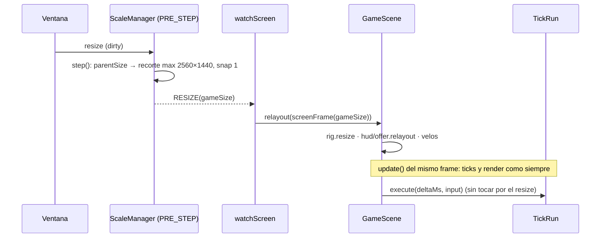

# Design · 0017-fullscreen-view

## Resumen
El lienzo pasa a `Phaser.Scale.RESIZE` dentro de `#game` (toda la ventana), a zoom 1, con `max` 2.560 × 1.440 de
contenido: por encima del tope el lienzo deja de crecer y el CSS lo centra (bandas del color de la página). La vista
sale del núcleo. El anillo de aparición pasa a ser un radio de contenido (`waves.spawn.ringRadius` = 1.500) y
`View` desaparece del dominio. El mundo pasa a 3.840 × 2.160 (rejilla 64 × 36), y el castillo y la salida quedan
centrados solos por la regla de `castleSite`. El HUD y las cartas (Phaser) se recolocan con funciones de layout
puras que reciben un `ScreenFrame` (tamaño entero del lienzo + escala de UI entera ×1/×2); `GameScene` los vuelve a
aplicar en cada `Scale.Events.RESIZE` y quita la suscripción en `SHUTDOWN`. Menú, pausa, diálogo y resultados son
bloques DOM únicos centrados por la rejilla CSS (el título del menú y las 5 líneas de resultados pasan al DOM) y
escalan con la variable CSS `--ui-scale`. El balance se recalibra en `waves.json` con una tabla monótona.

## Contraste con las specs delta (escritas después de la primera versión)
Cambios hechos a este design al contrastarlo con `specs/**`:
- **Nombres**: la spec usa `arena.maxView` y `waves.spawn.ringRadius`, los mismos que aquí. Sin cambios.
- **Anillo estricto** (`enemy-spawning`): `ringRadius` **>** media diagonal del tope (1.468 y 1.468,6 fallan;
  1.468,61 pasa). D2 pasa de `≥` a `>`. `margin` y `ringRadius` ausente fallan por `strictObject` (D2/D3).
- **Balance** (`run-outcome` + requisito vivo "Oleadas que crecen"): la tabla medida (60 s 2,4 > 180 s 2) no era
  monótona. D9 pasa a exigir una tabla no decreciente y fija un protocolo de calibración con salida explícita.
- **Centrado vertical ≤ 1 px** (`main-menu`, `run-results`): con el título del menú en Phaser (y 72) y las líneas
  de resultados en Phaser sobre un panel DOM anclado abajo, el bloque no queda centrado. Nueva **D11**: ambos pasan
  al DOM; desaparecen `resultsLayout` y `menuTitleLayout` de D5.
- **Sonda** (`world-camera`, "Sonda de cámara para E2E"): la spec **exige** el tamaño de ventana en la sonda (no es
  solo soporte). `window.__sprint.screen` ya existe (`'menu' | 'playing'`), así que D10 la llama `viewport`.
- **HUD** (`hud`): ×1 hasta 1.280 × 720 y ≥ ×2 desde 2.560 × 1.440. La fórmula de D5 da ×2 desde 1.920 × 1.080:
  compatible y monótona. Por encima del tope, el HUD se ancla al lienzo (la vista), que está centrado.
- **Ventana 0 × 0** (`world-camera`): `scale.min` 1 × 1 (D1) además del saneado de `screenFrame`.
- **E2E**: el nuevo redimensiona a **1.000 × 600** (no 1.920 × 1.080) y hace clic en (500, 300). La ampliación de
  "Cámara" se queda en la sonda a 1.280 × 720 (sin la secuencia de redimensionados: la cubren tests unitarios).

## Fuentes consultadas (Phaser 4.2.1)
Vía: MCP `phaser-docs` (documenta la v4.1.0) y, como manda la 4.2.1 instalada, el código y los tipos de
`node_modules/phaser`:
- `Scale.RESIZE`, `min`/`max`, `autoCenter`: https://phaser.io/oss/docs/phaser/concepts/scale-manager.md y
  https://phaser.io/oss/docs/api-documentation/class/scale-scalemanager.md#scale-modes. En 4.2.1,
  `ScaleManager.updateScale` (`src/scale/ScaleManager.js` l. 1065-1087): en RESIZE,
  `displaySize.setSize(parentSize)` **recorta con `min`/`max`**, y `gameSize`, `baseSize` y `canvas.width/height`
  toman ese valor. `max` sirve, por tanto, de tope del lienzo.
- `snap`: `Size.setSize` aplica `SnapFloor(width, snapTo.x)` (`src/structs/Size.js` l. 334). `scale.snap`
  1 × 1 da un tamaño entero aunque el padre mida 1280,5 px (zoom del navegador). Lo confirma el `ScaleConfig` de
  `types/phaser.d.ts` (l. 96283): `mode`, `min`, `max`, `snap`, `autoRound`, `autoCenter`, `resizeInterval`.
- Evento: https://phaser.io/oss/docs/api-documentation/namespace/scale-events.md#resize-1 (`gameSize`, `baseSize`,
  `displaySize`, `previousWidth`, `previousHeight`). En 4.2.1 el `resize` de la ventana solo pone `dirty`.
  `ScaleManager.step` corre en `PRE_STEP` y emite RESIZE **como mucho una vez por frame** (l. 1706-1726): arrastrar
  la ventana ya llega agrupado por frame.
- Cámaras: https://phaser.io/oss/docs/api-documentation/class/cameras-scene2d-cameramanager.md (`onResize`). En
  4.2.1 (`CameraManager.js` l. 685-699) redimensiona la cámara si está en (0, 0) y medía el tamaño anterior. La
  principal cumple, pero `CameraRig` lo hace explícito (D4). El `CameraManager` de cada escena quita su escucha al
  destruirse (l. 759). Las escuchas propias en `scene.scale` (gestor **global** del juego) hay que quitarlas a mano.
- Nitidez: `Config.js` l. 395-403: `pixelArt` fuerza `antialias` falso y `roundPixels` verdadero en **todo** el
  juego. No se activa (D7).

## Decisiones

### D1 · Escalado: RESIZE con tope por `max` y centrado por CSS (ADR-0014)
- `Phaser.Game` con `scale: { mode: RESIZE, parent: root, width: maxView.width, height: maxView.height, min:
  { width: 1, height: 1 }, max: maxView, snap: { width: 1, height: 1 }, autoCenter: NO_CENTER }`. El tamaño
  inicial lo sustituye el del padre en `boot`. `min` 1 × 1 evita un lienzo de 0 × 0 con la ventana minimizada.
- Tamaño visible: `min(W, 2.560) × min(H, 1.440)` a zoom 1. Por encima del tope sobra espacio: el lienzo queda
  centrado por la rejilla CSS de `#game`, que ya tiene `place-content: center`, y las bandas se pintan con el fondo
  de la página. Se usa `NO_CENTER` porque `autoCenter` añadiría márgenes encima del centrado CSS y el
  desplazamiento saldría doble.
- `styles.css`: `body { overflow: hidden }` (si aparece una barra de desplazamiento cambia el tamaño del padre y
  provoca un bucle de RESIZE) y `#game > canvas { display: block }`. `#game` ya mide el 100 % de alto y ancho.
- Los paneles DOM (menú, pausa, confirmación, panel de resultados) comparten celda con el lienzo y quedan centrados
  en ella (y en la ventana). El de resultados deja de anclarse al borde inferior (D11).
- Sin Fullscreen API: F11 del navegador cambia el tamaño de la ventana y entra por el mismo RESIZE.

### D2 · Tope de vista en contenido y fuera del núcleo
- `content/arena.json`: `{ "width": 3840, "height": 2160, "maxView": { "width": 2560, "height": 1440 } }`. La clave
  `view` desaparece. `ArenaSchema` es `strictObject`: un `view` antiguo da el error "clave desconocida", con el
  campo `arena.view`.
- zod (`ArenaSchema`): `maxView` con enteros positivos y mundo ≥ `maxView`. Reutiliza
  `WORLD_NARROWER_THAN_VIEW` y `WORLD_LOWER_THAN_VIEW` con el texto ajustado a "tope de vista".
- El dominio **no** ve `maxView`. `RunConfig.arena` queda en `{ width, height }`. `parseRunConfig` devuelve el tipo
  de salida de zod (`ParsedContent`, asignable a `RunConfig`), y `bootContent` expone `maxView` en `BootedContent`
  para la composición.
- Regla cruzada **de infraestructura** (en el `superRefine` de `RunConfigSchema`, no en `buildRunRules`):
  `ringRadius > hypot(maxView.width, maxView.height) / 2` (estricto, spec `enemy-spawning`). Si no se cumple, el
  error va en `waves.spawn.ringRadius` con el mensaje `SPAWN_RING_INSIDE_MAX_VIEW`. Así se mantiene la intención de
  "nacer fuera de la vista" con el tope, sin que el núcleo conozca la pantalla (1.500 > 1.468,605).
- `WavesSchema.spawn` sigue siendo `strictObject`: `margin` (o cualquier campo desconocido) falla con su nombre y
  `ringRadius` es obligatorio.

### D3 · Aparición desacoplada de la vista (ADR-0015)
- `SpawnConfig`: `margin` se sustituye por `ringRadius` (finito y > 0; si no, `RING_RADIUS_MUST_BE_POSITIVE`, campo
  `waves.spawn.ringRadius`). `SpawnRules.create(config)` deja de recibir `View`.
- `View.ts` y `tests/domain/view.test.ts` se borran, y `RunRules.view` desaparece.
- `waves.json`: `spawn: { ringRadius: 1500, minDistance: 200, maxAttempts: 8 }`. `minDistance ≥ ringRadius` sigue
  siendo válido.
- `placeSpawn` no cambia: anillo, recorte a la arena y `minDistance`, con 1 valor del generador por intento.
- Consecuencia: el núcleo no tiene ninguna entrada que dependa del tamaño de la ventana. La igualdad tick a tick
  entre ventanas es estructural, y se comprueba pintando con dos tamaños de cámara (§ Tests).

### D4 · Cámara
- `FollowCamera` añade `setSize(width, height)`. `CameraRig.resize(frame)` lo llama, así que no se depende de la
  heurística de `CameraManager.onResize`. Llamarlo dos veces con el mismo tamaño no tiene efecto.
- Límites (`setBounds`) al mundo y seguimiento con lerp 1, como hasta ahora. Como `maxView` ≤ mundo (zod), el
  recorte `[0, W − V_w] × [0, H − V_h]` siempre es válido. La sonda `camera` sigue siendo `worldView` del último
  frame pintado, ahora con el tamaño real.

### D5 · Escala de UI por escalones y layout puro
- `screenFrame(width, height): ScreenFrame` (puro, `src/infrastructure/phaser/ui/screenFrame.ts`):
  - `width` y `height` se redondean hacia abajo a enteros ≥ 1 (los valores no finitos dan 1).
  - `uiScale = max(1, ⌊min(width / 960, height / 540)⌋)`, con la referencia de UI 960 × 540 como constante con
    nombre.
  - Resultado: ×1 por debajo de 1.920 × 1.080 (y también en ventanas menores que 960 × 540, sin mínimo) y ×2 a
    partir de 1.920 × 1.080. Con el tope 2.560 × 1.440, ⌊2,67⌋ = 2, así que ×3 es inalcanzable sin cambiar el tope.
  - Cumple la spec `hud` ("Escala del HUD por escalones"): ×1 con cualquier ventana ≤ 1.280 × 720, ≥ ×2 desde
    2.560 × 1.440 y monótona (⌊min⌋ de cocientes no decrecientes). Con la ventana por encima del tope el frame es
    el del lienzo (recortado), así que 3.840 × 2.160 da ×2, igual que 2.560 × 1.440.
  - El HUD se ancla al lienzo. Por debajo del tope lienzo = ventana; por encima, el lienzo (la vista) está centrado
    y el HUD queda anclado a la vista, con las mismas garantías (spec `hud` deja la elección al design).
- `uiLayout.ts` (puro) calcula a partir del `ScreenFrame`:
  - `hudLayout(frame)`:
    - Vida y XP arriba a la izquierda.
    - Reloj arriba en el centro (`width / 2`).
    - Bajas arriba a la derecha (`width − margin`).
    - Todas las medidas de hoy (`MARGIN` 16, `BAR_WIDTH` 240, `BAR_HEIGHT` 10, `HEALTH_Y` 16, `XP_Y` 34,
      `LABEL_GAP` 8, fuente 14 px) se multiplican por `uiScale`.
  - `cardLayout(frame, n)` (modificado): cartas de 240 × 170 con hueco 24, todo × `uiScale`, centradas.
    - Con ×1 la fila de 3 cartas mide 768 px y no cabe en una ventana de menos de 768 px de ancho. Se acepta: sin
      mínimo de ventana (decisión del usuario).
    - Con ×2 mide 1.536 y siempre cabe, porque ×2 exige un ancho ≥ 1.920.
    - El centro del rectángulo que engloba n cartas es (width / 2, height / 2), en fila y simétricas; con 3, la
      de índice 1 contiene el centro (spec `upgrades`).
  - `veilLayout(frame)`: `width × height`, centrado (velo de oferta y de resultados).
- El texto se pinta a su tamaño final (`setFontSize`, `setWordWrapWidth`), no reescalando el objeto, para que se
  mantenga nítido. Solo se vuelve a pintar si cambia `uiScale`. Un simple cambio de tamaño solo mueve objetos
  (`setPosition`/`setSize`).
- **Una sola escala de UI** para HUD, cartas y paneles DOM. Los paneles DOM la reciben como `--ui-scale` (D11).

### D6 · Recolocar al redimensionar: `watchScreen`
- `watchScreen(scale, sceneEvents, apply)` (`ui/watchScreen.ts`, con costuras sin motor):
  1. Llama a `apply(screenFrame(scale.gameSize))` al entrar.
  2. Se suscribe a `Phaser.Scale.Events.RESIZE` y llama a `apply` con el `gameSize` nuevo.
  3. Hace `off` en `Phaser.Scenes.Events.SHUTDOWN`. Así, al volver al menú y entrar otra vez no se acumulan escuchas
     sobre el `ScaleManager` global.
- `GameScene.create` crea los widgets con el frame actual y registra `watchScreen` con
  `relayout(frame)`, que actualiza:
  - `rig.resize`.
  - `hud.relayout(layout.hud)`: actualiza el ancho de barra de `Hud` y `XpBar` e invalida la caché del relleno.
  - `offer.relayout(frame)`: coloca otra vez las cartas visibles aunque la oferta no cambie. `Rectangle.setSize`
    ajusta también el área de clic, así que el clic sigue a lo pintado.
  - Velo de resultados (`setPosition`/`setSize` con `veilLayout`).
- `MenuScene` no necesita `watchScreen`: el menú es DOM (D11) y la rejilla CSS lo recoloca sola.
- La composición se suscribe **una vez** a `phaserGame.scale` RESIZE (vive lo que vive el juego, sin `off`) y llama
  a `applyUiScale(root, screenFrame(gameSize))`, que pone `--ui-scale` en `#game` con `style.setProperty` (CSSOM,
  permitido por `style-src 'self'`) y la sonda `viewport`. Solo escribe si el valor cambia.
- Ningún `relayout` toca el `TickRun` ni la `PauseGate`: redimensionar no cambia la partida ni la pantalla (pausa,
  oferta y resultados siguen igual). `relayout` no crea objetos: el número de elementos del HUD y de cartas es fijo.

### D7 · Nitidez
- Zoom 1 sin reescalado CSS, porque en RESIZE el lienzo mide lo mismo que su caja. Con DPR 1 la nitidez es la de hoy.
- No se activa `pixelArt` ni `roundPixels`: cambiaría el filtrado de todas las hojas ya aprobadas (riesgo visual
  fuera de alcance), y `ROUND_PIXELS` de `CameraRig` sigue en falso.
- Con DPR > 1, el navegador reescala igual que hoy: no empeora y queda como riesgo conocido.

### D8 · Mundo y rejilla (ADR-0016, extiende ADR-0013)
- `arena.json` pasa a 3.840 × 2.160. La rejilla sale de `⌈W/60⌉ × ⌈H/60⌉`, que da 64 × 36. `map.json` no cambia:
  `rivers` 1, `castle` 5 × 4 y `tuning` igual (medido: 0/200 fallos de conectividad).
- `castleSite` no cambia:
  - Centro: (cc, rc) = (32, 18).
  - Huella: columnas 30–34 × filas 15–18.
  - Puerta: (32, 19).
  - **Salida: (1.950, 1.170)**. La zona de inicio (`startRadius` 180) se centra en ella.
- Tope de objetos del arte del mapa: 300 → **1.000** (medido: 667 y 750 en las semillas 42 y 123). El suelo es un
  `tileSprite` del tamaño del mundo: es un solo objeto y en WebGL su tamaño no se reserva como textura.

### D9 · Balance (contenido), con calibración en apply
- Restricciones (todas a la vez; ninguna se relaja):
  1. Requisito vivo "Oleadas que crecen" (`enemy-spawning`): `budgetPerSecond` **no decreciente** por tramo.
  2. Bot de referencia: entre **25 y 35** victorias en las semillas 1..50 (`run-outcome`).
  3. Quieto: derrota en < 10.800 ticks con las 50 semillas, **con el mapa generado y con el mapa vacío**.
  4. Primera oferta del quieto (semilla 7) en un tick ≤ 4.800.
- `player.speed` 215, `maxBudget` 10, `maxAlive` 200 y los `types` de cada tramo no cambian. Solo se toca
  `budgetPerSecond`.
- La tabla medida antes del contraste (1,2 / 2,4 / 2 / 3,2 / 4,48: 27/50, 0 quietos) **incumple 1** y queda
  descartada. Hipótesis: el ×1,2 temprano sostiene la presión del quieto y el ×0,8 tardío da la banda; se aplana el
  tramo 60–180 s. Candidatas, en este orden:
  - A: 1,2 / 2,2 / 2,2 / 3,2 / 4,48.
  - B: 1,2 / 2,0 / 2,0 / 3,2 / 4,48.
  - C: 1,2 / 2,2 / 2,2 / 3,0 / 4,2.
  - D: 1,1 / 2,0 / 2,0 / 3,4 / 4,6.
- **Protocolo** (tarea de calibración, antes de migrar tests de contenido): un script de medición en
  `tests/support/` (o un `it.only` local que no se commitea) da victorias, quietos vivos (generado y vacío) y tick de
  primera oferta para cada candidata. Se admiten **como mucho 6 tablas** (A–D más 2 interpolaciones entre las dos
  mejores).
- **Criterio de salida**: la primera tabla que cumple 1–4 se fija en `waves.json` y se anotan sus números en
  `tasks.md` y en este design. Si ninguna de las 6 cumple 1–4 a la vez, el implementer **se detiene y reporta** las
  mediciones al orquestador (se vuelve a spec); no relaja la monotonía, la banda ni el invariante del quieto, ni
  toca `player.speed` u otros campos sin un change de spec.

### D10 · Sonda E2E y Playwright
- La spec ("Sonda de cámara para E2E") pide el tamaño de ventana usado en el frame. `window.__sprint.screen` ya
  existe (`'menu' | 'playing'`), así que se añade `window.__sprint.viewport: { width, height, uiScale }`:
  - `width`/`height`: `scale.parentSize` (el padre `#game` mide la ventana) redondeado hacia abajo, en px CSS.
  - `uiScale`: el del `ScreenFrame` del lienzo.
  - Existe también en el menú (la escala no depende de la partida). `camera` sigue igual: `null` en el menú y
    `worldView` en partida (su ancho y alto son la vista).
- `playwright.config.ts`: `viewport: { width: 1280, height: 720 }` explícito en `logic` y `realtime`.

### D11 · Overlays DOM centrados (menú y resultados)
La spec pide que el menú (título incluido) y el overlay de resultados (las 5 líneas incluidas) queden centrados en
vertical con ≤ 1 px. Hoy mezclan texto Phaser con un panel DOM, que no se centran juntos. Decisión:
- **Menú**: el título pasa a un `h1` dentro de `MenuPanel` (la regla `.menu-panel h1` ya existe). `MenuScene` deja
  de pintar texto y de recibir el título; solo enruta.
- **Resultados**: las 5 líneas (título, tiempo, nivel, bajas, indicación de R) pasan a una cabecera DOM al
  principio de `ResultsPanel`. Un adaptador `DomResultsLines` (en `infrastructure/dom/`) implementa `ResultsTexts`
  (`setText` → `textContent`, `setVisible` → `hidden`), así que la lógica de `ResultsOverlay` no cambia. En Phaser
  queda solo el velo. `GameScene` recibe las líneas por dependencias (la composición las saca del panel).
- `.results-panel` pasa de `align-self: end` a centrado (hereda `place-items: center`). Pausa y diálogo ya lo
  están.
- Escala: los paneles usan `font-size: calc(<base> * var(--ui-scale, 1))` y medidas en `em`, de modo que todo
  escala con el mismo escalón que el HUD. Sin `style` en línea en el HTML (CSP intacta).
- Contención en 960 × 540 con el contenido máximo de resultados (2 avisos + mensaje): estimado ≈ 430 px de alto a
  ×1. Se comprueba a mano en verify (ver Riesgos): no hay E2E para ello por la regla `e2e-lite`.

## Piezas por capa
| Capa | Pieza | Nueva/Mod. | Notas |
|---|---|---|---|
| domain | `wave/SpawnRules` | Mod. | `ringRadius` de contenido; sin `margin` ni `View`; `RING_RADIUS_MUST_BE_POSITIVE` |
| domain | `arena/View` | Borrada | La vista deja el núcleo (ADR-0015) |
| domain | `run/RunConfig` | Mod. | `arena` = `{width,height}`; `waves.spawn.ringRadius`; `RunRules` sin `view` |
| domain | `map/CastleSite`, `wave/placeSpawn` | Sin cambios | Se centran o recortan solos con el mundo nuevo (los tests lo fijan) |
| application | — | — | Sin cambios: ningún caso de uso conoce la pantalla |
| infrastructure | `content/schemas` | Mod. | `ArenaSchema.maxView`, mundo ≥ tope; `WavesSchema.spawn.ringRadius` |
| infrastructure | `content/loadRunConfig` | Mod. | Regla anillo ≥ media diagonal del tope; devuelve `ParsedContent` con `maxView` |
| infrastructure | `phaser/ui/screenFrame` | Nueva | VO de presentación `ScreenFrame` (enteros + `uiScale`), puro |
| infrastructure | `phaser/ui/uiLayout` + `cardLayout` | Nueva / Mod. | Anclajes y medidas × `uiScale`, puros |
| infrastructure | `phaser/ui/watchScreen` | Nueva | RESIZE → `apply`; `off` en SHUTDOWN |
| infrastructure | `Hud`, `XpBar`, `UpgradeOverlay` | Mod. | `relayout(...)`; caché invalidada; cartas recolocadas con la oferta abierta |
| infrastructure | `ResultsOverlay` | Sin cambios de lógica | Recibe líneas DOM (`DomResultsLines`) en lugar de `Text` |
| infrastructure | `dom/MenuPanel`, `dom/ResultsPanel` | Mod. | `h1` del título; cabecera con las 5 líneas de resultados (D11) |
| infrastructure | `dom/DomResultsLines`, `dom/applyUiScale` | Nuevas | `ResultsTexts` sobre DOM; `--ui-scale` en `#game` |
| infrastructure | `sceneWidgets` | Mod. | Creación con layout inicial; adaptadores `setFontSize`/`setWordWrapWidth`; sin textos de resultados |
| infrastructure | `CameraRig` | Mod. | `resize(frame)` → `camera.setSize` |
| infrastructure | `GameScene` | Mod. | `watchScreen` en `create` |
| infrastructure | `MenuScene` | Mod. | Sin título ni texto: solo enruta |
| infrastructure | `src/styles.css` | Mod. | `overflow: hidden`, lienzo `display: block`, resultados centrados, tamaños × `--ui-scale` |
| composition | `main.ts` | Mod. | `scale` RESIZE con `min` 1, `max = maxView`, `snap` 1, `NO_CENTER`; `applyUiScale`; sonda `viewport` |
| composition | `contentBoot` | Mod. | `BootedContent.maxView` |
| content | `arena.json`, `waves.json` | Mod. | Mundo 3.840 × 2.160 + `maxView`; `ringRadius` 1.500; oleadas recalibradas |

No hay puertos nuevos: `ScreenFrame` y las costuras (`ScaleLike`, `SceneEventsLike`) son tipos de
infraestructura para tests, igual que `FollowCamera`.

## Flujo
La simulación no cambia: `FixedStepLoop` y `TickRun` no ven la pantalla. Así va un redimensionado:

## Dependencias nuevas
| Paquete | Versión exacta | Motivo | Alternativa descartada |
|---|---|---|---|
| — | — | No se añaden (RESIZE, `max`, `snap` y eventos vienen en Phaser 4.2.1) | `ResizeObserver` propio: duplicaría lo que ya hace el `ScaleManager` |

## Estrategia de tests (rojo → verde)
Unitarios y de aplicación primero (regla `e2e-lite`):
1. **Dominio**:
   - `SpawnRules` (`ringRadius` del contenido = 1.500, rechazo de ≤ 0 o no finito, `minDistance ≥ ringRadius`
     válido).
   - `run-config` sin `view`.
   - `place-spawn` con `ringRadius` explícito.
   - `generate-castle` con el contenido por defecto (30–34 × 15–18, salida (1.950, 1.170)).
   - `connectivity` con 64 × 36.
   - Firma dorada regenerada.
   - Balance.
2. **Contenido**:
   - `maxView` obligatorio, entero y positivo.
   - Mundo < tope → error.
   - `view` antiguo → "clave desconocida" en `arena.view`.
   - `ringRadius` < 1.468,7 con el tope por defecto → error en `waves.spawn.ringRadius`.
   - `bootContent` expone `maxView`.
3. **Presentación pura**:
   - Tabla de `screenFrame`: 959 × 539 y 1.280 × 720 → ×1; 1.919 × 1.080 → ×1; 1.920 × 1.080 y 2.560 × 1.440 →
     ×2; 1.280,5 → 1.280; 320 × 200 → ×1.
   - `hudLayout`/`cardLayout`/`veilLayout`: anclajes a bordes y centro con varios frames, sin solapes a 960 × 540
     con los textos más largos, y medidas dobles con ×2.
4. **Widgets con dobles**:
   - `Hud.relayout` recalcula el relleno con el ancho nuevo; 50 relayouts no crean elementos.
   - `UpgradeOverlay.relayout` con la oferta abierta recoloca las cartas y el clic de cada una sigue dando su
     índice.
   - `DomResultsLines` + `ResultsOverlay` con dobles mínimos de elemento (`{ textContent, hidden }`): Vitest corre
     en `node` y no se añade jsdom. El `h1` de `MenuPanel` y el CSS se revisan en el E2E de humo y a mano.
   - `applyUiScale`: escribe `--ui-scale` solo si cambia.
   - `watchScreen`: llamada inicial, llamada por RESIZE, ninguna tras SHUTDOWN y una sola escucha tras dos entradas.
5. **Cámara** (`camera-rig.test`):
   - `FakeCamera` con tamaño de vista parametrizable y `setSize`.
   - Escenarios de esquinas y recorte en 3.840 × 2.160 con 1.280 × 720 y con 2.560 × 1.440.
   - `resize` en mitad del seguimiento.
   - **Misma partida con ventanas distintas** (spec `world-camera`): tres partidas pintadas con 960 × 540,
     2.560 × 1.440 y una que cambia cada 60 ticks entre 320 × 180, 1.280 × 720 y 3.840 × 2.160 (vista recortada al
     tope en el propio test), 3.600 ticks, snapshots iguales campo a campo. Cubre también "Mismas apariciones con
     cualquier ventana".
6. **E2E** (1 nuevo y 1 ampliado en `gameplay.spec`, en modo manual):
   - Ampliado "Cámara" (`?e2e&manual&seed=42`, 1.280 × 720): `viewport` 1.280 × 720 y `uiScale` 1, mundo
     3.840 × 2.160, rectángulo de 1.280 × 720 con la fórmula (primera lectura en (1.310, 810)).
   - Nuevo "Redimensionado con la oferta abierta" (`?e2e&manual&seed=7`): `step(60)` hasta la oferta;
     `setViewportSize(1000, 600)`; esperar a que `camera.width` sea 1.000; comprobar fórmula y tick n; clic en
     (500, 300) → la mejora elegida es `offer[1]`.
   - Escenarios con navegador sin E2E (menú/diálogo/pausa/resultados centrados y contención en 960 × 540, DPR 2,
     ventana 0 × 0): cubiertos por tests unitarios de layout y CSS donde se pueda; el resto se acepta sin test
     automático según `e2e-lite` y se comprueba a mano en verify.

Migración de constantes y escenarios de test:
- Mundo de 1.920 × 1.080 → leído de `content/` (`aDefaultConfig`, `WORLD` del E2E desde `arena.json`).
- `SCENARIO_ARENA` y `builders.ts` sin `view`.
- `piled-contact`, `policies` y `content.test` pierden `arena.view`.
- `run-weapons`: de "vista pequeña + margin 0" a `ringRadius` pequeño, por ejemplo 71.
- 582,7 → 1.500.
- (990, 630) → (1.950, 1.170).
- Castillo 14–18 × 6–9 → 30–34 × 15–18.
- Cámara E2E [510, 360] → [1.310, 810].
- `MAX_MAP_OBJECTS` 300 → 1.000.
- `MAP_GOLDEN`:
  - 36 filas de 64 caracteres por semilla, regeneradas con `map-golden.test`.
  - Revisión a mano: 20 `C` en 30–34 × 15–18 y ningún `~`/`=` en la zona de inicio.
- `single-arena-source.test`: la regex de literales vetados pasa a `\b(3840|2160|1920|1080|960|540)\b`.
- `FIRST_OFFER_LIMIT` 4.800 se mantiene, pero se vuelve a medir el tick de la primera oferta de la semilla 7.

## Rendimiento y seguridad
- **Presupuesto por tick** (16,67 ms): el coste del núcleo no cambia.
  - Mismo `maxAlive` y misma colisión O(1) por celda.
  - Generar el mapa cuesta ≤ 2,3 ms, una vez por partida y no por tick.
  - `planMapArt` crea ≤ 1.000 objetos una vez por partida. No se crean objetos por frame.
  - Un `relayout` cuesta O(30 objetos), como mucho uno por frame (RESIZE en `PRE_STEP`). Solo vuelve a pintar texto
    si cambia `uiScale`.
  - En CI el lienzo mide 1.280 × 720, fijo en Playwright. El render de 2.560 × 1.440 solo se da en monitores
    reales, por eso el tope.
  - `npm run bench` (mapa) se vuelve a medir a título informativo, sin gate.
- **Datos persistidos**: ninguno nuevo; el formato de progreso no cambia.
- **Entradas externas**: el tamaño de ventana lo da el motor; `screenFrame` lo sanea (enteros ≥ 1, sin NaN) y no
  llega al núcleo. `arena.json` y `waves.json` se validan con zod como siempre. CSP sin cambios: Phaser pone estilos
  por CSSOM, que `style-src 'self'` permite.

## Riesgos
- **Spawns visibles en ventanas grandes cerca de los bordes**: el recorte a la arena es más frecuente con un anillo
  de 1.500 (aceptado en la propuesta).
- **Lienzo con decimales** (zoom del navegador) o DPR > 1: `snap` 1 asegura enteros; con DPR > 1 la nitidez queda
  igual que hoy.
- **Clics tras redimensionar**: Phaser actualiza `canvasBounds` en `refresh`. Si la rejilla CSS mueve el lienzo sin
  cambiar el tamaño del padre, no hay RESIZE, pero eso solo ocurre si cambia el tamaño, que sí emite RESIZE. Lo
  cubre el E2E de clic.
- **Fila de cartas a ×1 en ventanas de menos de 768 px de ancho**: se recorta (sin mínimo, por decisión del
  usuario).
- **Migración de tests amplia**: firma dorada y escenarios. El orden de las tareas pone primero los de dominio.
- **Balance monótono fuera de banda**: puede que ninguna tabla no decreciente dé 25–35 con 0 quietos. Salida
  explícita en D9 (parar y volver a spec), sin relajar requisitos.
- **Paneles DOM a ×2**: el `--ui-scale` depende de que todas las medidas de los paneles estén en `em`; un `px`
  olvidado no escala. Revisión a mano en verify con 1.920 × 1.080.
- **Contención en 960 × 540** del resultado con contenido máximo: estimada, no medida por E2E.

## ADRs
- `docs/adr/0014-escalado-resize-con-tope-de-vista.md`
- `docs/adr/0015-aparicion-desacoplada-de-la-vista.md`
- `docs/adr/0016-mundo-3840x2160-y-rejilla-64x36.md` (extiende ADR-0013)
