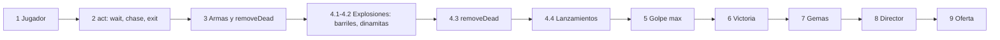

# Design · 0020-enemy-behaviors

> Revisión 2 (2026-11-24): la v1 se escribió antes que las specs delta. Esta versión está contrastada con
> **todas** ellas: `enemy-behavior`, `enemy-hazards`, `enemy-spawning`, `player-health`, `xp-gems`, `run-outcome`,
> `run-state`, `simulation-loop`, `sprite-rendering` y `asset-provenance`. Los cambios respecto a la v1 están en §10.

## Resumen
Cada `EnemyType` lleva un `Behavior`: un VO compilado desde `content/enemies.json` con un estado inicial y estados de
una **clase cerrada**:
- `chase`, con una salida opcional por distancia;
- `fuse`, terminal: explota y da de baja al barril;
- `charge`, que lanza una dinamita y pasa a su destino;
- `wait`, que pasa a su destino.

El estado de cada enemigo son dos escalares mutables (índice y tick de entrada). `HazardField` (servicio de dominio
propiedad de `Run`, como `Arsenal`) guarda:
- las dinamitas, en un pool fijo de `maxDynamites`;
- las explosiones visibles, en un pool que solo crece al superar su máximo histórico.

El tick sigue el orden de `simulation-loop`: comportamiento → armas (con su `removeDead`) → peligros (explosiones,
`removeDead` y lanzamientos) → golpe único al jugador. Los avisos no son entidades: el snapshot los deriva de los
barriles en mecha y de las dinamitas. Nada consume azar ni toca el mapa.

## Fuentes y vías consultadas
- Phaser, por MCP `phaser-docs`:
  - `Graphics#fillStyle(color, alpha)`, `#fillCircle(x, y, radius)` y `#clear()`
    (`/api-documentation/class/gameobjects-graphics.md#instance-fillcirclex-y-radius`, `#instance-fillstylecolor-alpha`,
    `#instance-clear`).
  - `GameObjectFactory#circle` → `Arc` (`/api-documentation/class/gameobjects-gameobjectfactory.md`).

  Las hojas nuevas se cargan como las de 0012 (`load.spritesheet` y `FILE_LOAD_ERROR` en `BootScene`). No hace falta
  ninguna API de motor nueva.
- `measurements.md` §5 (rejillas de las hojas). `TNT_Red.png` y `Barrel_Red.png` ya están versionadas desde 0012.
  Las hojas nuevas son **2**: `Dynamite.png` y `Explosions.png`.

## Piezas por capa
| Capa | Pieza | Nueva/Mod. | Notas |
|---|---|---|---|
| domain | `enemy/behavior/BehaviorConfig.ts` | Nueva | Formas del contenido: `{ initial, states: StateConfig[] }` con la unión `kind: chase \| fuse \| charge \| wait` (§1). Solo tipos. |
| domain | `enemy/behavior/Behavior.ts` | Nueva | VO inmutable. Arrays paralelos por índice de estado: `kind`, `ticks`, `exitDistSq`, `to` (índice o −1), `blastRadius`, `blastDamage` y `dynamite` (`flightTicks`, `radius`, `damage`). `names[]` para el snapshot. `Behavior.create(config, typeId, path)` valida (§2) y exporta los mensajes que reutiliza zod. |
| domain | `enemy/EnemyType.ts` | Mod. | + `behavior`. `damage` **opcional** en la config: si está, > 0; si falta, el VO guarda `damage = 0` y `hasContact = false` (spec `enemy-spawning`). |
| domain | `enemy/Enemy.ts` | Mod. | + `state` (índice) y `since` (tick de entrada), escalares mutables (ADR-0003). + `enter(state, n)`, `stateEndsAt` y `explode()` (vida a 0, sin destello). Recibir daño no toca el estado. |
| domain | `enemy/Horde.ts` | Mod. | `chase` pasa a `act(n, px, py, dt, field)` en tres pasadas sin asignar (§3, paso 2). |
| domain | `hazard/HazardRules.ts` | Nueva | VO de los globales: `maxDynamites` (entero ≥ 1), `dynamiteRadius` (> 0, visual) y `blastTicks` (entero ≥ 1). |
| domain | `hazard/Dynamite.ts` · `Blast.ts` | Nueva | Entidades reutilizables. Dynamite: `id, ox, oy, tx, ty, launchedAt, explodesAt, radius, damage`; la posición se interpola en el snapshot. Blast: `id, x, y, radius, tick`. |
| domain | `hazard/HazardField.ts` | Nueva | Pool de `maxDynamites` y lista de explosiones visibles, ambos en orden de creación y con ids que no se reutilizan. Compactación estable (ADR-0006). `explode(n, enemies, px, py, pr): boolean` (paso 4.1; devuelve si hubo bajas), `launch(n, enemies, px, py)` (4.3), `playerHit` (mayor daño candidato del tick) y `expire(n)`. |
| domain | `run/Run.ts` | Mod. | Orden del tick de §3. `applyContact` → `applyHit`: `max(contacto, hazards.playerHit)`. |
| domain | `run/RunConfig.ts` | Mod. | `enemies: { hazards: HazardRulesConfig, types[] }`. `RunRules.hazards`. |
| domain | `run/RunSetup.ts` | Mod. | `enemies[i].state?` (nombre) y `elapsed?` (ticks ya pasados en él, `0 ≤ elapsed < ticks`). `dynamites?: { x, y, targetX, targetY, ticksLeft, radius, damage }[]` con `≤ maxDynamites` y `1 ≤ ticksLeft`. Solo para tests y bench. Validados con mensajes propios. |
| domain | `run/RunSnapshot.ts` · `snapshotParts.ts` | Mod. | `EnemySnapshot` + `state` (nombre) y `stateKind`. `dynamites[]`: `{ id, x, y, targetX, targetY, radius, explodesAt }`. `warnings[]`: `{ x, y, radius, source: 'fuse' \| 'dynamite', explodesAt }`. `blasts[]`: `{ id, x, y, radius, tick }`. Orden en §4. |
| application | — | — | Sin cambios. |
| infrastructure | `content/schemas.ts` | Mod. | `EnemiesSchema`: `hazards` estricto y `behavior` obligatorio por tipo, con `discriminatedUnion('kind')` estricta. `damage` `.optional()`. Las referencias de estados (inicial, destino, nombres repetidos) las resuelve `Behavior.create` desde `buildRunRules`, en el `superRefine`: una sola implementación. |
| infrastructure | `content/appearanceSchema.ts` | Mod. | Enemigo: `fuse?` y `throw?` (Anim). Nuevos `dynamite` (`StillSchema`), `explosion` (con `explode: DeathSchema`, sin bucle), `warnings: { fuse, dynamite }` (`{ color: Hex, alpha ∈ (0, 1) }`) y `maxBlastSprites` (entero ≥ 1). |
| infrastructure | `phaser/HazardLayer.ts` | Nueva | Un `Graphics` para los avisos (`clear` y `fillStyle`/`fillCircle` por aviso y frame). Pool de `maxDynamites` sprites de dinamita y pool de `maxBlastSprites` sprites de explosión, todos creados en `create()`. Reservas con `PLACEHOLDER_TEXTURE` teñida (diámetro 2r). Contadores incrementales. |
| infrastructure | `phaser/EnemyLayer.ts` · `art/animation.ts` · `art/looks.ts` | Mod. | `stateKind` `fuse` → `fuse` y `charge` → `throw`, reiniciadas al entrar. El resto, `idle`/`walk` por movimiento como hoy. `AnimTrack<'idle' \| 'walk' \| 'fuse' \| 'throw'>`. Si la hoja del tipo falla o falta un frame de `fuse`/`throw`, el tipo entero va con reserva. Contador por clase de estado. |
| infrastructure | `phaser/RenderLayers.ts` · `renderCounts.ts` · `GameScene.ts` | Mod. | `HazardLayer` se crea tras la capa alta del mapa y antes del HUD (capa 8). Sonda: `warnings`, `dynamites` y `explosions` (`SpriteCount`) y `enemyStates: { chase, fuse, charge, wait }`; todo 0 en el menú y tras `clear()`. |
| composition | `contentBoot.ts` | Mod. | `checkAppearanceRefs`: `fuse` es obligatorio si el tipo tiene un estado `fuse` y `throw` si tiene `charge` (el error nombra el tipo). `bootPlan` carga las 2 hojas nuevas. |
| content | `enemies.json` · `appearance.json` · `asset-provenance.json` | Mod. | §5. |
| tests/support | `policies.ts` (bot v3) · `builders.ts` · `balanceMeasure.ts` | Mod. | §7. |

No hay puertos nuevos. `HazardField` no depende de `Horde`: recibe `horde.alive` como lista de solo lectura, igual que
`Arsenal`.

## 1. Modelo de comportamiento (ADR-0018)

```jsonc
"behavior": {
  "initial": "approach",
  "states": [
    { "name": "approach", "kind": "chase", "exit": { "distance": 260, "to": "aim" } },
    { "name": "aim", "kind": "charge", "ticks": 30, "to": "reload",
      "dynamite": { "flightTicks": 45, "radius": 56, "damage": 15 } },
    { "name": "reload", "kind": "wait", "ticks": 90, "to": "approach" }
  ]
}
```

- `chase`: `exit?: { distance > 0, to }`.
- `fuse`: `ticks` (entero ≥ 1), `radius` > 0 y `damage` > 0. Sin destino.
- `charge`: `ticks`, `dynamite: { flightTicks (entero ≥ 1), radius > 0, damage > 0 }` y `to`.
- `wait`: `ticks` y `to`.
- Ningún campo extra: el esquema es estricto. Las distancias se comparan al cuadrado.

Semántica en el tick n (en orden de lista; los enemigos no interactúan entre sí):
- Un `wait` con `since + ticks == n` pasa a `to` al empezar el paso 2: `enter(to, n)`, sin moverse antes.
- Un `chase` se mueve (persecución de 0019). Después, si tiene `exit` y d² ≤ `distance²`, `enter(to, n)`.
- `fuse` termina en `since + ticks` y se resuelve en el paso de peligros.
- `charge` está "lista" desde `since + ticks` y lanza en el paso de peligros si hay sitio. Si no, sigue en carga y
  quieta.
- Un enemigo recién aparecido (paso 8) no actúa en su tick. Los de `RunSetup` empiezan con `since = −elapsed`, de
  modo que actúan en el tick 1.

## 2. Validación
Los mensajes son del dominio y llevan el **id del tipo** y el nombre del estado o de la clase. El campo va en la ruta
`enemies.types.i.behavior...` (los escenarios piden que se mencione `goblin-barrel`, `teleport` y `hide`).
- `kind` fuera del catálogo: zod, con el mensaje propio `BEHAVIOR_KIND_UNKNOWN` y el valor recibido.
- `initial` ausente (zod) o inexistente: `BEHAVIOR_INITIAL_UNKNOWN`.
- `to` inexistente: `BEHAVIOR_TARGET_UNKNOWN`.
- Nombres repetidos: `BEHAVIOR_STATE_REPEATED`.
- `distance`, `radius` y `damage` ≤ 0 o ausentes: zod, con los mensajes del dominio.
- `ticks` y `flightTicks` no enteros o < 1: zod, con `Count`.
- `behavior` ausente: falla el tipo y se nombra.
- `damage` del tipo: opcional; si está, > 0.
- `hazards.maxDynamites` entero ≥ 1, `hazards.dynamiteRadius` > 0 y `hazards.blastTicks` entero ≥ 1. Un campo
  desconocido (`chainReaction`) falla.
- **Cotas del contenido por defecto** (`enemy-behavior`, "legible y esquivable"): no son reglas de zod porque
  dependen del contenido concreto. Las comprueba un test de contenido.

## 3. Flujo de un tick (contrato de determinismo; `simulation-loop`)
1. Jugador.
2. `field.retarget` y `horde.act`:
   1. Esperas que terminan pasan a su destino.
   2. Los `chase` se mueven.
   3. Los `chase` con salida y d ≤ `distance` entran en su destino.
3. Armas (3a–3d, sin cambios) y, si hubo bajas, `removeDead(dropGem)`. Una baja por armas en el mismo tick que una
   explosión se resuelve aquí, una sola vez.
4. Peligros (`hazards.step`):
   1. `expire(n)`: se retiran las explosiones con `tick + blastTicks ≤ n`.
   2. Explosiones del tick, en este orden:
      - (a) Barriles **vivos** con `fuse` que termina en n, en orden de lista. Primero se marcan todos (`exploding`),
        así que todos explotan aunque otra explosión del mismo tick los deje a 0.
      - (b) Dinamitas con `explodesAt == n`, en orden de creación. Salen del pool y dejan su hueco.

      Cada explosión crea un `Blast` y resta `damage` a todo enemigo vivo (vida > 0), salvo al propio barril, cuyo
      círculo solapa estrictamente el de la explosión (`circlesOverlap`). Si el círculo del jugador lo solapa,
      `playerHit = max(playerHit, damage)`. Al final, los barriles marcados pasan a vida 0 con `explode()`.
   3. Si hubo bajas, `removeDead(dropGem)`: suma 1 por cada una y suelta su gema en orden de lista. Las gemas de las
      armas ya se crearon antes.
   4. Lanzamientos: en orden de lista, cada enemigo vivo en `charge` con `since + ticks ≤ n` lanza mientras queden
      huecos: origen en su centro, objetivo en el centro del jugador, `explodesAt = n + flightTicks`. Después
      `enter(to, n)`.
5. `applyHit`: `max(contactDamage(vivos con contacto), playerHit)` si `canBeHitAt(n)`. Un solo golpe con la misma
   invulnerabilidad. `contactDamage` ignora `damage = 0`.
6. Victoria. 7. Gemas. 8. Director. 9. Oferta (sin cambios).

Con la partida terminada o eligiendo mejora no se ejecuta nada. Como todo es función del tick y de `since`, los
peligros quedan congelados sin código extra (`run-state`).



## 4. Snapshot
- `dynamites`, en orden de creación. Para k = n − `launchedAt` en [0, W): `x, y = o + (t − o)·k/W`.
- `warnings` se construye por frame:
  - uno por cada enemigo en `fuse` (en orden de lista), con `explodesAt = since + ticks`;
  - uno por cada dinamita, centrado en su objetivo.

  Se ordena con `sort` estable por `explodesAt`. A igual tick van primero las mechas, porque se insertan antes.
- `blasts`, en orden de creación. Cada explosión figura desde su `tick` hasta `tick + blastTicks − 1`.
- `enemies[i].state` (nombre) y `stateKind`. Todo congelado (`Object.freeze`), como hoy.

## 5. Contenido (valores de partida; la calibración los fija)
`player.speed` es 215: 3,5833 px/tick y radio 16.
- `hazards`: `maxDynamites` 24, `dynamiteRadius` 8 y `blastTicks` 30.

  El pico medido es de 42 TNT vivos. Con un ciclo de 30 + 90 ticks y 45 de vuelo sale ≈ 0,375 dinamitas por TNT, es
  decir, ~16 en vuelo.
- `goblin-barrel`: sin `damage`.
  - `approach` (`chase`, salida a 40) → `fuse` (40 ticks, radio 64, daño 20).
  - Cota: ⌈(64 + 16 − 40) / 3,5833⌉ = 12 ≤ 40 y 40 < 64.
- `goblin-tnt`:
  - `approach` (`chase`, salida a 260) → `aim` (`charge` de 30 ticks; dinamita con vuelo 45, radio 56 y daño 15) →
    `reload` (`wait` de 90) → `approach`.
  - Cotas: 38 < 260 ≤ 360 y ⌈(56 + 16) / 3,5833⌉ = 21 ≤ 45.
- `goblin-torch`: `chase` sin salida.
- Stats de tipos intactos (`run-outcome`). Solo desaparece el `damage` del barril.
- `appearance.json`:
  - `goblin-barrel.fuse` con frames [30, 31, 32] en bucle.
  - `goblin-tnt.throw` con frames [14–20], sin bucle, a unos 14 fps (≈ 0,5 s).
  - `dynamite`: `Troops/TNT/Dynamite/Dynamite.png`, 64 × 64, `idle` con los frames 0–5 en bucle.
  - `explosion`: `Effects/Explosion/Explosions.png`, 192 × 192, `explode` con los frames 0–8 a 18 fps, sin bucle.
  - `warnings`: `fuse` naranja y `dynamite` rojo, ambos con `alpha` 0,35.
  - `maxBlastSprites` 64.
- `asset-provenance.json`: exactamente 2 entradas nuevas, con `source`, `version`, `sha256` y `bytes` medidos al
  copiar byte a byte. Las entradas de `Barrel_Red` y `TNT_Red` no cambian.

## 6. Render
- Capa 8 de `sprite-rendering`, en este orden: avisos (`Graphics`), dinamitas y explosiones. Se crea después de la
  capa alta del mapa y antes de los widgets del HUD, y se mantiene tras un RESIZE porque es el orden de creación de
  la escena.
- **No se crean objetos del motor por frame.** El `Graphics` reescribe su buffer de comandos, que es interno al
  motor.
- Las explosiones se asignan por `id` en `SlotPool`. `explode` empieza en el primer frame pintado, avanza con el
  `AnimClock` de render (se para con el mundo detenido) y se queda en el último frame. La dinamita reproduce `idle`
  en bucle.
- `clear()` vacía avisos, dinamitas y explosiones sin animación de salida (R y Volver al menú).
- El barril que explota deja cadáver como cualquier baja.

## 7. Tests, bot, balance y bench
- **Unitarios y de aplicación** para todos los escenarios de dominio: `Behavior`, `Horde.act`, `HazardField`, `Run`,
  `RunSetup`, snapshot, zod, cotas, `checkAppearanceRefs`, `HazardLayer`/`EnemyLayer` con `FakeSprite` y un
  `Graphics` falso, y la sonda.
- Builders de escenario en `tests/support/builders.ts`:
  - `aBarrelType`, `aTntType` y `aWaitType` con los parámetros de los escenarios;
  - `aDynamite` para `RunSetup.dynamites`;
  - `inState(name, elapsed)`.
- **E2E: 1** (`sprite-rendering`, "Barril en mecha y su explosión en el navegador"), en el proyecto `logic`,
  ampliando `gameplay.spec`:
  - `?e2e&manual&map=empty&seed=s`, jugador quieto, `step(120)` en bucle hasta que la partida termina, y tras cada
    llamada se lee la sonda.
  - Se espera ≥ 1 lectura con aviso y barril en mecha, y una posterior con explosión, sin reserva.
  - En cada lectura los recuentos de avisos, dinamitas y explosiones coinciden con el snapshot.
- **Bot v3** (spec `run-outcome`, reglas fijadas): se implementa tal cual.
  - Amenaza: d < r_aviso + r_jugador + v/60, desde el snapshot anterior.
  - Se suman los vectores unitarios aviso → jugador, se cuantiza a 8 direcciones y se aplica la regla de direcciones
    bloqueadas. Si la suma es nula, `fleeInput`.
  - Sin pesos ni márgenes propios. `fleeInput` (v2) queda como la parte "Movimiento".
- **Balance**: palancas permitidas, por orden:
  1. parámetros de comportamiento y de `hazards`, dentro de las cotas;
  2. solo si no basta, la curva de XP.

  Oleadas, `maxAlive`, `ringRadius`, `player.speed`, stats, armas y mejoras no se tocan. Si no se alcanzan a la vez
  25–35 victorias y 0 quietos (mapas generado y vacío), el change **se detiene** y vuelve al usuario. Se anotan la
  primera oferta de la semilla 7 (2.082 antes), el primer golpe, el primer pulso (≤ 4.800) y la primera baja (≤ 900).
  Todo valor que fije una spec y cambie la calibración se actualiza en la spec delta antes de verify.
- **Bench**: caso nuevo "Peor caso con peligros".
  - Preparación: 300 vivos (≥ 100 barriles en mecha escalonados y ≥ 100 TNT en carga lista), el tope de dinamitas
    lleno en todos los ticks, y cada 10 ticks una explosión con ≥ 50 enemigos dentro.
  - La partida se rehace con `RunSetup` cada 60 ticks, fuera del tiempo medido, hasta completar 600.
  - Un test unitario comprueba que la preparación cumple esas condiciones.
  - Objetivo informativo ≤ 0,25 ms/tick, anotado en el verify-report junto al peor caso con proyectiles.

## 8. Rendimiento y seguridad
- Comportamiento: por enemigo, una rama por clase y ≤ 1 comparación de distancia. La persecución es la de siempre.
- Peligros: O(E) por explosión más O(D) por tick. Los lanzamientos son O(E) solo si hay alguna carga lista (se lleva
  un contador).
- Sin asignaciones en régimen estable: pool fijo de dinamitas, explosiones reutilizadas con crecimiento solo al
  superar el máximo histórico, `playerHit` escalar y bucles por índice. El snapshot asigna una vez por frame.
- El render usa un `Graphics` y pools fijos. Si en algún frame hay más explosiones que `maxBlastSprites`, las que
  sobran no se pintan y la sonda lo refleja (riesgo R3).
- Bundle: +2 PNG. Sin dependencias nuevas.
- Datos persistidos: el formato no cambia, solo el valor de `kills` (D1).
- Entradas externas: ninguna nueva. Contenido con zod estricto y `buildRunRules`.
- Determinismo: sin azar, y `MAP_STREAM` y `DECOR_STREAM` no se tocan (firma dorada intacta).

## 9. Dependencias nuevas
| Paquete | Versión exacta | Motivo | Alternativa descartada |
|---|---|---|---|
| — | — | Ninguna. | Librería de FSM (xstate): asigna por evento, no fija el orden del tick y no se valida con zod. |

## 10. Cambios respecto a la v1 (contraste con las specs)
1. Los estados son **clases cerradas** (`chase`, `fuse`, `charge`, `wait`) con sus parámetros, no movimientos,
   condiciones y efectos genéricos. Hay una sola salida por distancia y en `chase`.
2. El radio y el daño de la explosión, y el vuelo de la dinamita, van **en el comportamiento del tipo**. En
   `hazards` solo quedan los globales (`maxDynamites`, `dynamiteRadius`, `blastTicks`). No hay catálogo de peligros
   ni `warningTicks`: el aviso de la dinamita dura su vuelo y el de la mecha, su duración.
3. El tope es solo de **dinamitas en vuelo**. Las mechas y las explosiones no cuentan. Un TNT sin sitio sigue en
   carga y lanza en el primer tick con sitio. En la v1, con el pool lleno no había transición.
4. Transición por distancia **tras moverse**. Las esperas terminan al empezar el paso 2.
5. **Dos `removeDead`** (armas y peligros), no uno. Una baja por armas en el mismo tick que una explosión cuenta en
   las armas.
6. Todos los barriles cuya mecha termina en el tick explotan, aunque otra explosión del mismo tick los deje a 0. El
   barril no se daña con su propia explosión. Un barril abatido por armas en ese tick, o antes, no explota.
7. `damage` de contacto **opcional** (ausente = no golpea), no 0.
8. Snapshot con tres listas: `dynamites`, `warnings` y `blasts`. Los avisos se derivan y no hay "peligro anclado".
9. Golpe al jugador por solape estricto (`d < R + r`): coincide con la spec. Se mantiene.
10. El bot v3 sigue la regla de la spec (vectores unitarios, umbral de un tick y prioridad sobre la huida). Se quitan
    `HAZARD_WEIGHT` y `HAZARD_MARGIN`.
11. Animaciones `fuse`/`throw` por **clase** de estado (no por nombre), `explode` en la explosión, colores de aviso por
    origen y `Graphics` para los avisos en lugar de un `Arc` por aviso.

## ADRs
- `docs/adr/0018-comportamientos-en-contenido-y-peligros-de-area.md`, actualizado a esta revisión.
- Se rozan sin cambios: ADR-0003, ADR-0006, ADR-0007, ADR-0012, ADR-0013 y ADR-0017.
