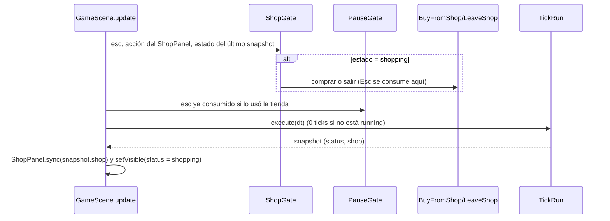

# Design · 0024-split-progression-castle

> Base: `proposal.md` aprobada con las decisiones del autor a sus 6 preguntas (2026-11-24): oro por baja **fijo por
> tipo**; más oro **solo en casas y torres** (sin vetas nuevas); personaje = las 3 actuales + regeneración, armadura
> (daño mínimo 1), invulnerabilidad más larga, más XP %, más oro %, más curación de la carne (madera a 0025);
> catálogo agotado ⇒ **la subida cura un poco**; tienda con **varias compras por visita**, curación en **porción fija**
> con tope, precios **crecientes por nivel** en contenido, único gasto de oro; **sin botón de tienda en el HUD**,
> entrada por radio con re-armado, salida con Esc (sin abrir la pausa) o botón, pausa total. Bot v4 que compra.
> Las specs delta se escriben en paralelo. **Contrastado con `castle-shop`, `upgrades` y `leveling`** (las primeras en
> llegar; mandan las specs): ids y stats de personaje, curación por subida en `progression.json`, cota superior de la
> carne, `d < radio` estricto, productos en todo snapshot, id propio de la curación y sonda por producto. §13 recoge lo
> que queda por contrastar con las demás (`resources`, `player-health`, `run-state`, `simulation-loop`, `hud`…).
> **Segunda revisión (fase tasks), contrastado con las 12 specs delta** (§14): oro por baja como tabla completa por
> tipo, armadura `max(1, bruto − armadura)`, re-armado del paso 11 también con oferta abierta, puerta declarable en el
> mapa vacío y validada dentro del mundo, bot v4 de `run-outcome` (curación antes que arma, peligro = enemigo vivo en
> un radio), palancas de calibración de `run-outcome` y convención "oro por baja 0" de los escenarios.

## Resumen
Se mantiene **un solo vector de niveles** (ADR-0008) sobre un catálogo con dos orígenes: `level` (personaje, oferta de
1 de 3 por XP) y `shop` (arma, por oro, con precio por nivel). El contenido los declara en dos listas separadas de
`upgrades.json`; el dominio los une en `UpgradeCatalog` para que la derivación de estadísticas efectivas y la build de
peor caso sigan teniendo una sola implementación. La tienda es una **fase nueva de `Run`** (`shopping`), que se abre en
un paso nuevo al final del tick (paso 11) cuando el jugador entra en el radio de la puerta del castillo **tras haberse
alejado** la distancia de re-armado. Comprar y salir son métodos de `Run` sin azar, servidos por dos casos de uso
(`BuyFromShop`, `LeaveShop`). La vista es un overlay **DOM** (`ShopPanel`, ADR-0011) y las reglas de Esc viven en un
`ShopGate` sin motor. Ningún puerto nuevo.

## 1. Piezas por capa

| Capa | Pieza | Nueva/Mod. | Notas |
|---|---|---|---|
| domain | `upgrade/UpgradeType.ts` | Mod. | `source: 'level' \| 'shop'` y `prices: readonly number[]` (vacío en `level`). `PLAYER_STATS` gana `invulnerabilityTicks`, `armor`, `regeneration`, `xpBonusPercent`, `goldBonusPercent`, `meatHealPercent` (§3). Mensajes nuevos de precios. |
| domain | `upgrade/UpgradeCatalog.ts` | Mod. | `create({ character, weapons }, loadout, player, arena)`: índices = `character` y luego `weapons`; rutas de error `upgrades.character.i` / `upgrades.weapons.i`. Reglas nuevas: `character` solo apunta al jugador y `weapons` solo a un arma; `prices` de longitud `maxLevel`, enteros ≥ 1 y no decrecientes; paso entero en todos los stats enteros (§3). Peor caso sin cambios de algoritmo. `levelIndices`/`shopIndices` precalculados. |
| domain | `upgrade/upgradeStats.ts` | Mod. | `playerWith` suma los 6 stats nuevos. `maxHealthBonus` sin cambios. |
| domain | `upgrade/UpgradeBoard.ts` | Mod. | `open(random)` sortea **solo** entre mejoras `level` disponibles (mismo Fisher–Yates parcial). Nuevo `raise(index)` (sube 1 nivel, lo usa la compra; sin azar). |
| domain | `player/PlayerRules.ts`, `player/Player.ts` | Mod. | Stats efectivos nuevos con **base 0 implícita** (spec `upgrades`: "todas con base 0") y `regenIntervalTicks` de contenido (§2); invariantes en `checkPlayer` (enteros ≥ 0; intervalo entero ≥ 1). `Player.hit` aplica la armadura (§4.2); la invulnerabilidad ya lee `rules.invulnerabilityTicks` efectivo. |
| domain | `progression/Experience.ts` | Mod. | `gain(amount, bonusPercent)` con resto en centésimas (§4.4). Con bonus 0, idéntico a hoy. |
| domain | `resource/Stockpile.ts` | Mod. | `add(gold, wood, goldBonusPercent)` con resto en centésimas para el oro; `spend(price): boolean`. |
| domain | `resource/ResourceRules.ts` | Mod. | Tabla nueva `drops.goldPerKill` (§2, §14): **todos** los tipos de `enemies.json`, entero ≥ 0; falta o sobra un tipo ⇒ error que lo nombra. `goldForEnemy(id)`. `drops.enemies` (madera) sin cambios. |
| domain | `shop/ShopRules.ts` | Nueva | VO de `content/shop.json` (§2): radio, distancia de re-armado (> radio), curación (`amount`, `price`). |
| domain | `shop/CastleGate.ts` | Nueva | Entidad mutable interna a `Run`: puerta (punto o `null`), `armed`. `step(x, y): boolean` (paso 11, §4.1). Sin azar ni asignación. |
| domain | `shop/ShopError.ts` | Nueva | Errores tipados de comprar y salir: `not-shopping`, `unknown-product` (id), `max-level` (id), `not-enough-gold` (precio, oro), `health-full`. Los productos se piden **por id** (spec `castle-shop`): el de cada mejora de arma y el id propio de la curación. |
| domain | `run/RunPhase.ts`, `RunStatus.ts` | Mod. | `SHOPPING = { status: 'shopping', outcome: null }`. `over` sigue solo desde `running`. |
| domain | `run/Run.ts` | Mod. | Paso 11, `buy(productId)`, `leaveShop()`, oro por baja en `onDeath`, armadura en `applyHit`, regeneración (7.3), bonus de XP y oro en 7.1/7.2, carne con `meatHealPercent`, curación por subida sin mejoras (§4.5). |
| domain | `run/RunConfig.ts`, `RunSetup.ts`, `RunSnapshot.ts`, `snapshotParts.ts` | Mod. | `RunConfig.shop`; `UpgradesConfig = { character, weapons }`; `progression.levelUpHealPercent`; reglas cruzadas de la carne y del id de la curación (§3); `RunSetup.shop?: { armed? }` (escenarios); `snapshot.shop` (§6). |
| domain | `map/TerrainSource.ts`, `GameMap.ts`, `MapSnapshot.ts` | Mod. | `door?: Point` en `open`/`cells`; `GameMap.door` (salida del castillo en el generado, la declarada o `null`) y `MapSnapshot.door`. Generación, firmas y colocación intactas. |
| application | `BuyFromShop.ts`, `LeaveShop.ts` | Nuevas | Patrón de `ChooseUpgrade`: llaman a `Run` y devuelven el snapshot o el error tipado. |
| application | `StartRun.ts` (`StartedRun`) | Mod. | Gana `buyFromShop` y `leaveShop`. `TickRun` y `FixedStepLoop` **sin cambios**: ya no avanzan con estado ≠ `running` y descartan el resto del frame si un tick cambia de fase. |
| infrastructure | `content/schemas.ts`, `loadRunConfig.ts` | Mod. | `UpgradesSchema` con dos listas (`prices` solo en `weapons`); `ProgressionSchema` con `levelUpHealPercent`; `PlayerSchema` con `regenIntervalTicks`; `ResourcesSchema` con `gold` por enemigo; `ShopSchema` nuevo; `RawContentFiles.shop`. |
| infrastructure | `dom/ShopPanel.ts` | Nueva | Overlay DOM (`role="dialog"`, `aria-label` "Tienda"): oro, una fila por mejora de arma (nombre, descripción, nivel `n/máx`, precio o "Máximo"), curación y botón "Salir". Botones deshabilitados con su motivo ("Oro insuficiente", "Vida llena"). Se reconstruye solo cuando cambia la clave del `ShopSnapshot`, no por frame. `textContent`, sin `innerHTML` ni estilos en línea (CSP). |
| infrastructure | `phaser/ShopGate.ts` | Nueva | Sin import del motor (patrón `PauseGate`): con estado `shopping`, Esc o "Salir" ⇒ `LeaveShop`; "Comprar" ⇒ `BuyFromShop`. Va **antes** de `PauseGate` en `GameScene.update` y consume Esc ese frame (§5). |
| infrastructure | `phaser/GameScene.ts`, `dom/menuText.ts`, CSS | Mod. | Cableado del panel y la puerta; `Screen` gana `'shop'`; textos; estilos del panel con `--ui-scale`. |
| composition | `main.ts`, `contentBoot.ts` | Mod. | Crea `ShopPanel`, carga `shop.json`; sonda `window.__sprint.shop` (§6) y `screen: 'shop'`. |
| content | `upgrades.json`, `player.json`, `resources.json`, `progression.json`, `shop.json` (nuevo) | — | §2. `enemies`, `waves`, `weapons`, `map`, `structures`, `sheep` y la curva de XP (9/4) **no** cambian. |
| tests/support | `policies.ts`, `balanceMeasure.ts`, `balanceBaseline.ts`, `builders.ts` | Mod. | Bot v4 (§8), traza de economía, línea base nueva, `withShopDoor`/escenarios de tienda. |

**Por qué en esta capa.** Disparador, precios, gasto, curación y estadísticas son simulación: núcleo puro (ADR-0002);
la fase de tienda es estado de la partida (como `choosing`, spec `run-state`), no de la presentación (a diferencia de
la pausa de Esc, ADR-0011), porque la abre una regla del tick y la determinan semilla y acciones. Panel y teclas son
presentación. **Sin puertos nuevos**: no hay dos implementaciones previsibles de nada nuevo.

**Sin `Shop` como agregado propio.** Comprar toca a la vez tablero, oro, jugador y armas: lo hace `Run`, raíz del
agregado. `CastleGate` y `ShopRules` son piezas pequeñas que `Run` posee.

## 2. Contenido (cifras provisionales; se calibran en §9)

`content/upgrades.json`:

```json
{
  "character": [
    { "id": "guardrail", "...": "igual que hoy (maxHealth 20 × 5)" },
    { "id": "shortcuts", "...": "igual que hoy (speed 20 × 5)" },
    { "id": "context-window", "...": "igual que hoy (pickupRadius 32 × 5)" },
    { "id": "regeneration", "stat": "regeneration", "perLevel": 1, "maxLevel": 5 },
    { "id": "armor", "stat": "armor", "perLevel": 1, "maxLevel": 3 },
    { "id": "steady-nerves", "stat": "invulnerabilityTicks", "perLevel": 6, "maxLevel": 5 },
    { "id": "scholar", "stat": "xpBonusPercent", "perLevel": 10, "maxLevel": 5 },
    { "id": "prospector", "stat": "goldBonusPercent", "perLevel": 10, "maxLevel": 5 },
    { "id": "hunter", "stat": "meatHealPercent", "perLevel": 5, "maxLevel": 4 }
  ],
  "weapons": [
    { "id": "strict-rules", "...": "igual que hoy", "prices": [10, 15, 22, 30, 40] },
    { "id": "fast-ci", "...": "igual que hoy", "prices": [10, 15, 22, 30, 40] },
    { "id": "wide-analysis", "...": "igual que hoy", "prices": [8, 12, 18, 25, 33] },
    { "id": "hard-asserts", "...": "igual que hoy", "prices": [10, 15, 22, 30, 40] },
    { "id": "watch-mode", "...": "igual que hoy", "prices": [10, 15, 22, 30, 40] },
    { "id": "coverage", "...": "igual que hoy", "prices": [8, 12, 18, 25, 33] }
  ]
}
```

- Las 6 de personaje nuevas llevan `target: { kind: "player" }` y los `name`/`description` de la tabla de la spec
  `upgrades` ("Textos medievales de las mejoras"); ids y `stat` también de la spec. `perLevel`/`maxLevel`
  provisionales (§9).
- Las 6 mejoras de arma conservan `id`, `name`, `description`, `target`, `stat`, `perLevel` y `maxLevel`; solo ganan
  `prices`. Las 3 de personaje actuales no cambian.
- `character` y `weapons` con ≥ 1 entrada cada una (forma); ids únicos **entre las dos listas** (dominio).

`content/progression.json` gana `"levelUpHealPercent": 10` (spec `leveling`, "Curación por subida sin mejoras":
entero en [1, 100]).

`content/player.json` gana solo `"regenIntervalTicks": 180` (no mejorable; ritmo de "cada tick de regeneración",
a confirmar con `player-health`). Los 6 stats nuevos tienen base 0 implícita y no se declaran en el fichero
(la invulnerabilidad parte de la `invulnerabilityTicks` que ya existe).

`content/resources.json`: `drops.goldPerKill` = `{ "goblin-torch": 1, "goblin-tnt": 2, "goblin-barrel": 1,
"goblin-tnt-guard": 2 }` (tabla nueva, completa; `drops.enemies` con la madera del barril no cambia) y
`drops.structures` = `{ "goblin-house": { "gold": 15 }, "goblin-tower": { "gold": 25 } }` (> 5 y > 8). `goldVeins`
intacto (decisión 2).

`content/shop.json` (nuevo, zod estricto):

```json
{
  "door": { "radius": 40, "rearmDistance": 160 },
  "heal": { "id": "heal", "name": "Poción de curación", "description": "Recuperas vida.", "amount": 25, "price": 8 }
}
```

- `radius` > 0, `rearmDistance` > `radius` (cruce en `ShopRules`, mensaje propio), `heal.amount` y `heal.price`
  enteros ≥ 1, `heal.id` con el formato de id de mejora y distinto de todo id de mejora (regla cruzada en
  `buildRunRules`). Nombre y texto de la curación, a confirmar con la spec. `rearmDistance` 160 < `map.startRadius` 180: el re-armado siempre es posible dentro de la zona de inicio
  libre (no es regla de contenido; lo vigila un test del contenido por defecto y facilita el E2E).
- `maxGold` (32) se conserva salvo que M1 mida oro perdido por el relleno al más antiguo (§9).

## 3. Catálogo con dos orígenes (ADR-0023)

- **Un vector de niveles**: índices `0..C−1` para `character`, `C..C+W−1` para `weapons`. `snapshot.upgrades`,
  `RunSetup.upgrades` (por id) y la derivación (`upgradedWeapon`/`upgradedPlayer`) no distinguen origen.
- **Oferta**: `UpgradeBoard.open` recorre solo `levelIndices`. El consumo de azar sigue siendo exactamente k valores
  por oferta; cambia **qué** se sortea (las ofertas de una semilla cambian, esperado y medido en §9).
- **Compra**: `UpgradeBoard.raise(i)` con `i` de `shopIndices`; precio = `prices[nivel actual]`.
- **Peor caso** (ADR-0008) intacto: recorre todas las mejoras. Stats nuevos con cota inferior: `armor`,
  `regeneration`, `xpBonusPercent`, `goldBonusPercent` ≥ 0 y `invulnerabilityTicks` ≥ 1, todos enteros;
  `checkIntegerStep` se extiende a todos los stats enteros (hoy solo daño y cadencia).
- **Primera cota superior** (spec `upgrades`: carne efectiva entre 1 y 100): `resources.meat.healPercent +
  Σ meatHealPercent` se valida en `buildRunRules` (cruza `upgrades` y `resources`) con **dos** aportes: `worstCase`
  (≥ 1) y un `bestCase` nuevo (`max(0, perLevel · maxLevel)`, ≤ 100). Es la consecuencia que ADR-0008 ya preveía
  ("si aparece una estadística con cota superior…"). El error nombra la mejora y `meatHealPercent`.
- **Guerrero (0027)**: una mejora de arma referencia su arma por `target.weapon`. Con varios personajes, la regla
  "arma existente" pasará a "arma de algún loadout" y la tienda listará las del loadout activo; el formato no cambia.

## 4. Reglas del núcleo

### 4.1 Puerta del castillo (paso 11 nuevo)
- **Puerta, propiedad del mapa** (spec `castle-shop` remite a "Puerta de la tienda en cada mapa" de
  `procedural-map`; su escenario usa "el mapa vacío con puerta declarada"): en el mapa generado, la salida ante la
  puerta del castillo (`map.start`); en `open`/`cells`, la `door` opcional que declara el `TerrainSource` (como ya se
  declaran salida, estructuras y ovejas); sin ella, `null` y no hay tienda (mapa vacío de los E2E y tests de siempre;
  una salida declarada no crea puerta). Una puerta declarada fuera del mundo hace fallar `Run.start` con
  `map.door` ("puerta de la tienda"). `GameMap.door` y `MapSnapshot.door` la exponen. `RunSetup` no la declara.
- **Estado**: `armed` empieza en `false` (o `RunSetup.shop.armed`, atajo de escenarios): el jugador nace en la salida.
- **Paso 11** (spec `simulation-loop`), con d = distancia del centro del jugador a la puerta:
  1. si `!armed` y d ≥ `rearmDistance` ⇒ `armed = true` (también en un tick que acaba de abrir oferta);
  2. solo si la partida sigue `running`: si `armed` y d **<** `radius` (estricto, spec "Tangencia con el radio no
     abre") ⇒ `armed = false` y la partida pasa a `shopping`.
  Como `rearmDistance > radius`, 1 y 2 no se dan en el mismo tick. Sin azar.
- **Oferta y tienda en el mismo tick**: manda la oferta (paso 10). La puerta sigue armada y, tras elegir, el primer
  tick con el jugador aún dentro del radio abre la tienda.
- Los ticks de muerte o victoria acaban antes del paso 7: nunca abren la tienda.

### 4.2 Golpe con armadura (paso 5)
`bruto = máx(contacto, explosión)` como hoy; si `bruto > 0` y el jugador no es invulnerable, recibe
`máx(MIN_HIT_DAMAGE, bruto − armor)` (spec `player-health`), con `MIN_HIT_DAMAGE = 1` constante del dominio (regla de
la decisión 3, como `OFFER_SIZE`, no un número de balance). La invulnerabilidad dura la `invulnerabilityTicks`
efectiva **en el momento del golpe** (`Player.hit` ya fija `invulnerableUntil`: mejorarla durante una invulnerabilidad
no cambia su final).

### 4.3 Curaciones (todas con tope en la vida máxima efectiva; no resucitan)
- **Carne** (7.1): `valor × máx(1, ⌊(healPercent + meatHealPercent) × máx / 100⌋)`.
- **Regeneración** (7.3, nuevo, tras las vetas): si `regeneration > 0` y `n mod regenIntervalTicks = 0`, cura
  `regeneration`.
- **Subida con catálogo agotado** (paso 10, §4.5).
- **Compra de curación** (fuera del tick, §4.6).

### 4.4 Bonus de XP y de oro (enteros, sin alterar la curva)
Acumulador en centésimas (spec `leveling`, "Subida de nivel con arrastre"): `t = v × (100 + b) + r`; se suma
`⌊t / 100⌋` y `r = t mod 100`, gema a gema. Implementación: `PickupGain` ya suma la XP del paso 7.1 y se aplica una
vez a la suma; es **idéntico** a hacerlo gema a gema porque, con el resto arrastrado, `Σ ⌊…⌋` telescopa a
`⌊(Σ v × (100 + b) + r₀) / 100⌋` (b es constante dentro del tick: las mejoras solo cambian entre ticks). Igual para el
oro (7.1 y cada veta en 7.2, `Stockpile.add`), con su propio resto. Con b = 0 el resto queda en 0 y todo es idéntico a
hoy. Los restos no salen en el snapshot.

### 4.5 Subidas sin mejoras de personaje disponibles
`openNextOffer` (paso 10 y tras cada elección): si hay subidas pendientes y `board.open` no encuentra mejoras `level`
disponibles, cura `pendientes × máx(1, ⌊levelUpHealPercent × máx / 100⌋)` con tope y limpia las pendientes, sin pausa
ni azar (spec `leveling`, "Curación por subida sin mejoras"). Sumar y curar una vez es igual que pieza a pieza (tope
monótono, como la carne).

### 4.6 Tienda (`Run.buy(productId)`, `Run.leaveShop()`)
- Solo en `shopping` (si no, `not-shopping`, sin cambios). Varias compras por visita.
- Id de una mejora de `weapons`: nivel < máx (si no, `max-level`); oro ≥ `prices[nivel]` (si no,
  `not-enough-gold`). Si todo va bien: gasta, sube el nivel y `retune(arma)`; rige desde el siguiente tick.
- `heal.id`: vida < máx (si no, `health-full`, sin cobrar); oro ≥ `heal.price`; gasta y cura `heal.amount` con tope.
- Cualquier otro id (incluido uno de personaje): `unknown-product`.
- `leaveShop()`: `shopping` ⇒ `running`. No hay subidas pendientes que abrir (la tienda solo se abre con la oferta
  cerrada y el paso 10 ya las resolvió). La invulnerabilidad, las mechas y las esperas no corren en la tienda (no hay
  ticks).
- Ninguna operación consume azar: la secuencia del flujo principal solo depende de la semilla y de los ticks.

## 5. Flujo de un frame y del tick



- Esc en la tienda nunca abre la pausa: `ShopGate` lo consume y, además, `PauseGate` ya ignora Esc con estado distinto
  de `running`. En pausa no se puede estar en la tienda (pausa solo desde `running`). Con la tienda abierta, las
  teclas 1–3 y R se leen y se descartan (spec "Overlay de la tienda"); el movimiento no llega porque no hay ticks.
- Salir y avanzar en el mismo frame (spec "Salir con Esc o con el botón": `tick` n + 1 tras 1 frame de 16,667 ms): el
  acumulador está a 0 desde que se abrió la tienda (`TickRun` lo reinicia con estado ≠ `running`) y `LeaveShop` va
  antes de `TickRun.execute`, así que ese frame ejecuta exactamente 1 tick.
- Tick (spec `simulation-loop`): pasos 1–9 como hoy; 7.1 con bonus de XP/oro y carne con su bonus; 7.3 regeneración;
  10 oferta (o curación por catálogo agotado); **11 puerta del castillo**. En `shopping` no se ejecuta ningún paso.
- Modo manual: `step(n)` con la tienda abierta ejecuta 0 ticks (como con la oferta); `ManualStepper` ya lo cubre.

## 6. Snapshot y sonda
- `shop: ShopSnapshot` en **todo** snapshot (spec `castle-shop`, "Productos de la tienda"): `armed`, `open` (= estado
  `shopping`), `door` (`{ x, y, radius }` o `null` sin puerta), `gold` y `products[]` en el orden de la tienda: una
  fila por mejora de arma (`id`, `name`, `description`, `level`, `maxLevel`, `price` o `null` al máximo,
  `affordable`) y la curación (`id`, `name`, `description`, `amount`, `price`, `affordable` = oro ≥ precio y vida <
  máx). Para no asignar 7 objetos por frame, `Run` guarda el último `ShopSnapshot` congelado y solo lo rehace cuando
  cambia su clave (oro, vida, máx, niveles de arma, `armed`, `open`): en la práctica, al recoger oro o al comprar.
- El bot v4 lee `shop.door`, `shop.armed` y los productos. El HUD no muestra nada de la tienda (spec `hud`).
- Sonda E2E `window.__sprint.shop` (spec "Tienda observable en el navegador"): `visible` (panel DOM a la vista) y, por
  producto, `id`, `level`, `price` y `buyable` (lo que muestra el panel), más `screen: 'shop'` mientras se ve.

## 7. E2E (e2e-lite: 1 nuevo, como máximo 2)
Spec "Abrir, intentar comprar y salir [E2E]", con un **recorrido determinista fijo** en modo manual (sin rama
abierta): `gameUrl` con `map: 'real'` y `?e2e&manual&seed=42`.
1. Mantener ↓ y avanzar con `step(5)` hasta `snapshot.shop.armed` (con 160 px y 215 px/s, 45 ticks ≈ 161 px, dentro
   de la zona de inicio libre de 180 px). Estado `running`.
2. Soltar ↓, mantener ↑ y `step(5)` hasta que uno devuelva < 5 con estado `shopping` (se para al abrirse).
3. **Precondición comprobada, no rama**: en ese momento el oro es 0 (≈ 100 ticks tras nacer, lejos del anillo de
   aparición de 1.500 px y antes de la 1.ª oferta) y el producto más barato marca `buyable: false`.
4. Clic en ese producto ⇒ nivel y oro sin cambios y `buyable: false` (la rama "con oro" de la spec la cubren los
   tests de aplicación y de `ShopPanel`).
5. Esc ⇒ `shop.visible` false, `screen` nunca fue `paused` (se registra en la sonda) y `step(1)` devuelve 1.
Para no depender de las cifras calibradas, el test no fija `T_out`: con ↓ pulsada hace `step(5)` hasta que
`snapshot.shop.armed` es true (como mucho 20 veces) y después ↑ con `step(5)` hasta `shopping` (como mucho 20);
cada `step` es exacto, así que el recorrido es el mismo en cada ejecución. Un solo E2E nuevo, ampliando un test de `gameplay.spec`.

## 8. Bot de referencia v4 (`tests/support/policies.ts`)
- `ReferenceBot` gana `shop(snapshot): string[]` (ids de las compras de la visita, en orden) además de `input` y
  `pick`. "La política de tienda fija" del escenario del quieto es no comprar nada y salir.
- Reglas exactas en `run-outcome` ("Bot de referencia para el balance", v4). La esquiva de avisos sigue mandando sobre
  todo. **Movimiento**: si quiere comprar (oro ≥ precio de una mejora de arma no agotada o, con vida < umbral, de la
  curación), `shop.armed` y ningún enemigo vivo a < `SHOP_DANGER_RANGE`, va a la puerta con un `FlowField` del bot
  apuntado a la celda de la puerta (una BFS por partida) y la misma línea libre que los enemigos; cuantiza a 8
  direcciones y aplica la regla de direcciones bloqueadas. Si no, `fleeInput` de v3 (que, además, re-arma la puerta al
  alejarse).
- **Compra**: repite mientras pueda: con vida < umbral y oro para la curación, la compra; si no, la primera mejora de
  `REFERENCE_SHOP_ORDER` no agotada que le alcance. Después sale.
- **Parámetros** (constantes de `tests/support/policies.ts`, provisionales hasta M1 y anotados aquí al cerrar):
  `REFERENCE_SHOP_ORDER` = `strict-rules, fast-ci, hard-asserts, watch-mode, wide-analysis, coverage`;
  `REFERENCE_HEAL_THRESHOLD` = 0,5 de la vida máxima; `SHOP_DANGER_RANGE` = 200 px (> 100 del escenario "El peligro
  gana a la tienda").
- `REFERENCE_UPGRADE_PRIORITY` (oferta) pasa a solo personaje (provisional `guardrail, armor, regeneration,
  steady-nerves, shortcuts`). Ambas prioridades son palancas de §9 y quedan fijadas en la spec al cerrar.
- El bucle de `balanceMeasure` llama a `buy` por cada artículo y a `leaveShop` en `shopping`.
- **Parámetros finales (apply, M1)**: sin cambios respecto a los provisionales: `REFERENCE_UPGRADE_PRIORITY` =
  `guardrail, armor, regeneration, steady-nerves, shortcuts`; `REFERENCE_SHOP_ORDER` = `strict-rules, fast-ci,
  hard-asserts, watch-mode, wide-analysis, coverage`; `REFERENCE_HEAL_THRESHOLD` 0,5; `SHOP_DANGER_RANGE` 200 px.
  `ReferenceBot.shop(snapshot)` devuelve **la siguiente compra** (o `null`) y `visitShop` repite con el snapshot
  nuevo, porque el precio del nivel siguiente solo se conoce tras comprar (desviación menor de la firma).

## 9. Plan de calibración de balance (mediciones)

**M0 (ya medido, `proposal.md`)**: bot v3, 28/50, oro 1,86/partida, 15,86 subidas, 11,42 mejoras de arma y 4,44 de
personaje elegidas por partida, 1.ª/5.ª/10.ª subida en los ticks 2.042/5.179/12.547; cota inferior 0/50. Añadir en la
tarea 0: **bajas medias por tipo** del bot v3 (para dimensionar el oro por baja) y tiempo del lote en local.

**M1 (núcleo + bot v4 + contenido provisional)**, informativo en `balance.test.ts`, por partida sobre 1..50:
victorias; oro ganado por fuente (bajas, estructuras, vetas) y gastado; visitas a la tienda; niveles de arma
comprados (total y ticks de la 1.ª, 5.ª y 10.ª compra); curaciones compradas; subidas y curaciones por catálogo
agotado; oro sin gastar al final y oro que quedó en el suelo; mechas por partida; tiempo del lote.

**Criterios de cierre**: 25–35/50 (objetivo ~28–30); 0 quietos (el quieto nunca re-arma ni compra); paridad
aproximada de ofensiva con M0 (≥ ~10 niveles de arma por partida ganada; 5.ª compra antes del tick ~7.000); "Mechas
por partida" > 16,3; lote ≤ 45 s local (≤ ~81 s en CI).

**Palancas, en este orden** (las únicas que admite `run-outcome`; una por iteración, se anota cada medición):
1. oro por baja por tipo; 2. precios por nivel y precio/porción de la curación; 3. oro de casas y torres (> 5 y > 8);
4. `perLevel`/`maxLevel` de las 6 mejoras de personaje nuevas, intervalo de regeneración y `levelUpHealPercent`;
5. parámetros del bot v4 (prioridad de personaje, orden de compra, umbral de vida, radio de peligro); 6. radio y
re-armado de la puerta; 7. `maxGold` si se pierde oro por el relleno. **No se tocan** `waves`, `enemies`, `weapons`,
`map`, estructuras salvo su oro, vetas, montones, `sheep`, la carne, `player.speed` ni la curva de XP (9/4). Si
ninguna combinación da a la vez 25–35 y 0 quietos con ambos mapas, el change se para y decide el autor.

**Riesgo del quieto** (armadura y regeneración salen ahora en la oferta del quieto, que ya no recibe mejoras de arma):
M1 mide el tick de muerte máximo del quieto sobre 1..50 con ambos mapas frente a 10.800 (M0 de 0023: 6.802 generado
y 7.948 vacío). Si el margen baja de ~1.000 ticks, la palanca es el `perLevel`/`maxLevel` de `armor` y `regeneration`
(o el intervalo). También se anotan los plazos del quieto (primer golpe, primer pulso y primera oferta ≤ 4.800,
primera baja ≤ 900) y la primera oferta de la semilla 7.

**Timeout**: `BOT_BATCH_TIMEOUT_MS` (180 s) no se sube.

**M2 (congelar)**: `balanceBaseline.ts` se **reemplaza a propósito**: filas `[semilla, resultado, tick, bajas]` del
bot v4 con el contenido final (regresión de determinismo), media de mechas nueva y huella de combate con `waves`,
`enemies` y `weapons` **iguales a las de hoy** y `upgrades` (con los precios), `player`, `resources`, `progression` y
`shop` nuevas (spec: un precio cambiado en 1 hace fallar la huella). El verify-report anota victorias, oro ganado y
gastado, visitas y compras medias, mechas y el lote en local y ×2,8 (CI).

**Resultado del apply (M1 → M2)**. Iteración 0 (contenido de §2): 22/50, 0 quietos, oro ganado 334 y gastado 172
por partida (sobra oro; faltan visitas: 2,2), 5.ª compra en el tick ~14.300. Iteración 1 (palanca 2): precios del
daño y la cadencia de las dos armas **5, 8, 11, 15, 20** y de alcance y radio **4, 6, 9, 12, 16** ⇒ **30/50**, 0
quietos con los dos mapas (muerte máxima 6.081 generado / 6.475 vacío: margen 4.325), primera oferta s7 en el
2.082 y plazos del quieto intactos, mechas **30,44** (> 16,3), oro ganado 284 y gastado 122,5, 2,54 visitas, 11,6
niveles de arma (18,9 por partida ganada) y 0,12 curaciones por partida; 1.ª/5.ª/10.ª compra en los ticks
3.599/8.285/12.412. El resto del contenido de §2 queda como estaba (oro por baja 1/2/1/2, casas 15, torres 25,
curación 25 por 8, puerta 40/160, `levelUpHealPercent` 10, regeneración cada 180 ticks, `maxGold` 32). Lote del bot
v4: 34,7–35,8 s en local (×2,8 ≈ 97–100 s, por encima de los 90 s objetivo); `BOT_BATCH_TIMEOUT_MS` sigue en 180 s.
La 5.ª compra (8.285) queda por encima del ~7.000 orientativo. M2 congelada en `balanceBaseline.ts`.

**Tiempo del lote**: se retira el segundo lote "sin ovejas" (comparaba con la base M0, que deja de existir); queda un
solo lote con el contenido por defecto, comparado fila a fila con la base nueva. Con el bot v4 (viajes a la puerta,
partidas algo más largas) se espera ~30–40 s en local, por debajo de los 56 s de los dos lotes actuales.

## 10. Determinismo y firmas
- Azar nuevo: **ninguno**. Puerta, compras, salida, armadura, regeneración, bonus y curaciones no consumen azar; los
  drops de oro crean recogibles (ids) pero no tocan `random`.
- Cambia la secuencia de ofertas (otro pool), de forma esperada: es parte del balance nuevo.
- `MAP_GOLDEN`, `STRUCTURE_GOLDEN`, `RESOURCE_GOLDEN` y `SHEEP_GOLDEN` **intactas**: ni vetas nuevas ni cambios en la
  colocación (el oro de casas y torres no entra en ninguna firma). El test de `upgrades-rename-determinism` se revisa
  para el formato nuevo.

## 11. Rendimiento y seguridad
- **Por tick**: paso 11 (una distancia), 7.3 (un módulo), armadura y bonus (aritmética entera). Sin asignaciones; el
  `ShopSnapshot` se rehace solo al cambiar su clave (§6). Coste < 0,01 ms/tick; el bench no debe moverse
  (M1 lo comprueba con `npm run bench`, informativo).
- **Render**: el panel DOM se reconstruye solo al cambiar su clave (oro y niveles), no por frame; ningún objeto del
  motor nuevo. Pool de recogibles sin cambios salvo `maxGold`.
- **Seguridad y datos**: nada nuevo se persiste (el oro y las compras son de la partida; `progress-persistence` sin
  cambios). `shop.json` y los campos nuevos pasan por zod estricto y por `buildRunRules`. El panel usa `textContent`
  y clases (CSP estricta).
- **Phaser**: sin API nueva del motor (Esc sigue con `PauseKey`, ya en uso; el panel es DOM). No se fija ninguna API
  de Phaser nueva, así que no se consultó `phaser-docs`; si apply necesitara una, se comprueba allí (o en los tipos de
  `node_modules/phaser` 4.2.1) y se cita aquí.

## 12. Dependencias nuevas
Ninguna.

| Paquete | Versión exacta | Motivo | Alternativa descartada |
|---|---|---|---|
| — | — | — | — |

## 13. Contraste con las specs delta
**Ya contrastado** (`castle-shop`, `upgrades`, `leveling`) y reflejado arriba: ids y stats (`regeneration`, `armor`,
`steady-nerves`, `scholar`, `prospector`, `hunter`; `meatHealPercent`); precios no decrecientes; bonus con resto
gema a gema (equivalente a la suma del paso, §4.4); curación por subida en `progression.json` y también en la
elección que cierra la anterior; cota superior de la carne; `d < radio` estricto; productos en todo snapshot; compra
por id con id propio de la curación; puerta declarada en mapas `open`/`cells`; sonda por producto; 1 E2E.

## 14. Segunda revisión: contraste con las 12 specs delta (fase tasks)
- `player-health`: regeneración con intervalo de `player.json` en 7.3 (coincide); armadura `max(1, bruto − armadura)`
  (corregido §4.2); invulnerabilidad fijada en el golpe (coincide); curación de pago con precio completo aunque el
  tope recorte (coincide).
- `simulation-loop`: pasos 7.3 y 11 como aquí; el re-armado del paso 11 corre también con oferta abierta (corregido
  §4.1); "Política de tienda fija" (salir sin comprar) es la de los escenarios y del quieto; "Tienda a mitad de step"
  ya lo cubre `advanceTicks`/`ManualStepper`; productos en todo snapshot (coincide §6).
- `resources`: oro por baja como **tabla completa** `goldPerKill` (corregido §1/§2); orden gema → madera → oro; el
  barril que explota no suelta oro; bonus por ingreso con resto propio (coincide §4.4); `maxGold` palanca.
  **Convención de escenario**: `aRunConfig` (builder de escenarios) lleva `goldPerKill` 0 en todos los tipos, como
  ya lleva el tope de ovejas 0 y como `SCENARIO_PROGRESSION`; los escenarios que necesitan oro por baja usan
  `withGoldPerKill({...})`. `aDefaultConfig` conserva el contenido; los tests vivos que cuentan drops con él se pasan a
  `withGoldPerKill({})` (todo 0). "Mismo combate con y sin recursos" usa un `withoutResourceSources(config)`.
- `procedural-map`: puerta declarable también en el mapa vacío, validada dentro del mundo (corregido §4.1); salida
  declarada ≠ puerta.
- `run-state`: transiciones y congelación como `choosing` (coincide; `TickRun` sin cambios).
- `hud`: sin indicador de tienda (se retira la "pista futura"); en la tienda solo cambian oro y vida.
- `main-menu`: Esc en la tienda sale y no pausa; una pulsación cambia como mucho una vez (`PauseKey` ya da flanco).
- `run-outcome`: bot v4 con curación antes que arma bajo el umbral y peligro = enemigo vivo en un radio (corregido
  §8); palancas y prohibiciones (corregido §9); lote anotado ×2,8; timeout sin subir.
- `sheep`: retira "Balance con las ovejas y la carne"; se retira con él el segundo lote del bot (§9).
- **Criterios de éxito de `proposal.md`**: coinciden con las specs salvo dos puntos, en los que mandan las specs: el
  bot compra **curación primero** bajo el umbral (la propuesta decía "arma primero") y la lista de palancas es cerrada
  (la propuesta dejaba abiertas "más vetas"; la decisión 2 del autor ya las excluía).

## 15. Desviaciones del apply
- **Grupo 1**: los 5 stats de base 0 (`regeneration`, `armor`, `xpBonusPercent`, `goldBonusPercent`,
  `meatHealPercent`) son **opcionales** en `PlayerRules` (ausentes = 0; `playerWith` siempre los rellena), así que
  `content/player.json` y los escenarios no los declaran; `regenIntervalTicks` sí es obligatorio. `checkPlayer`
  exige enteros ≥ 0 en los cuatro primeros; la cota de la carne vive en `UpgradeCatalog.checkMeatHeal(base)`, que
  llama `buildRunRules` tras `ResourceRules` (peor y mejor caso, error en el `perLevel` de la primera mejora que
  empuja fuera). La curación por subida es un VO pequeño (`progression/LevelUpHeal.ts`) validado en `buildRunRules`
  (`progression.levelUpHealPercent`). `Experience.bonusRemainder` expone el resto (solo tests; no va al snapshot).
  Tres escenarios de mejoras de arma a mitad de partida se retiran en 1.1 y vuelven en 3.2 con la compra.
  **Incidencia de specs**: "Límites válidos" de `resources` (carne 100 con el contenido por defecto) choca con la
  cota de la carne efectiva de `upgrades` (100 + el máximo de `hunter` > 100); el test prueba el límite sin `hunter`.
- **Grupo 2**: `drops.goldPerKill` es **opcional en el dominio** (ausente = ningún tipo suelta oro, como los
  catálogos vacíos); si está, debe tener exactamente los tipos del catálogo (enteros ≥ 0, error en
  `resources.drops.goldPerKill.<tipo>`). El fichero lo exige (zod). Así `aRunConfig` (`NO_RESOURCES`) y `withDrops`
  quedan con oro por baja 0 sin cambiar los escenarios que eligen otros tipos; `withGoldPerKill(c, {…})` construye la
  tabla completa sobre los tipos de `c` y `withExtraTypes` añade tipos de escenario con 0. `aSheepConfig` aplica la
  convención (oro por baja 0). `Stockpile.add(oro, madera, g)` y `spend(precio)`; el bonus de oro se aplica a la
  suma de 7.1 y a cada veta en 7.2.
- **Grupo 3**: `ShopProductSnapshot` es una unión con `kind: 'upgrade' | 'heal'` (la curación lleva `amount` y
  precio fijo); la clave de la caché del `ShopSnapshot` incluye el estado de la partida. `buy` comprueba, en este
  orden: tienda abierta, id de la curación (vida llena, oro), mejora de arma (desconocida, máximo, oro). La
  política de tienda fija de los escenarios vive en `chooseWhileOpen` de `tests/support/runs.ts` (sale sin comprar),
  así que `advance`, `play` y los lotes la aplican sin más cambios. "La política de tienda fija no cambia la partida"
  compara con un re-armado inalcanzable (equivale a sin puerta en el mapa generado, que siempre la tiene).
- **Grupo 4**: el repo no tiene jsdom (y no se añaden dependencias): `ShopPanel` se prueba con un DOM falso mínimo
  (`tests/support/fakeDom.ts`). Las filas son botones con `aria-disabled` y clase `is-unavailable` en vez de
  `disabled`, para que un clic sin oro llegue al caso de uso (que lo rechaza sin cambios) y el E2E pueda pulsarlo.
  `shopVisible`/`playScreen` (puros, en `ShopGate.ts`) deciden overlay y pantalla de la sonda. La sonda gana
  `shop` (`visible`, `gold`, productos con `id`, `level`, `price`, `buyable`) y `screens` (pantallas vistas desde
  la carga, para comprobar que Esc en la tienda no pasa por `paused`). Sin API nueva de Phaser.
- **Grupo 6**: el E2E pulsa la fila sin oro con `click({ force: true })` (Playwright no pulsa un botón con
  `aria-disabled`); el resto del recorrido es el de §7.

## ADRs
- `docs/adr/0023-progresion-separada-y-tienda-como-fase.md` (nuevo): catálogo con dos orígenes sobre un vector de
  niveles, tienda como fase de `Run` con puerta re-armable y compras sin azar. Matiza ADR-0008 (origen y precios) y
  ADR-0009 (cuarta fase).
