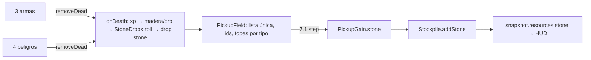

# Design · 0025-stone-resource

> Base: `proposal.md` aprobada (opción A de `exploration.md`) y las 6 specs delta (`resources`, `xp-gems`,
> `simulation-loop`, `sprite-rendering`, `hud`, `asset-provenance`), **contrastadas en la fase tasks** (§13). El
> usuario decidió a favor de este design las dos discrepancias abiertas (1 valor por baja siempre; `rock` en
> `appearance.json` y `source` en el dominio). ADR nueva: `docs/adr/0024-flujo-de-azar-de-sueltas-en-la-siembra.md`.
> API de Phaser: no se usa ninguna nueva. La carga de hojas de un solo frame sigue `LoaderPlugin#spritesheet`
> (consultado con el MCP `phaser-docs`: `/api-documentation/class/loader-loaderplugin.md#instance-spritesheet...`,
> "At a minimum it should have a frameWidth property"); en caso de duda mandan los tipos de `node_modules/phaser`.

## Resumen
`stone` es el **quinto tipo de recogible** de la unión cerrada de ADR-0021, con tope propio `maxStone`, en la misma
lista, secuencia de ids y pool. Al morir un enemigo, un colaborador puro del dominio, **`StoneDrops`**, consume
**exactamente 1 valor** de un **flujo de azar propio** (`STONE_STREAM` 6) y decide si suelta una piedra de valor 1
según el porcentaje entero de su tipo (`resources.drops.stoneChance`). El barril detonado nunca suelta. El flujo viaja
en `RunSeeding` (no en `TerrainSource`), así que existe en todo mapa, también en `?e2e&map=empty`. La piedra suma a
un contador de la partida en `Stockpile` sin bonificaciones, sale en `snapshot.resources.stone` y en el HUD (tercera
fila de contadores), y se pinta con una de tres rocas (`Deco/04`–`06`) elegida por el **tipo de enemigo que la soltó**
en `appearance.json`: solo presentación, sin azar.

**Balance idéntico por construcción**: la piedra no toca `Run.random`, ni los otros flujos, ni la vida, el oro, la XP
o el bot; solo desplaza ids de recogibles posteriores, y nada del lote depende de ids absolutos (§9).

## 1. Piezas por capa

| Capa | Pieza | Nueva/Mod. | Notas |
|---|---|---|---|
| domain | `pickup/PickupKind.ts` | Mod. | `'stone'` en la unión y al final de `PICKUP_KINDS` (orden fijo: `xp, gold, wood, meat, stone`). |
| domain | `pickup/PickupRules.ts` | Mod. | `maxStone` (entero ≥ 1, `MAX_STONE_MUST_BE_INTEGER`), `capacity` = Σ 5 topes, `max('stone')`. |
| domain | `pickup/Pickup.ts`, `PickupField.ts` | Mod. | `Pickup.source: string \| null` (tipo de enemigo que soltó la piedra; `null` en el resto). `drop(kind, x, y, value, attracted = false, source = null)`. `PickupGain.stone`; `counts.stone`. El relleno al tope conserva el `source` del más antiguo. |
| domain | `resource/StoneDrops.ts` | **Nueva** | Colaborador puro con estado (el generador). `roll(typeId, detonated): boolean` (§3). `STONE_PER_DROP = 1` (regla fijada por la propuesta, no contenido). Sin flujo (`null`) nunca suelta y no consume nada. |
| domain | `resource/ResourceRules.ts` | Mod. | `drops.stoneChance?` (opcional en el dominio como `goldPerKill`: ausente = 0 en todos los tipos). `resolveStoneChance` contra el catálogo: entero en [0, 100], exactamente los tipos del catálogo; el error nombra el tipo (`STONE_CHANCE_INVALID`). `stoneChanceFor(typeId)`. |
| domain | `resource/Stockpile.ts` | Mod. | Tercer contador `stone` (constructor `(gold, wood, stone = 0)`), `addStone(n)` sin bonificación. `add(gold, wood, bonus)` no cambia de firma. |
| domain | `run/Run.ts` | Mod. | `Run.start(config, random, setup?, terrain?, stoneRandom?)`. `onDeath` llama a `StoneDrops.roll` tras madera y oro (§3). `collect` suma `gain.stone` con `addStone`. Snapshot `resources.stone`. Comentario del contrato de determinismo ampliado. |
| domain | `run/RunSetup.ts` | Mod. | `resources.stone?` (entero ≥ 0, por defecto 0) para escenarios. `pickups[i].kind` admite `stone` (sin `source`: aspecto por defecto). |
| domain | `run/RunSnapshot.ts`, `snapshotParts.ts` | Mod. | `ResourcesSnapshot.stone`. `PickupSnapshot.source?: string`, **solo** presente en recogibles `stone` con origen (no rompe los `toEqual` de los demás tipos). |
| application | `StartRun.ts`, `RestartRun.ts` | Mod. | `RunSeeding` gana `stoneRandom: RandomGenerator` (obligatorio). `StartRun.execute(config, random, setup?, terrain?, stoneRandom?)`; `RestartRun` lo pasa desde la siembra. Sin casos de uso nuevos. |
| infrastructure | `random/deriveSeed.ts` | Mod. | `STONE_STREAM = 6`. `deriveSeed` no cambia. |
| infrastructure | `content/schemas.ts` | Mod. | `ResourcesSchema.drops.stoneChance` (obligatorio en el fichero, enteros 0..100); `progression.maxStone` (obligatorio). |
| infrastructure | `content/appearanceSchema.ts`, `loadAppearance.ts` | Mod. | `pickups.stone` (§6) y `enemies.<id>.rock`; `pickupAspectsOf` emite las 3 rocas (carga, registro en la nota y reserva gratis). Color de reserva de la piedra en `checkResourceColors`. |
| infrastructure | `phaser/art/looks.ts` | Mod. | `Looks.pickups.stone` (= roca mediana: icono del HUD y aspecto sin origen) y `Looks.stones: StoneLooks` (`of(source)`). |
| infrastructure | `phaser/PickupLayer.ts`, `renderCounts.ts` | Mod. | El hueco guarda el `PickupLook` usado; la piedra toma `stones.of(p.source)`. Sonda `sprites.pickups.stone`. |
| infrastructure | `phaser/ui/uiLayout.ts`, `sceneWidgets.ts`, `Hud.ts`, `GameScene.ts` | Mod. | Tercera fila `stoneY` 70 (×1), `HudTexts.stone`, `hudBoxes.stone`, `Hud.shown.stone`, `hudView().stone`. |
| composition | `seedSource.ts`, `runLauncher.ts`, `main.ts` | Mod. | `seededRun` crea `stoneRandom = Mulberry32(deriveSeed(seed, STONE_STREAM))` **en los dos modos** (antes de la rama `empty`). `runLauncher` lo pasa. Sonda `hud.stone`. |
| content | `resources.json`, `progression.json`, `appearance.json`, `asset-provenance.json` | Mod. | §5 y §6. `enemies.json`, `waves.json`, `weapons.json`, `upgrades.json`, `player.json`, `structures.json`, `sheep.json`, `shop.json` **no** cambian. |
| public | `assets/tiny-swords/Deco/04.png`, `05.png`, `06.png` | Nuevos | Copiados del pack local Update 010 (§7). |
| tests/support | `runs.ts`, `builders.ts`, `balanceMeasure.ts`, `stoneGolden.ts` (nuevo), `combat-content.test.ts` | Mod. | §9 y §10. |

**Por qué en esta capa.** Tirar el dado, soltar, recoger y contar son simulación: núcleo puro (ADR-0002). Elegir la
roca es presentación: vive en `appearance.json` (infraestructura) y el núcleo solo publica el **hecho** "esta piedra
la soltó un `goblin-tnt`". Solo la composición conoce `Mulberry32` y el número de flujo. **Sin puertos nuevos**: el
flujo de la piedra es otro `RandomGenerator`.

**Por qué `StoneDrops` y no código en `Run.onDeath`.** `Run.ts` ya pasa de 550 líneas. El colaborador encapsula el
generador, la regla de consumo y la comparación entera, y se prueba en rojo sin montar una partida (tablas de
probabilidad 0/100, barril detonado, sin flujo). `onDeath` solo añade dos líneas.

## 2. Flujo de azar `STONE_STREAM` 6 (ADR-0024)

- **Dónde viaja**: `RunSeeding = { random, terrain, stoneRandom }`. `seededRun(seed, mode)` crea
  `new Mulberry32RandomGenerator(deriveSeed(seed, STONE_STREAM))` **antes** de mirar el modo, así que existe con el mapa
  generado, con `map=empty` (`OPEN_TERRAIN`) y en cada reinicio (`restartRandoms` → `seededRun`).
- **Por qué no en `TerrainSource`** (patrón de ADR-0022): no es azar del terreno y no existiría en `open`/`cells` sin
  declararlo aparte; los E2E usan `map=empty` por defecto y no verían piedras.
- **Valor por defecto seguro**: `Run.start`/`StartRun.execute` reciben `stoneRandom` como **parámetro opcional**.
  Sin él, `StoneDrops` no tiene generador: **nunca suelta piedra y no consume nada**, sea cual sea `stoneChance`. Así
  los ~110 sitios de los tests que montan la partida a mano (`Run.start(config, random, setup, terrain)`) no cambian
  de comportamiento ni con el contenido real. Los escenarios que prueban la piedra pasan un generador explícito
  (`SequenceRandom`/`Mulberry32` de los tests) o usan `startSeededRun`.
- `RunSeeding.stoneRandom` es **obligatorio**: la composición siempre lo da y el compilador obliga a quien construya
  una siembra a mano (p. ej. `restart-run.test.ts`) a decidirlo.
- **No consume** `Run.random`, ni los flujos 1–5. Por eso `MAP_GOLDEN`, `STRUCTURE_GOLDEN`, `RESOURCE_GOLDEN`,
  `SHEEP_GOLDEN`, oleadas y ofertas no cambian (lo vigilan sus tests actuales, que pasan por `startSeededRun`).

## 3. Tirada por baja

`Run.onDeath(dead)` (único punto por el que pasan todas las bajas: paso 3 tras las armas y paso 4.2 tras las
explosiones, en orden de lista):

```
1. xp (siempre)
2. si !detonated: madera (si el tipo la suelta) y oro por baja (si el tipo lo suelta)   ← sin cambios
3. si stones.roll(type.id, dead.detonated): drop('stone', x, y, STONE_PER_DROP, false, type.id)
4. post?.release()
```

`StoneDrops.roll(typeId, detonated)`:
- Sin generador → `false` (sin consumo).
- Con generador → `r = ⌊next() × 100⌋` (entero en 0..99) **siempre**, y devuelve `!detonated && r < chance(typeId)`.
  Con 0 nunca suelta; con 100 siempre (salvo detonado). Comparación entera: sin coma flotante en el contenido.

**Consumo: 1 valor por baja, siempre** (también con probabilidad 0 y con el barril detonado). Justificación por
determinismo: el valor k del flujo pertenece a la k-ésima baja procesada. La posición en el flujo depende solo de la
secuencia de bajas, que es la misma que la línea base. Cambiar la probabilidad de un tipo (o que un barril detone en
lugar de morir por armas) cambia solo **si** esa baja suelta, no las tiradas de las bajas siguientes. Con la
alternativa "1 valor solo si p > 0 y no detonado", subir un tipo de 0 a 5 % desplazaría todas las tiradas
posteriores de los demás tipos y movería la firma dorada entera. El coste (un `next()` por baja, ~900 bajas por
partida) es despreciable. *(Si la spec fija otra regla, manda la spec: el cambio es una línea en `roll` y la firma.)*

La posición de la piedra es la del enemigo, recolocada con `nearestWalkable` como cualquier recogible. Con el tope
lleno suma 1 al valor de la piedra más antigua (que conserva su `source` y, por tanto, su roca).

## 4. Recogida, contador y snapshot

- Paso 7.1: la misma pasada única de `PickupField.step` (sin distinguir tipo) deja `gain.stone`; `collect` hace
  `this.stock.addStone(gain.stone)`. **Sin** `goldBonusPercent` ni ninguna otra mejora.
- `snapshot.resources = { gold, wood, stone }`. La piedra no entra en `RecordRun`, resultados, récords, historial ni
  export: esas piezas leen `outcome`, `tick`, `kills`, nivel… y no `resources` (ningún cambio en `src/domain/progress`
  ni en el formato de ADR-0010).
- `PickupSnapshot.source` solo en piedras. `gems` (vista obsoleta de `xp`) no cambia.

## 5. Contenido (valores propuestos, sin medición previa)

`content/resources.json` → `drops.stoneChance` (porcentaje entero, tabla completa del catálogo):

| Tipo | `stoneChance` | Roca (`appearance.json`) | Por qué |
|---|---|---|---|
| `goblin-torch` | 10 | `small` (`Deco/04`) | El más numeroso: goteo constante. |
| `goblin-tnt` | 15 | `medium` (`Deco/05`) | Más peligroso, algo más de premio. |
| `goblin-barrel` | 5 | `small` (`Deco/04`) | Ya suelta madera; muchos detonan y no tiran. |
| `goblin-tnt-guard` | 25 | `large` (`Deco/06`) | Guardia de casa: premio por limpiar campamentos. |

`content/progression.json` → `"maxStone": 32` (como `maxGold`). Capacidad del pool: 404 → **436** registros/sprites.

Estimación orientativa: con ~850 bajas por partida ganada del bot y mayoría de `goblin-torch`, unas 80–110 piedras
caídas por partida. 0026 fijará precios con la media real que informa `verify` (§9); estos números no son gate.

## 6. Aspecto (`appearance.json`) y render

Esquema nuevo (estricto):

```json
"pickups": {
  "stone": {
    "placeholderColor": "#9aa0a6",
    "rocks": {
      "small":  { "sheet": { "file": "Deco/04.png", "frameWidth": 64, "frameHeight": 64 }, "scale": 0.5,
                  "origin": { "x": 0.5, "y": 0.5 }, "facing": "right",
                  "idle": { "frames": [0], "fps": 1, "loop": true } },
      "medium": { "...": "Deco/05.png, mismo formato" },
      "large":  { "...": "Deco/06.png, mismo formato" }
    }
  }
},
"enemies": { "goblin-torch": { "...": "...", "rock": "small" } }
```

- `RockAspectSchema` = `StillSchema` sin `placeholderColor` (un único color de reserva para la piedra). Las tres
  claves `small`/`medium`/`large` son obligatorias. **No hace falta un esquema especial para hojas de 64 × 64 sin
  animación**: `SheetSchema` ya admite cualquier tamaño de frame y la "animación" es `idle` con `[0]` (como el oro).
- `EnemyAspectSchema.rock: z.enum(['small', 'medium', 'large'])` **obligatorio**. La completitud por tipo sale gratis
  de `checkAppearanceRefs` (los tipos con aspecto son exactamente los de `enemies.json`).
- `pickupAspectsOf` emite `[['pickups','stone','rocks',size], { ...rock, placeholderColor }]` para las tres: la carga
  (`bootPlan`), la comprobación "hoja registrada en la nota de procedencia" y la reserva por hoja que no carga
  (`base()` de `looks.ts`) funcionan sin código nuevo. `XP_SHEET_MUST_DIFFER` incluye las tres rocas.
- `checkResourceColors`: el color de la piedra se añade al final de la lista (tras la oveja), distinto de todos.
- `looks.ts`: `Looks.stones: StoneLooks = { rocks: Record<RockSize, PickupLook>; of(source: string | undefined):
  PickupLook }` (tipo desconocido o sin origen → `medium`). `Looks.pickups.stone = rocks.medium`.
- `PickupLayer`: el hueco guarda `look: PickupLook` además de `kind`; al aparecer, `look = kind === 'stone' ?
  stones.of(p.source) : looks[kind]`. El recuento de reserva usa el `look` del hueco (cada roca puede caer a reserva
  por separado). `counts.stone`. Sin objetos nuevos por frame: el pool sigue siendo de `capacity` sprites creados al
  montar la capa.
- Sonda: `sprites.pickups.stone = { visible, placeholder }` (`renderCounts`).
- **HUD**: `HUD_BASE.stoneY = 70` (filas 16/34/52/70 a ×1; 140 + mitad de icono a ×2, muy por debajo del alto mínimo
  del lienzo). `hudLayout(...).stone = counterAt(frame, stoneY × k)`; icono `counterIcon(looks.pickups.stone)`;
  `HudTexts.stone`, `hudBoxes.stone`. `Hud.shown = { gold, wood, stone }`, `GameScene.hudView()` y la sonda
  `window.__sprint.hud` ganan `stone`.

## 7. Assets y procedencia

- Copiar `C:\Users\Adri\TFM\Tiny Swords (Update 010)\Deco\04.png`, `05.png`, `06.png` a
  `public/assets/tiny-swords/Deco/` (mismo nombre).
- Tres entradas en `content/asset-provenance.json`: `path` `public/assets/tiny-swords/Deco/0N.png`, `source`
  `Tiny Swords (Update 010)/Deco/0N.png`, `version` `Update 010`, `sha256` y `bytes` **medidos en apply** sobre el
  fichero copiado (no del Free Pack: el guardarraíl lo rechaza por origen).
- **Verificar en apply** el tamaño real y el número de frames de cada hoja (la vista previa de `05.png` es una roca
  suelta en 64 × 64, un frame). Si alguna difiere, se corrigen `frameWidth`/`frameHeight`/`scale` en
  `appearance.json`; el design no cambia. Licencia: la CC0 de Update 010 ya registrada (ADR-0012).

## 8. Flujo de un tick (lo que cambia)



Ningún otro paso cambia de orden ni de consumo de azar.

## 9. Balance idéntico: cómo se comprueba

1. **Por construcción**: la piedra no consume `Run.random` ni los flujos 1–5; no cura, no da XP ni oro; las armas no
   la apuntan; el bot de referencia no lee recogibles. El tope y el relleno son por tipo, así que una piedra nunca
   ocupa plaza ni recibe valor de otro tipo. Lo único que cambia para los demás recogibles es su **id**.
2. **`tests/support/runs.ts`**: `startSeededRun` pasa `stoneRandom` de `seededRun`. Así el lote de balance (bot v4,
   semillas 1..50) y los quietos **se juegan con piedra**, y el test existente compara con `BALANCE_BASELINE`
   (resultado, tick final y bajas) semilla a semilla: debe seguir **30/50** y 0 quietos sin tocar la línea base.
3. **`balanceMeasure`** no depende de ids absolutos ni contiguos: usa `lastPickup` como marca creciente (`id >
   último`) y filtra `kind === 'gold'`, así que el oro soltado por bajas/estructuras sale igual. Se añade a
   `EconomyTrace` (o a una traza aparte) `stonesDropped` y `stoneCollected` por partida, **informativos**; `verify`
   informa la media.
4. **Test de invariancia directa** (rápido, sin lote): para 1–2 semillas y el bot v4 durante N ticks, la partida con
   `stoneRandom` y sin él da la misma secuencia de snapshots salvo `resources.stone`, los recogibles `stone` y los
   ids de recogibles (comparar por `kind, value, x, y` en orden).
5. **Huellas de contenido** (`combat-content.test.ts`): `COMBAT_CONTENT_SHA256` no cambia (no toca `enemies.json` ni
   los campos de XP de `progression`). `BALANCE_CONTENT_SHA256.resources` y `.progression` se calculan **sin
   `drops.stoneChance` y sin `maxStone`** (proyección explícita en el test), de modo que las constantes de 0024 **no
   se reescriben** y siguen probando que el resto del fichero está intacto. La proyección `INTACT_SHA256.resources`
   (sin `drops`) tampoco cambia.

## 10. Firma dorada `STONE_GOLDEN`

`tests/support/stoneGolden.ts`: para las semillas **42 y 123**, mapa generado, `startSeededRun`, jugador quieto y
política de elección fija (opción 0) durante **3.600 ticks** (o hasta el final), la lista de las primeras **12**
piedras soltadas como `<id>@<tick>:<source>:<round(x)>,<round(y)>` (orden de aparición en `pickups`; **con id**, como
exige la spec `simulation-loop`, "Azar de la piedra") más el total de piedras soltadas y `resources.stone` al final.
Se regenera solo si cambian `stoneChance`, `STONE_STREAM`, la regla de consumo o la secuencia de ids de recogibles. Junto a ella, las firmas
`MAP_`, `STRUCTURE_`, `RESOURCE_` y `SHEEP_GOLDEN` siguen pasando sin cambios.

## 11. Rendimiento

| Coste | Antes | Después | Presupuesto |
|---|---|---|---|
| Por baja | — | 1 `next()` + 1 comparación entera | despreciable |
| `PickupField.step` | O(recogibles activos) | igual; ≤ 32 piedras más en el suelo | M1 ≤ 0,3 ms/tick |
| Pool del núcleo | 404 registros | 436 (al crear la partida) | 0 asignaciones por tick |
| Pool de sprites | 404 | 436 (al montar la capa) | 0 objetos del motor por frame |

Se amplía el bench existente de topes llenos (`tests/bench/run.bench.ts`) a **cinco topes**; se informa el valor
frente a 0,27 ms (0022) y el tiempo del lote de balance frente a 0024 (~35 s local). No bloquea CI.

## 12. Seguridad y datos persistidos

Sin dependencias nuevas. Sin cambios en `localStorage`, formato de progreso (ADR-0010), export/import ni CSP. La
piedra es estado de la partida y se pierde al terminar. Los tres PNG son CC0 con procedencia registrada y el
guardarraíl (`guard-assets.mjs`) los vigila.

## 13. Contraste con las specs delta (fase tasks)

Coinciden con el design: regla de consumo (1 valor por **toda** baja, también p = 0 y detonado; `⌊u × 100⌋ < p`),
orden xp → madera → oro → tirada → piedra en los pasos 3.3 y 4.2, `source` solo en piedras, relleno que conserva el
origen, flujo en todo mapa, `drops.stoneChance` entero 0..100 con tabla completa, `maxStone` entero ≥ 1, valor 1 no
configurable (`stonePerDrop` falla por estricto), `resources.stone`, `sprites.pickups.stone` (`visible`/`placeholder`,
suma de las tres rocas), `hud.stone`, rocas `small`/`medium`/`large` en `Deco/04`–`06`, `rock` obligatorio en el
aspecto de cada enemigo, reserva `medium` sin origen u origen sin aspecto, icono del HUD siempre `medium`.

Ajustes que imponen las specs:
- **Firma dorada con id** (§10 corregido).
- **Partida de escenario sin azar de la piedra** = el parámetro opcional ausente (§2): la spec la usa como convención
  para los escenarios vivos ("se leen sin piedra"). Los escenarios nuevos que cuentan "valores consumidos" usan un
  doble `CountingRandom` (envoltorio que cuenta `next()`) en `tests/support/`.
- **Reserva de una roca**: forma del color de `stone` de **10 px** (`2 × gemRadius`), la regla actual de
  `PaintedSprite.look(look, radius)` para la reserva; nada nuevo.
- **"Cada roca cabe en la hoja versionada"**: test de contenido que lee ancho y alto de la cabecera PNG (IHDR) de los
  tres ficheros y comprueba `frameWidth ≤ ancho` y `frameHeight ≤ alto`.
- **Rendimiento**: el bench es "cinco topes llenos + 300 enemigos + 32 proyectiles + ovejas en huida", ≤ 2 ms gate
  informativo y objetivo ≤ 0,25 ms anotado en el verify-report frente a 0,27 ms (0022).
- **E2E**: la spec `hud` pide "el mismo recorrido que Contadores en el navegador": se **amplía ese test de
  `gameplay.spec`** (seed 42, mapa real, manual), que ya compara `hud` con el snapshot tras cada `step`, con `stone` y
  `sprites.pickups.stone.visible`. En `smoke.spec` solo cambia mecánicamente la expectativa `{ gold: '0', wood: '0' }`
  (no es un E2E nuevo).
- **Balance**: el verify-report anota piedra media **soltada y recogida** por partida (`balanceMeasure`).
- **Orden de grupos**: añadir `'stone'` a la unión obliga a tocar registros exhaustivos de infraestructura
  (`Looks.pickups`, `PickupLayer.counts`, `renderCounts`) y el esquema de progresión, así que el aspecto de la piedra
  (assets, esquema, `looks.stones`) va **antes** del grupo de la unión para que cada grupo cierre con `verify` en
  verde (ver `tasks.md`).

Criterios de éxito de `proposal.md` frente a las specs: todos tienen requisito y escenario (determinismo y firma →
`simulation-loop`; probabilidad 0/100/detonado/validación → `resources`; tope → `xp-gems`; balance idéntico y quietos
→ `resources` "Balance idéntico con la piedra"; persistencia → `resources` "Sin rastro en resultados ni en el
guardado"; procedencia → `asset-provenance`). Sin huecos.
