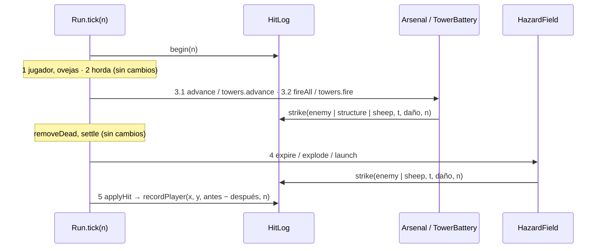

# Design · 0031-combat-feedback

## Resumen
El núcleo gana un **registro de golpes** (`HitLog`, dominio) propiedad de `Run`: un anillo preasignado por el que pasa
todo el daño que hoy se aplica (`Arsenal`, `TowerBattery`, `HazardField` y `Run.applyHit`). Anota el **daño aplicado**
(vida antes − vida después), sumado por objetivo y tick, con un id de una secuencia propia y un tope por tick. El
snapshot expone los golpes de los últimos `hitWindowTicks` ticks (`hits`) y la vida máxima de cada estructura
(`maxHealth`). El render pinta un número por golpe nuevo (deduplicado por id) en un pool de 48 `Text` y una barra sobre
cada casa y torre goblin intacta en un `Graphics`. Ventana y tope van en el contenido nuevo `content/combat.json`
(15 y 48). Colores y medidas van en el bloque `combat` de `content/appearance.json`. Registrar no consume azar ni
cambia el orden del tick: `BALANCE_BASELINE` y las seis firmas no cambian.

> **Revisión tras las specs delta** (`simulation-loop`, `goblin-structures`, `auto-weapons`, `sprite-rendering`):
> - tope **48**, no 32;
> - `targetId` en cada golpe, salvo en `player`;
> - el número nace con el reloj del **frame** en que se crea, sin desfase por tick;
> - movimiento y opacidad **lineales** con elevación E;
> - datos de aspecto de la spec, sin trazo ni alfa de barra;
> - sonda `damageNumbers.{enemy,structure,sheep,player,created}` y `healthBars`;
> - relleno de la barra **sin redondeo**;
> - **1 solo E2E**.
>
> Ver «Contraste con las specs» al final.

## Piezas por capa
| Capa | Pieza | Nueva/Mod. | Notas |
|---|---|---|---|
| domain | `combat/HitKind.ts` | **Nueva** | `type HitKind = 'enemy' \| 'structure' \| 'sheep' \| 'player'`. |
| domain | `combat/CombatRules.ts` | **Nueva** | VO `hitWindowTicks` y `maxHitsPerTick`, enteros ≥ 1 (`create` → `Result`). |
| domain | `combat/HitLog.ts` | **Nueva** | Anillo de `HitRecord`, con `begin`, `strike`, `recordPlayer` y la ventana (D1). |
| domain | `weapon/WeaponTarget.ts` | Mod. | Gana `readonly id` y `readonly hp`. `Enemy`, `Structure` y `Sheep` ya los tienen. Los dobles de `tests/support/weapons.ts` ganan `id`. |
| domain | `weapon/Arsenal.ts`, `weapon/TowerBattery.ts`, `hazard/HazardField.ts` | Mod. | Reciben el `HitLog` en el constructor (desactivado por defecto). Sus 6 `takeDamage` pasan a `log.strike(kind, …)` (D3). |
| domain | `run/RunConfig.ts` | Mod. | `RunConfig.combat: CombatConfig`, `RunRules.combat: CombatRules` y validación en `buildRunRules`. |
| domain | `run/Run.ts` | Mod. | Crea el `HitLog` y lo inyecta. `begin(n)` en cada tick que corre, `recordPlayer` en `applyHit` y snapshot `hits` con caché (D2, D4). |
| domain | `run/RunSnapshot.ts`, `run/snapshotParts.ts` | Mod. | `HitSnapshot`, `RunSnapshotBody.hits` y `StructureSnapshot.maxHealth` (= `site.type.health`). |
| application | `FixedStepLoop.ts` | Mod. | Exporta `MAX_TICKS_PER_FRAME` (= `MAX_FRAME_MS × TICKS_PER_SECOND / 1000` = 15). Solo una constante. |
| infrastructure (contenido) | `schemas.ts`, `loadRunConfig.ts` | Mod. | `CombatSchema` (estricto) y `combat` en `RunConfigSchema`, `RawContentFiles` y `repositoryContent` (D5). |
| infrastructure (contenido) | `appearanceSchema.ts` | Mod. | Bloque raíz `combat` obligatorio, con `numbers` y `bar` (D6). |
| infrastructure (render puro) | `art/combatFeedback.ts` | **Nueva** | `numberPose(age, spec)`, `newHits(hits, lastId, pool)`, `damageText` y `barRects`. Sin motor. |
| infrastructure (motor) | `DamageNumberLayer.ts` | **Nueva** | Pool de P `TextLike` en anillo, deduplicación por id y recuentos (D7). |
| infrastructure (motor) | `HealthBarLayer.ts` | **Nueva** | Un `BarCanvas` (`Graphics`) que se redibuja al cambiar la clave de vidas (D8). |
| infrastructure (motor) | `RenderLayers.ts`, `GroundView.ts`, `renderCounts.ts`, `GameScene.ts` | Mod. | `createFeedback()` justo después de `createHazards()`. `render`/`clear` las llaman. Sondas y fábricas `this.add.text`/`this.add.graphics`. |
| composition | cableado de capacidades/aspecto | Mod. | Pasa `appearance.combat` a las capas. |
| contenido | `content/combat.json` | **Nueva** | `{ "hitWindowTicks": 15, "maxHitsPerTick": 48 }`. |
| contenido | `content/appearance.json` | Mod. | Bloque `combat` (D6). Sin hojas nuevas ni cambios en `asset-provenance.json`. |
| tests/support | `builders.ts` | Mod. | `CONTENT_COMBAT` (de `content/combat.json`, una sola fuente) y `withCombat(config, combat)`. |
| tests/e2e | `probe.ts`, `gameplay.spec.ts` | Mod. | Tipos de la sonda y un test de humo ampliado en manual (D9). |

**Por qué en estas capas.** Los golpes son hechos de la simulación. Solo el núcleo sabe cuánto daño se aplicó tras
`armor`, el mínimo 1 y el recorte, y solo él ve el golpe letal antes de que `removeDead` retire al enemigo. Derivarlo
en render por diferencias de `health` perdería el golpe letal y mezclaría la curación (ADR-0027). El número, su
movimiento y la barra son presentación: van en infraestructura, con el reloj de render y sin reglas (ADR-0002). La
ventana y el tope son contrato del snapshot y van en contenido de juego. Pool, colores y medidas son aspecto. No se
crea ningún puerto: `HitLog` es una clase concreta con una sola implementación.

## D1 · `HitLog`
```ts
// src/domain/combat/HitLog.ts (forma orientativa)
class HitRecord { id = -1; tick = 0; kind: HitKind = 'enemy'; targetId = -1; x = 0; y = 0; amount = 0;
                  target: WeaponTarget | null = null; view: HitSnapshot | null = null; }
export class HitLog {
  constructor(rules: CombatRules)        // capacidad = hitWindowTicks × (maxHitsPerTick + 1)
  static disabled(): HitLog              // aplica el daño y no anota (por defecto fuera de Run)
  begin(n: number): void                 // abre el tick n
  strike(kind: Exclude<HitKind, 'player'>, t: WeaponTarget, amount: number, n: number): boolean
  recordPlayer(x: number, y: number, amount: number, n: number): void
  forWindow(k: number, visit: (r: HitRecord) => void): void   // tick > k − N, por id
  get nextId(): number
}
```
- **`strike`** es el único punto de daño de armas y explosiones. Hace `before = t.hp`, luego
  `killed = t.takeDamage(amount, n)` y `applied = before − t.hp`, y devuelve `killed`. Con `applied === 0` no anota
  nada: objetivo ya a 0 en el tick, ruina. Así el golpe letal anota lo que quedaba (10 sobre vida 4 → 4), y un pulso
  sobre un enemigo abatido en 3.1 no suma.
- **Suma por objetivo y tick**: busca en los registros del tick (de `tickStart` al final) uno con el mismo objeto
  `target`, comparando referencias, y le suma `applied`. Posición e id son los del primer impacto. En los pasos 3 a 5
  nada se mueve, ni hay reaparición de ovejas antes de 9.2.
- **Tope**: como mucho `maxHitsPerTick` registros de no jugador por tick. Con el tope lleno, un objetivo nuevo **no**
  crea registro ni consume id, pero el daño se aplica igual. Un objetivo con registro sigue sumando. El jugador va
  **fuera del tope**, en una plaza reservada: como mucho 1 golpe por tick, en el paso 5.
- **Ids**: `nextId` desde 0 en cada `Run`, asignado al crear el registro. Orden de registro = orden del tick:
  - 3.1: proyectiles del jugador y después flechas de torre;
  - 3.2: pulsos (enemigos → estructuras → ovejas);
  - 4: explosiones (enemigos → ovejas);
  - 5: jugador.
- **Anillo**: `N × (M + 1)` = 15 × 49 = 735 registros preasignados. Un tick usa ≤ M + 1, así que un registro solo se
  reutiliza cuando su tick ya está fuera de cualquier ventana futura. Al reutilizarlo se borran `target` y `view`.
  Cero asignaciones por golpe.
- **Fuera del registro**: el barril que explota por su mecha (`explode()`, no es daño) y las curaciones de cualquier
  tipo. El jugador invulnerable no llega a `applyHit`.
- La cota "ventana ≥ 15" es del bucle, así que la pone zod (D5). El dominio solo exige enteros ≥ 1.

## D2 · Integración en el tick (orden intacto)

- `begin(n)` va justo después de la guarda `status !== 'running'`. Un tick que no corre no abre nada.
- En `Arsenal`, el tier da la clase con la constante `RESERVE_KINDS = ['structure', 'sheep']`: tier 0 es `enemy`,
  tier 1 `structure` y tier 2 `sheep`. `TowerBattery` siempre anota `enemy`. `HazardField.strike` anota `enemy` y
  `sheep`.
- `applyHit`: `before = player.health.current`. Tras `player.hit(damage, n)`, anota `before − current` en la posición
  del tick, con `armor`, mínimo 1 y recorte ya aplicados (armadura 3 y golpe 2 → 1; vida 5 y explosión 25 → 5).
- Nada lee ni escribe azar. `strike` devuelve el mismo booleano que `takeDamage`, así que bajas, gemas, piedra
  (1 valor de `STONE_STREAM` por baja) y ruinas no cambian.

## D3 · Cambios en las firmas
- `WeaponTarget`: `+ readonly id: number` y `+ readonly hp: number`. `HazardField` sigue recibiendo `Enemy[]`.
- Los constructores ganan un `log = HitLog.disabled()` final: `Arsenal(loadout, pulseCapacity, log)`,
  `TowerBattery(rules, sites, log)` y `HazardField(rules, initial = [], log)`.
- `Structure.takeDamage(amount)` no cambia.

## D4 · Snapshot
```ts
export interface HitSnapshot {
  readonly id: number;
  readonly tick: number;
  readonly kind: HitKind;
  readonly targetId?: number;  // enemigo, estructura u oveja; ausente en 'player'
  readonly x: number;
  readonly y: number;
  readonly amount: number;     // entero ≥ 1, suma de lo aplicado en el tick
}
// RunSnapshotBody.hits: readonly HitSnapshot[]  — ticks k − N + 1 … k, orden de id, [] en k = 0
// StructureSnapshot.maxHealth: number           — site.type.health (casa 60, torre 90; la declarada en escenarios)
```
- **Caché**: cada registro guarda su `HitSnapshot` congelado (`view`), creado una vez. El registro ya está cerrado,
  porque `snapshot()` nunca se llama a mitad de tick. El array congelado se rehace solo si cambia `(k, nextId)`. En
  tienda, oferta, obra, pausa y fin, la misma lista de golpes.
- La vida de `RunSetup.structures` sigue acotada a `type.health`, así que `maxHealth = site.type.health` cumple
  «vida con la que se crea» y la torre 63/90.

## D5 · `content/combat.json`
`{ "hitWindowTicks": 15, "maxHitsPerTick": 48 }`, con
`CombatSchema = z.strictObject({ hitWindowTicks: int ≥ MAX_TICKS_PER_FRAME, maxHitsPerTick: int ≥ 1 })`. Infraestructura
importa la constante de aplicación. Los mensajes son constantes exportadas y la ruta nombra el campo. 15 es el máximo de
ticks por frame a velocidad 1. Con `speed` > 1, o con `step(n)` y n > 15, se pierden números y se acepta.

## D6 · `appearance.json` → `combat`
```jsonc
"combat": {
  "colors": { "enemy": "#ffffff", "structure": "#ffd166", "sheep": "#9be7ff", "player": "#ff3b30" },
  "numbers": { "durationMs": 800, "risePx": 32, "liftPx": 20, "fontPx": 16, "pool": 48 },
  "bar": { "width": 48, "height": 6, "gap": 8, "fill": "#e63946", "back": "#1d1d1d" }
}
```
- `strictObject` en todos los niveles: un campo extra (`font`) da error con su nombre.
- `colors` usa `Hex` (`#RRGGBB`). Un `superRefine` exige los cuatro colores distintos dos a dos (el error nombra la
  clase repetida, la última en el orden enemy, structure, sheep, player) y `player` rojo: R ≥ 192, G ≤ 80 y B ≤ 80
  (el error nombra `player`).
- `durationMs`, `fontPx` y `pool` son enteros, con mínimos 1, 8 y 1. `risePx`, `liftPx` y `gap` son ≥ 0. `width` y
  `height` son enteros ≥ 1.
- `fill` debe ser distinto de `back`, y el error nombra `fill`.
- No tiene hojas: no pasa por `bootPlan` ni por la nota de procedencia.
- Los nombres de campo son de este design (la spec describe el significado). El verifier contrasta los valores.

## D7 · `DamageNumberLayer` y `art/combatFeedback.ts`
- **Costura `TextLike`**: `setText`, `setPosition`, `setAlpha`, `setTint`, `setVisible` y `setOrigin(0.5, 0.5)`.
  Los P objetos los crea una vez la escena con `this.add.text(0, 0, '', { fontSize: fontPx px, color: '#ffffff' })`.
- **Color por tinte**: el relleno es blanco y `setTint` le da el color de la clase. No regenera la textura, a
  diferencia de `setColor`. Al ocupar un hueco: un `setText(damageText(amount))` (`String(amount)`, entero ≥ 1) y un
  `setTint`. Por frame, solo `setPosition`/`setAlpha` de los visibles y `setVisible` al cambiar. Plan B (R3):
  `setColor` al ocupar.
- **Deduplicación**: los ids crecen con el orden del snapshot, así que basta `lastId`. Es nuevo todo golpe con
  `id > lastId`, y un re-render no crea nada. `newHits` devuelve los P de id más alto si llegan más de P; los saltados
  avanzan `lastId` y no cuentan en `created`.
- **Reciclado**: los huecos forman un anillo con un puntero `next` y se ocupan en orden de id. Todos duran L desde su
  R_b y los R_b no decrecen, así que `next` es libre o es el vivo de menor id.
- **Pose**: `R_b` = reloj de render del frame que lo crea y `a = R − R_b`. Se ve si 0 ≤ a < L, en
  `(x, y − E − H·a/L)` con alfa `1 − a/L` (`numberPose`). En manual, `step(n)` avanza el reloj n × TICK_MS antes del
  render: a 500 ms el alfa es 0,375 y a 800 ms ya no se ve. El reloj congelado (pausa, `status ≠ running`) los deja
  quietos sin código nuevo. Coordenadas de mundo, `scrollFactor` 1 y sin recorte.
- **Recuentos** (`counts.damageNumbers`): visibles por clase y `created`. `clear()` (R, menú) oculta todo y pone
  `lastId = −1` y los recuentos a 0.

## D8 · `HealthBarLayer`
- Un `BarCanvas` (`clear`, `fillStyle`, `fillRect`, lo cumple `Graphics`) creado **antes** que los números.
- La clave de cada frame se forma con `health`/`destroyed` de cada estructura y solo al cambiar se redibuja (el
  resultado es el mismo que redibujar en cada frame). Para cada intacta, `barRects(s, bar, cellSize)`:
  - fondo de x `s.x − w/2` a `s.x + w/2`, con el borde inferior en `row × cellSize − gap`;
  - relleno alineado a la izquierda, de ancho `w × health / maxHealth` **sin redondeo** (63/90 → 33,6 px).
  - Ejemplo de la casa de prueba: el fondo va de (1.236, 586) a (1.284, 592) y el relleno de (1.236, 586) a
    (1.260, 592).
- Una ruina no se dibuja, y la reserva del arte no afecta. `cellSize` llega en `paintMap`.
- `counts.healthBars` = barras dibujadas.
- Fuera del plan del mapa y de `MapCuller`: los objetos siguen en 820/904 y `drawn` no cambia.

## D9 · Capas, sonda y E2E
- **Capa (9)**: `createPlayfield` llama a `createHazards()` y luego a `createFeedback()` (barras y después números).
  Queda sobre las entidades, la capa alta del mapa y los peligros, y bajo el HUD (`HUD_DEPTH` 100) y los overlays.
- **Sonda** `window.__sprint.sprites`:
  - `damageNumbers: { enemy, structure, sheep, player, created }`;
  - `healthBars: number`;
  - en el menú y tras `clear()`, todo a 0.
- **E2E: 1**, el escenario «Números de daño en el navegador», ampliando un test de humo de `gameplay.spec.ts` con
  `?e2e&manual&map=empty&seed=7`: `step(1)` hasta el primer golpe `enemy`, pausa 30 frames, `step(60)` y Volver al
  menú. Cubre de paso que la sonda queda a 0 en el menú. El resto (barras, recuentos coherentes con seed 42, R, capas
  y cámara) va en tests de infraestructura sin navegador con dobles del motor y snapshots reales de `Run`.

## Dependencias nuevas
| Paquete | Versión exacta | Motivo | Alternativa descartada |
|---|---|---|---|
| — | — | Ninguna: `Text`, `Graphics` y el tinte de Phaser 4.2.1 ya instalado. | Fuente bitmap o arte del pack (procedencia, fuera de alcance). |

## Rendimiento y seguridad
- **Tick**: por golpe, una lectura de `hp` y una consulta a un `Map` del tick (objetivo → registro), vaciado al
  empezar cada tick. *Desviación en apply (D1)*: el design preveía una búsqueda lineal de ≤ 49 registros, pero
  medida subía el tick +12–16 % (cada golpe descartado con el tope lleno recorría los 48 registros); con el `Map`
  queda en el ruido (0,047 frente a 0,048 ms y 0,235 frente a 0,233 ms). `HitRecord` ya no guarda el objetivo. El
  `Map` solo se consulta por clave, nunca se itera, así que el orden y el determinismo no cambian.
- **Snapshot** (por frame, y por tick en el lote del bot con invariantes): ≤ 735 referencias, decenas en lo típico,
  y una vista congelada por registro una sola vez. Estimación: **≤ +3 %** en el lote. Se **mide** en la tarea 6.1
  (bench antes/después y tiempo real del test de balance). Si supera +5 %, la mitigación es la caché perezosa por
  clave, que ya está, y no construir `hits` en las invariantes.
- **Render**: P = 48 `Text` creados una vez, `setText` solo al ocupar y ≤ 48 `setPosition`/`setAlpha` por frame. Un
  `Graphics` redibujado solo al cambiar la vida de una estructura. Ningún objeto del motor por frame.
- **Determinismo**: sin azar ni reloj. Mismos golpes por semilla y entradas. Otra ventana u otro tope solo cambian
  `hits`. `BALANCE_BASELINE`, `BUILDER_REFERENCE` y las seis `*_GOLDEN` intactas.
- **Datos**: nada persistido nuevo. `combat.json` y el bloque de aspecto son contenido versionado validado con zod.

## Riesgos
- **R1, igualdades estrictas** de `StructureSnapshot` o del snapshot entero (`toEqual`) se rompen con
  `maxHealth`/`hits`/`targetId`. Es esperado: se ajustan sin regenerar firmas.
- **R2, configuraciones literales** de `RunConfig` en tests: añadir `combat: CONTENT_COMBAT`.
- **R3, tinte de `Text`**: los tipos 4.2.1 declaran `Components.Tint` en `Text`, pero no está probado en navegador.
  El plan B es `setColor` al ocupar el hueco.
- **R4, golpe del jugador fuera del tope**: coincide con la spec y está pendiente de confirmar por el autor. Si
  cambia, la capacidad pasa a `N × M` y el resto no cambia.

## Contraste con las specs (2026-11-26)
| Punto | Design inicial | Spec | Ajuste |
|---|---|---|---|
| Tope por tick | 32 | 48 | 48 |
| Id del objetivo | no | sí, salvo `player` | `targetId` (+ `id` en `WeaponTarget`) |
| Nacimiento del número | desfase por tick | reloj del frame que lo crea | `R_b` = reloj del frame |
| Pose | `alpha = min(1, 2(1 − t))`, sin E | `y − E − H·a/L`, `1 − a/L` | lineal, E 20 |
| Aspecto | 800/32/18 px, trazo, barra 72 × 7 | L 800, H 32, E 20, letra 16, P 48, barra 48 × 6 a 8 | valores de la spec; sin trazo ni alfa |
| Colores | sin reglas | distintos dos a dos, `player` R ≥ 192, G/B ≤ 80; relleno ≠ fondo | `superRefine` |
| Relleno de barra | redondeado | ≤ 0,5 px (33,6) | sin redondeo |
| Sonda | `visible`, `shown`, `healthBars.visible` | por clase + `created`, `healthBars` | nombres de la spec |
| E2E | 2 | 1 | 1 (barras sin navegador) |
| `maxHealth` | `type.health` | «con la que se crea»; declarada | igual (`RunSetup` ≤ `type.health`) |
| Criterios de `proposal.md` | — | coherentes | sin cambios |

## Fuentes consultadas (Phaser)
- Vía: MCP `phaser-docs` (API publicada 4.1.0), contrastada con `node_modules/phaser/types/phaser.d.ts` (4.2.1).
- `Phaser.GameObjects.Text#setText` / `#setColor` / `#updateText`:
  `https://phaser.io/oss/docs/api-documentation/class/gameobjects-text.md`.
- Componente `Tint` (`setTint`):
  `https://phaser.io/oss/docs/api-documentation/namespace/gameobjects-components-tint.md`. En 4.2.1,
  `class Text … implements … Components.Tint`.

## ADRs
- `docs/adr/0027-registro-de-golpes-con-ventana-en-el-snapshot.md` (número libre en `origin/main`, confirmado por el
  orquestador).
