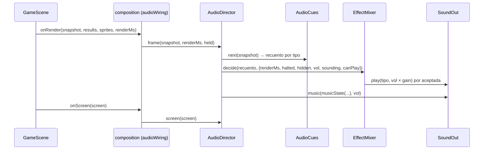

# Design · 0035-audio

> Revisión 2: contrastado con las 8 specs delta del change (`audio`, `asset-provenance`, `main-menu`, `menu-guide`,
> `touch-controls`, `mobile-display`, `world-camera` y `simulation-loop`). Al final van las diferencias con la
> versión 1 y los conflictos con la spec.
> Revisión 3 (tras los ficheros del autor, proposal «Cambios aprobados tras el gate»): 12 tipos (la recogida pasa a
> `pickupGold`/`pickupStone`/`pickupWood`), ficheros compartidos, `.flac`, tope de 6.291.456 bytes y nombres de
> fichero (D16).
> Revisión 4 (proposal, decisiones 6–8): licencias `CC0`/`CC-BY-3.0`/`CC-BY-4.0`, `CREDITS.md` vigilado por
> `guard-assets` (D13.7) con el enlace del README en un test, obra sustituida (faseer, CC0) y `level-up.wav` nuevo.

## Resumen
El audio va entero en el adaptador. Una pieza pura (`AudioCues`) compara cada snapshot procesado con el anterior de
la misma partida y saca las **peticiones** de los 12 tipos de efecto. Otra pieza pura (`EffectMixer`) decide cuáles
se reproducen: como mucho 1 por tipo y snapshot, con un intervalo mínimo medido con el **reloj de render** del
adaptador y con el tope de voces según los efectos que suenan. La música la decide la función pura `musicState`. La
reproducción va tras una interfaz `SoundOut` con tres implementaciones: **Phaser Sound** (Web Audio del motor), una
salida muda para `?e2e` y una salida no disponible para navegadores sin Web Audio. Los ajustes se guardan en
`localStorage` con zod. Un panel modal DOM `Sonido` se abre desde el menú y desde la pausa, con la tecla M y un
botón de silencio en la `TouchBar`. El guardarraíl gana una lista de audio con licencias `CC0`, `CC-BY-3.0` o `CC-BY-4.0`. La atribución de cada
entrada CC-BY va en una línea de `CREDITS.md`, que también vigila el guardarraíl (rev. 4). El núcleo no se toca.

Vía de consulta de Phaser: MCP `phaser-docs` (la API publicada es la v4.1.0) y, como manda la 4.2.1 instalada, el
fuente y los tipos de `node_modules/phaser`:
- `/api-documentation/class/sound-webaudiosoundmanager` (unlock, pauseOnBlur, mute/volume, add).
- `src/sound/webaudio/WebAudioSoundManager.js`: `locked = context.state === 'suspended'` (l. 89); `unlock()` escucha
  `touchstart/touchend/mousedown/mouseup/keydown` en `document.body` y hace `context.resume()`, que puede rechazarse
  (l. 348-389); `onBlur` suspende el contexto si `pauseOnBlur` (l. 399); `onGameVisible` (l. 118).
- `src/sound/BaseSoundManager.js`: `pauseOnBlur = true` por defecto; escucha `BLUR`/`FOCUS` del juego (l. 108, 182).
- `src/sound/webaudio/WebAudioSound.js` l. 54-58: `add(key)` **lanza** si la clave no está en `cache.audio`.
- `src/loader/filetypes/AudioFile.js`: XHR `arraybuffer` (l. 66) + `decodeAudioData` (l. 94). Si no decodifica,
  `console.error` y fallo del fichero (l. 104). Si el formato no se puede reproducir, `console.warn` y no se encola
  (l. 151). Sin `blob:`.
- `src/core/Config.js` l. 226 y `src/input/keyboard/KeyboardManager.js` l. 158-230: el teclado del motor escucha
  `keydown` en `window`.
- `types/phaser.d.ts`: `Types.Core.AudioConfig.noAudio` (l. 95641), `Core.Events.HIDDEN`/`VISIBLE`
  (l. 6559, 6642), `BaseSoundManager.pauseOnBlur` (l. 130819) y
  `KeyboardPlugin.enableGlobalCapture`/`disableGlobalCapture` (l. 84838-84845).

## Decisiones

**D1. Phaser Sound detrás de `SoundOut`** (ADR-0031). Phaser ya trae el `AudioContext`, el desbloqueo por gesto en
`body` (cubre el clic, el toque o la tecla de Jugar), la carga con XHR + decodificación, `mute`/`volume`, la
reanudación de iOS y `NoAudioSoundManager`. Un módulo propio de Web Audio repetiría todo eso, y el tope y la
limitación ya los decide la lógica pura (D4). Cambios sobre el motor:
- `sound.pauseOnBlur = false`: la spec pide pausa con la pestaña **oculta**, no con la ventana sin foco (D6).
- `audio: { noAudio: true }` si hay `?e2e` o si el navegador no tiene `AudioContext`/`webkitAudioContext`. Así no
  existe nunca el camino HTML5 Audio, y «sin Web Audio» es un caso único y comprobable.

Las implementaciones de `SoundOut` (`src/infrastructure/audio/SoundOut.ts`), que elige la composición:
- `PhaserSoundOut`: Web Audio real.
- `mutedSoundOut` (`?e2e`): `canPlay` vale verdadero, no suena nada y siempre hay 0 efectos sonando. Con ella,
  "reproducida" significa "entregada" (decisión D8 de la spec).
- `unavailableSoundOut` (sin Web Audio): `canPlay` vale falso, así que todo se descarta.

**D2. Peticiones desde el snapshot** (`audio/audioCues.ts`, `AudioCues`, pura). `next(snapshot)` devuelve un recuento
reutilizado por tipo (`Record<EffectType, number>`, sin reservar memoria por golpe). Reglas, una por una las de la
spec, «Sucesos de audio desde el snapshot»:

| Tipo | Regla |
|---|---|
| `playerHurt` | golpes con `id > lastHitId` y `kind === 'player'` |
| `impactWeapon` / `impactTower` / `impactBlast` | golpes nuevos de clase `enemy`/`structure`/`sheep`, con el tipo que da D3 |
| `enemyDeath` | `max(0, kills − killsPrev)` |
| `pickupGold` / `pickupStone` / `pickupWood` | ids del `pickups` anterior que faltan en el actual, cada uno con el tipo de recogida de su clase (`xp`, `gold` y `meat` → `pickupGold`; `stone` → `pickupStone`; `wood` → `pickupWood`). Ninguno si en ese snapshot algún solar pasó de `free` a construido |
| `levelUp` | `max(0, level − levelPrev)` |
| `explosion` | blasts con `id > lastBlastId` |
| `purchase` | 1 si `shop.open` (anterior o actual) y `shop.gold < goldPrev` |
| `build` | solares con `state` `free` en el anterior y distinto en el actual (mismo índice) |

Los ids de golpes y explosiones crecen y no se reutilizan (ADR-0027, `BlastSnapshot`), así que basta con guardar el
último id visto. Para los ids de recogibles y de proyectiles hay dos `Set` que se alternan y se vacían, sin reservar
memoria por frame. Como el tipo de recogida depende de la clase de un recogible que ya no está en el snapshot
actual, el `Set` del anterior pasa a ser un `Map<id, PickupKind>` reutilizado. La tabla de clase a tipo es la
constante `PICKUP_EFFECT` de `effectTypes.ts`, sin números ni ramas sueltas (rev. 3). **Referencia**: `newRun()` (D6) hace que el siguiente snapshot solo siembre el estado y dé 0
peticiones. Un snapshot igual al anterior da 0 por construcción.

**D3. Origen del impacto** (pura, en `AudioCues`). Por golpe nuevo de clase no jugador, en este orden:
1. `impactBlast` si hay un blast con `tick === hit.tick` y `dist(hit, blast) ≤ blast.radius`.
2. `impactTower` si hay una flecha de torre que estaba en el `towerProjectiles` anterior, falta en el actual y su
   última posición está a `≤ towerMatchPx` de `(hit.x, hit.y)`. `towerMatchPx` sale del contenido (D5).
3. `impactWeapon` en otro caso.

Es la precedencia de la spec y sale una sola petición por golpe. Las posiciones de las flechas de torre del snapshot
anterior se guardan en un buffer de tamaño `buildings.maxTowerProjectiles`, que la composición pasa desde la
`RunConfig`.

**D4. Mezclador de efectos** (`audio/EffectMixer.ts`, pura). `decide(counts, now)` recibe el recuento de D2 y un
`now` con estos campos:
- `renderMs`;
- `halted` (pausa o retención);
- `hidden`;
- `effectsVolume` efectivo;
- `sounding` = efectos que suenan según `SoundOut`;
- `canPlay(type)`.

Para cada snapshot:
1. Si `halted`, `hidden` o `effectsVolume === 0`, se descarta todo.
2. De cada tipo con recuento > 0 queda 1 candidata y el resto se descarta (como mucho 1 por tipo y snapshot).
3. La candidata se descarta si `renderMs − lastAt[tipo] < minIntervalMs` o si `!canPlay(tipo)`. `canPlay` falla
   cuando el fichero no cargó, el motor sigue bloqueado o no hay Web Audio.
4. Las que quedan se ordenan por `priority` descendente y, si empatan, por el orden de las convenciones. Se
   aceptan `max(0, maxVoices − sounding)` y el resto se descarta.
5. Por cada aceptada: `SoundOut.play(tipo, effectsVolume × gain)` y `lastAt[tipo] = renderMs`.

Los contadores son acumulados en la carga, en total y por tipo: `requested`, `played` y `dropped`, con
`requested = played + dropped` por construcción. Lo descartado no se guarda nunca. `newRun()` vacía `lastAt`,
porque el reloj de render de una escena nueva empieza en 0.

**Reloj de render**: es `RenderLayers.renderMs` (0029). En tiempo real avanza con `deltaMs` y se congela con el
mundo detenido. En modo manual avanza `n × TICK_MS` por cada `step(n)`. `GameScene` lo pasa como **cuarto argumento
de `onRender`**, que es el único cambio de firma en la escena.

**D5. Contenido `content/audio.json`** (zod estricto: `src/infrastructure/content/audioSchema.ts` +
`loadAudio.ts`, `parseAudio(raw, soundPaths)`; es presentación y no entra en la `RunConfig`):
```json
{
  "maxVoices": 8,
  "towerMatchPx": 24,
  "defaults": { "music": 50, "effects": 80, "muted": false },
  "music": { "file": "song.mp3" },
  "effects": {
    "playerHurt":   { "file": "receive-hit.flac", "priority": 10, "minIntervalMs": 120, "gain": 0.9 },
    "impactWeapon": { "file": "arrow-impact.mp3", "priority": 2,  "minIntervalMs": 40,  "gain": 0.5 },
    "impactTower":  { "file": "arrow-impact.mp3", "...": "..." },
    "impactBlast":  { "file": "explosion.wav" }, "enemyDeath": { "file": "enemy-death.wav" },
    "pickupGold": { "file": "get-gold.mp3" }, "pickupStone": { "file": "get-stone.wav" },
    "pickupWood": { "file": "get-wood.wav" }, "levelUp": { "file": "level-up.wav" },
    "explosion": { "file": "explosion.wav" }, "purchase": { "file": "buy-item.wav", "minIntervalMs": 0 },
    "build": { "file": "build.mp3" }
  }
}
```
Los valores de arriba son orientativos y el implementer los fija en el JSON. Reglas:
- `effects` es un objeto estricto con exactamente las **12** claves (rev. 3: `pickup` se parte en `pickupGold`,
  `pickupStone` y `pickupWood`). Si falta una, el error tiene ruta `effects.build`; si sobra `jump`, zod la nombra
  como clave desconocida.
- Varios tipos pueden citar el mismo `file` (`impactWeapon`/`impactTower` y `explosion`/`impactBlast`). Cada uno
  usa su propia `gain`, y el fichero se pide una sola vez (`audioFilesToLoad`, una clave de caché por fichero:
  `audioKey(file)`). Si ese fichero falla, `canPlay` es falso para todos los tipos que lo usan.
- `priority` es un entero; `minIntervalMs` es un entero ≥ 0; `gain` ∈ [0, 1]; `maxVoices` es un entero ≥ 1;
  `towerMatchPx` > 0; `defaults.music` y `defaults.effects` son enteros en [0, 100].
- `file` es un nombre plano `^[a-z0-9-]+\.(ogg|mp3|wav|flac)$`, relativo a `public/assets/audio/`.
- Cruce al arrancar (en `bootContent`, antes de la guía, con el `report` de siempre): cada `file` está en la lista
  de audio de la nota (`soundPaths(note)`). Si no, `AUDIO_NOT_REGISTERED` en `effects.<tipo>.file` con la ruta.

**Placeholders y conflicto con la spec**: la spec pide un fichero en cada entrada. Mientras el autor no los
entregue, el esquema acepta **`file: null` de forma transitoria** (ese tipo queda sin sonido y su `canPlay` es
falso). La tarea final, bloqueada por los assets, rellena los ficheros y **endurece el esquema** a `string`, con su
test de «null inválido». Así todo lo demás se implementa y se prueba antes de tener los ficheros.

El paso del deslizador (5) lo fija la spec como constante de interfaz: `SLIDER_STEP` en `SoundPanel`, no en el
contenido, porque la spec cierra los campos del fichero.

**D6. Música** (`audio/musicState.ts`, pura). Recibe
`{ inRun, over, paused, held, hidden }` y devuelve `'stopped' | 'playing' | 'paused'`:
- `!inRun` (menú, con o sin guía, diálogo o panel) o `over` (resultados) ⇒ `stopped`.
- `paused`, `held` o `hidden` ⇒ `paused`.
- En otro caso ⇒ `playing`. Oferta, tienda y obra no son pausa y la música sigue.

Entradas:
- `inRun`: falso con `onScreen('menu')`.
- `over`: `snapshot.status === 'over'`.
- `paused`: `onScreen` da `'paused'`.
- `held`: `hold()` del cableado móvil, leído en cada render.
- `hidden`: eventos `HIDDEN`/`VISIBLE` del juego, que se aplican en el propio evento porque con la pestaña oculta
  no hay frames.

`AudioDirector.newRun()` se llama desde el callback `started` de la composición (Jugar, R, ↻ y el arranque con
`?e2e`). Lleva la música a la posición 0 (`SoundOut.restartMusic()`) y fija la referencia de D2. Por eso Jugar dos
veces da una sola música (`MenuController` ya crea una sola partida). Al pasar a `paused` también se cortan los
efectos que suenan (`SoundOut.stopEffects()`). `SoundOut.music(state, volume)` es idempotente. Si la música aún no ha
cargado, `PhaserSoundOut` la arranca en cuanto aparece en caché y el estado sigue en `playing`. Con volumen efectivo
0, la música sigue en su estado y avanzando.

**D7. `PhaserSoundOut`** (motor). Cada tipo tiene un pool perezoso de hasta `maxVoices` instancias
(`sound.add(key)`), y nunca crea objetos del motor por frame una vez caliente. `play` usa una instancia libre o
reinicia la más antigua. `sounding` es el número de instancias de efecto con `isPlaying`. La música va con
`loop: true`. Un cambio de ajustes aplica `setVolume` a la música y a los efectos que suenan antes del siguiente
frame. El silencio general se traduce a volumen efectivo 0 (spec, convenciones) en vez de `sound.mute`, para que la
sonda y el motor vean los mismos números. `canPlay(tipo)` es `!sound.locked && cache.audio.exists(key)`. Nunca
llama a `add` con una clave ausente.

**D8. Carga del audio sin bloquear el menú** (`phaser/AudioLoadScene.ts`, nueva). Es una escena técnica sin render
que `BootScene.create` lanza en paralelo (`scene.launch`) **solo sin `?e2e` y con Web Audio**, antes de arrancar el
menú. Su `preload` encola `load.audio(key, audioUrl(base, file))` para la música y los efectos con fichero, y vive
toda la carga. El menú no espera por ella, lo que cubre el escenario «ficheros que tardan 10 s». Con
`FILE_COMPLETE` publica la clave y con `FILE_LOAD_ERROR` la marca como fallida, sin lanzar: ese tipo queda con
`canPlay` falso. `audioUrl` va en `assetUrl.ts` (`assets/audio/`). La sonda cuenta `filesRequested` (0 con `?e2e`).

**D9. Ajustes** (`src/infrastructure/audio/`):
- `audioSettingsSchema.ts`: zod `{ version: 1, music: int 0..100, effects: int 0..100, muted: boolean }`
  estricto.
- `LocalStorageAudioSettingsRepository`, con el patrón de `LocalStorageProgressRepository`: recibe
  `() => Storage`, usa la clave `sprint-survivors/audio`, devuelve `Result` y nunca lanza. `load()` da `ok(null)`,
  `err('unavailable')` o `err('corrupt')` y no toca el valor. `save()` da `quota-exceeded` o `unavailable`.
  **No hay puerto en `application`**: solo lo usa el adaptador y no hay una segunda implementación previsible.
- `AudioSettingsStore`: se carga una vez. Si la carga da `corrupt` o `unavailable`, usa los `defaults` y emite **1**
  `console.warn` que contiene `audio`; si da `null`, usa los `defaults` en silencio. `set(campo, valor)` (sujeta el
  valor a [0, 100]) y `setMuted(b)` solo actúan si el valor cambia. Cada cambio avisa a los suscriptores (mezclador,
  panel y barra) y guarda **1 vez**. Si el guardado falla, el ajuste vale igual durante la carga.
- `Exportar`, `Importar` y `Borrar datos` no tocan la clave: `wireProgress` no recibe el store y el export no lo
  incluye. Hay un test que lo comprueba.

**D10. Panel `Sonido`** (`dom/SoundPanel.ts`, modal DOM con el patrón de `GuideModal`). Lleva el título `Sonido`
(`h2` con `header`), dos `<input type="range">` (`Música` y `Efectos`, de 0 a 100 con paso 5, cada uno con su
`<output>` `N %`), la casilla `Silenciar todo` y el botón `Cerrar`. El `input` aplica el valor al instante y el
`change` guarda: es 1 escritura por cada flecha y por cada vez que se suelta el arrastre, y ninguna en los límites
porque el valor no cambia. Solo usa `textContent` y `addEventListener`, sin `style`. Lo visten las variables del kit
(0032) con `.sound-panel` en `styles.css`: centrado, escala 1 y desplazable con `is-mobile`, controles de ≥ 44 px.
`open(origin, opener)` pone el foco en el primer deslizador y `close()` lo devuelve a `opener`.
- **Desde el menú**: es el 3.º botón `Sonido` de `MenuPanel`. `MenuController` gana el estado `sound`
  (`openSound`/`closeSound`, que bloquea las demás opciones como `guide`, y al revés). Mientras está abierto, un
  `keydown` en `document` (sin repetición) cierra con Esc, como la guía.
- **Desde la pausa**: es el botón `Sonido` de `PausePanel`, entre `Reanudar` y `Volver al menú`. Mientras está
  abierto, `PausePanel.setLocked(true)`. Esc y ⏸ **no** los lee el panel, porque el motor también recibe el
  `keydown` en `window` y reanudaría. `GameScene` recibe la dependencia opcional
  `soundPanel?: { readonly open: boolean; close(): void }`. En `update`, si está abierto, la pulsación combinada de
  Esc o ⏸ llama a `close()` y se consume, y la acción de pausa, R y la elección se descartan. Además
  `keyboard.disableGlobalCapture()` mientras está abierto y `enableGlobalCapture()` al cerrar, para que las flechas
  muevan el deslizador con el foco y no queden capturadas por `KeyboardInput`.

**D11. Tecla M y botón de silencio** (`dom/MuteKey.ts`, `dom/TouchBar.ts`). M (`code === 'KeyM'`, sin `repeat` y
sin Alt/Ctrl/Meta) y el botón de la barra solo **marcan** una petición en `MuteRequests`. La composición la consume
**una vez por frame** del juego (`Phaser.Core.Events.PRE_STEP`) con `pressedOnce` y llama a
`store.setMuted(!muted)`. Así M + toque en el mismo frame dan un solo cambio y 1 escritura, y M funciona en
cualquier escena, también con la retención o el modo manual. Como M no está en el `KeyboardPlugin`, no mueve al
jugador ni lo ve la guía. El botón de la barra está siempre visible en modo móvil, con dos iconos SVG `data:` en
`touchIcons.ts`, etiqueta `Silenciar`/`Activar sonido` y `aria-pressed`, sincronizado por suscripción al store.

**D12. Sonda `window.__sprint.audio`** (solo con `?e2e`, también en el menú):
- `loaded` (falso con `?e2e`) y `filesRequested` (0 con `?e2e`);
- `music` (estado de D6);
- `settings { music, effects, muted }` y `volumes { music, effects }` efectivos;
- `requested`, `played` y `dropped`, totales y `byType`;
- `sounding` (0 con `?e2e`).

Sin `?e2e` no existe.

**D13. Procedencia** (`.claude/hooks/guard-assets.mjs`, `checkAssets` sigue pura). La nota gana la lista
**`sounds[]`**, con los campos `path`, `title`, `author`, `url`, `license`, `downloadedOn`, `sha256` y `bytes`, sin
admitir ninguno más (`attribution` falla). Reglas, con mensajes que nombran la ruta y el campo:
1. Todo audio versionado (`AUDIO = /\.(ogg|mp3|wav|flac)$/i`, con `.flac` desde la rev. 3) tiene entrada en
   `sounds[]`.
2. Cada entrada tiene su fichero versionado, con sha256 y bytes iguales, y no se repite.
3. `license` es exactamente uno de `AUDIO_LICENSES = ['CC0', 'CC-BY-3.0', 'CC-BY-4.0']` (rev. 4; falla con NC, SA,
   ND, `CC-BY-2.0`, `cc0` y licencias desconocidas). `url` con esquema `https:` y host `kenney.nl`, `opengameart.org` o `freesound.org`, con o
   sin `www.` (se analiza con `new URL`). `downloadedOn` es una fecha de calendario (`isCalendarDate`).
4. La ruta está bajo `public/assets/audio/`. Esto también va en `pathProblems`, así que el modo hook lo ve.
5. Una ruta figura una sola vez en el conjunto `files`/`fonts`/`generated`/`sounds`, y un audio en `files[]` o
   `generated[]` falla.
6. Los comprimidos ya estaban prohibidos.

7. **Créditos** (rev. 4, spec «Créditos del audio con atribución»). Por cada entrada `CC-BY-*`, `CREDITS.md` tiene
   una **misma línea** (separando por `\r?\n`) que contiene, como subcadenas literales, `title`, `author`, `url` y
   `license` de la nota. Si no la hay, falla con un mensaje que nombra la ruta del audio y `CREDITS.md`. Si hay alguna
   entrada CC-BY y `CREDITS.md` no está versionado, falla con un mensaje que nombra `CREDITS.md` y las rutas CC-BY.
   Las entradas `CC0` y las líneas sin entrada no se exigen. `checkAssets` sigue siendo pura: recibe un campo nuevo
   `credits: string | undefined` (`CREDITS_PATH = 'CREDITS.md'`). En pre-commit, `scripts/guard-staged.mjs` lo lee
   del índice, junto con la nota y los binarios (añadir `CREDITS.md` a `wanted`), y en `guard:all` del árbol
   versionado. Así bloquea el commit, no solo el CI. Si un hook de escritura llega a validar la nota, el orden
   práctico es escribir primero la línea de `CREDITS.md` y después la entrada CC-BY.

El enlace del `README.md` no es una regla de procedencia. Lo comprueba `tests/guardrails/credits-link.test.ts`: un
enlace Markdown `](CREDITS.md)` o `](./CREDITS.md)` y `CREDITS.md` en la raíz. El juego no muestra créditos.

`registeredPaths` no incluye `sounds[]` (un audio no vale como hoja). `soundPaths(note)` es una función aparte.
Tests en `tests/guardrails/assets.test.ts`, con listas y digests falsos. La regla «lista de audio ≥ 1 entrada» de la
spec («Nota del repositorio») se comprueba sobre el repositorio y queda bloqueada por los assets.

**D14. Peso y uso** (`tests/guardrails/audio-files.test.ts`, en `verify`, como pide la spec «Ficheros de audio
usados y peso»). Una función pura `audioFileProblems(files, sizes, audioContent)` comprueba dos cosas:
- que cada audio versionado está citado y cada fichero citado está versionado;
- que la suma de bytes es ≤ `AUDIO_MAX_BYTES` = **6.291.456** (6 MB, rev. 3; el mensaje da el total). Con los
  ficheros del autor suman unos 4,93 MB (rev. 4, con la obra y la subida sustituidas). «Todos usados» se comprueba por fichero: 11 ficheros distintos, 1 de música y
  10 de efectos.

El test usa la misma extensión de audio que el hook (con `.flac`).

Se ejecuta sobre `git ls-files` y sobre listas simuladas.

**D15. CSP sin cambios.** El audio carga por XHR (`connect-src 'self'`) y decodifica un `ArrayBuffer`, sin `blob:`
ni `data:`. No hay `<audio>`, porque HTML5 Audio queda fuera (D1). `tests/guardrails/csp.test.ts` no cambia. Queda
pendiente la comprobación con `build` + `preview` sin `?e2e` y con los ficheros reales (bloqueada por los assets).

**D16. Ficheros del autor en `public/assets/audio/`** (rev. 3). Se renombran en kebab-case: la errata `recevie`
pasa a `receive` y los `_` a `-`. No se recodifica ninguno, así que el sha256 y los bytes de la nota son los del
fichero descargado.

| Fichero del autor | Ruta en el repositorio | Tipos |
|---|---|---|
| `song.mp3` (3.289.143 B) | `public/assets/audio/song.mp3` | música |
| `recevie_hit.flac` | `public/assets/audio/receive-hit.flac` | `playerHurt` |
| `arrow-impact.mp3` | `public/assets/audio/arrow-impact.mp3` | `impactWeapon`, `impactTower` |
| `explosion.wav` | `public/assets/audio/explosion.wav` | `explosion`, `impactBlast` |
| `enemy_death.wav` | `public/assets/audio/enemy-death.wav` | `enemyDeath` |
| `get_gold.mp3` | `public/assets/audio/get-gold.mp3` | `pickupGold` |
| `get_stone.wav` | `public/assets/audio/get-stone.wav` | `pickupStone` |
| `get_wood.wav` | `public/assets/audio/get-wood.wav` | `pickupWood` |
| `level_up.wav` (sustituido, 119.114 B) | `public/assets/audio/level-up.wav` | `levelUp` |
| `buy_item.wav` | `public/assets/audio/buy-item.wav` | `purchase` |
| `build.mp3` (sustituido, 16.008 B: Freesound «house building», faseer, CC0, `https://freesound.org/people/faseer/sounds/171955/`) | `public/assets/audio/build.mp3` | `build` |

Las licencias y la atribución por fichero son las de la tabla 8 del proposal más la obra sustituida. Las entradas
CC-BY (`explosion.wav` CC-BY-3.0; `get-wood.wav`, `buy-item.wav` y, si sigue siéndolo tras sustituirse,
`level-up.wav` CC-BY-4.0) llevan su línea en `CREDITS.md`. Los autores pendientes (`enemy-death.wav` y
`receive-hit.flac`) y los datos del `level-up.wav` nuevo los confirma el autor antes de 6.1. No se inventan.

Compatibilidad, a comprobar a mano en 6.2:
- `decodeAudioData` admite WAV PCM de 24 bits en estéreo e ignora los chunks extra de la cabecera (`explosion.wav`)
  en Chromium y Firefox.
- FLAC lo decodifican Chromium, Firefox y Safari ≥ 11. Phaser comprueba `device.audio.flac` con `canPlayType`. Si
  el navegador no lo admite, `load.audio` no lo encola (`console.warn`) y `playerHurt` se queda sin sonido, sin
  errores.
- La música es el 65 % del peso. Su PCM decodificado ocupa mucha memoria (≈ 10 MB por minuto en float32 estéreo);
  se acepta.

## Piezas por capa
| Capa | Pieza | Nueva/Mod. | Notas |
|---|---|---|---|
| domain / application | — | — | Intactos |
| infrastructure (pura) | `audio/audioCues.ts`, `audio/EffectMixer.ts`, `audio/musicState.ts`, `audio/AudioDirector.ts`, `audio/MuteRequests.ts` | Nueva | Sin motor ni DOM; TDD |
| infrastructure | `audio/SoundOut.ts` (interfaz + muda + no disponible), `audio/PhaserSoundOut.ts` | Nueva | D1, D7 |
| infrastructure | `audio/audioSettingsSchema.ts`, `LocalStorageAudioSettingsRepository.ts`, `AudioSettingsStore.ts` | Nueva | D9 |
| infrastructure | `content/audioSchema.ts`, `content/loadAudio.ts` | Nueva | D5 |
| infrastructure | `dom/SoundPanel.ts`, `dom/MuteKey.ts` | Nueva | D10, D11 |
| infrastructure | `dom/MenuPanel.ts`, `menu/MenuController.ts`, `dom/PausePanel.ts`, `dom/TouchBar.ts`, `dom/touchIcons.ts`, `dom/menuText.ts` | Mod. | Botón `Sonido`, estado `sound`, `setLocked` y botón de silencio |
| infrastructure | `phaser/AudioLoadScene.ts` (nueva), `phaser/BootScene.ts`, `phaser/GameScene.ts`, `phaser/sceneKeys.ts` | Nueva / Mod. | Carga en paralelo; `onRender(..., renderMs)`; `soundPanel` en `update` |
| composition | `audioWiring.ts` (nueva), `main.ts`, `contentBoot.ts`, `progressWiring.ts`, `mobileWiring.ts`, `assetUrl.ts` | Nueva / Mod. | Elección de `SoundOut`, `noAudio`, `pauseOnBlur`, `HIDDEN`/`VISIBLE`, `PRE_STEP`, `started` → `newRun`, sonda |
| contenido | `content/audio.json`, `content/asset-provenance.json` (`sounds`) | Nueva / Mod. | `file: null` hasta que lleguen los assets |
| guardarraíl | `.claude/hooks/guard-assets.mjs`, `tests/guardrails/assets.test.ts`, `tests/guardrails/audio-files.test.ts` | Mod. / Nueva | D13, D14 |
| estilos | `src/styles.css` | Mod. | `.sound-panel` y reglas `is-mobile` |

## Flujo


## Dependencias nuevas
| Paquete | Versión exacta | Motivo | Alternativa descartada |
|---|---|---|---|
| — | — | Phaser Sound ya está en `phaser` 4.2.1 | Howler.js (dependencia nueva que duplica el motor) |

## Rendimiento y seguridad
- **Núcleo**: 0 ms/tick añadidos. `BALANCE_BASELINE` y las seis firmas quedan idénticas sin regenerarlas.
- **Por render**: O(golpes nuevos + recogibles + proyectiles), con ≤ 49 golpes por tick, ≤ 436 recogibles y
  ≤ 15 ticks por frame. Sin reservar memoria por frame. Objetivo < 0,1 ms.
- **Motor**: ≤ `maxVoices` efectos a la vez y pools perezosos y acotados.
- **Memoria**: el PCM decodificado ocupa mucho más que el fichero comprimido (60 s estéreo ≈ 21 MB en float32).
  Ver D16 para la música real.
- **Peso**: ≤ 6.291.456 bytes de audio en `public/` (5.093.480 con los ficheros del autor).
- **Entradas externas**: los ajustes de `localStorage`, `audio.json` y la nota pasan por zod y por el
  guardarraíl. No hay red de terceros y la CSP no cambia.

## Riesgos
- Si los assets no llegan, no se cierran la escucha real, el escenario «Contenido por defecto válido», la nota con
  ≥ 1 audio ni la comprobación de CSP en `preview`.
- `decodeAudioData` con un fichero dañado da un `console.error` del motor. Pasa solo sin `?e2e`, así que ningún E2E
  lo ve.
- En `PhaserSoundOut`, `sounding` depende de `isPlaying` del motor. Se prueba con un `sound` falso.

## Diferencias con la versión 1 y conflictos con la spec
1. Los controles en línea pasan a ser el **panel modal `Sonido`**, con `Esc`/⏸ tratados en `GameScene` cuando se
   abre desde la pausa (D10).
2. El reloj `tick × TICK_MS` pasa a ser el **reloj de render** (D4). Se quitan `voiceMs` y el `maxVoices` por tipo:
   ahora hay 1 por tipo y snapshot y el tope global sobre los efectos que suenan.
3. Los 10 tipos se renombran como en la spec, con `priority`, `minIntervalMs` y `gain`, y `towerMatchPx` va al
   contenido. La regla de la explosión queda en `≤ radio` y la de la torre en «desaparecida a ≤ tolerancia» (D3).
4. Música: `stopped` también en resultados y vuelta a 0 con R/↻/Jugar (D6). La recogida se excluye por obra en el
   snapshot, no porque el tick avance (D2). `purchase` exige la tienda abierta.
5. Los ajustes por defecto pasan a 50/80. Exportar, Importar y Borrar datos no los tocan (D9).
6. La carga del audio sale de `BootScene.preload` a `AudioLoadScene` en paralelo, para no retrasar el menú (D8).
   HTML5 Audio queda descartado (D1). El tope de peso pasa del hook a un test (D14): 2 MB en la rev. 2 y 6 MB en la rev. 3.
7. **Conflicto 1**: la spec exige fichero en cada entrada y ≥ 1 audio en la nota. Se resuelve con `file: null`
   transitorio y una tarea final, bloqueada por los assets, que endurece el esquema.
8. **Conflicto 2**: el E2E «Panel Sonido sin sonda» dice «se esperan 2 s», pero `logicGuard` prohíbe
   `waitForTimeout`. Se sustituye por esperar a que el menú se oculte. La espera no aporta nada a lo que se
   comprueba.

## ADRs
- `docs/adr/0031-audio-en-el-adaptador-con-phaser-sound.md` (numeración confirmada libre por el orquestador).
